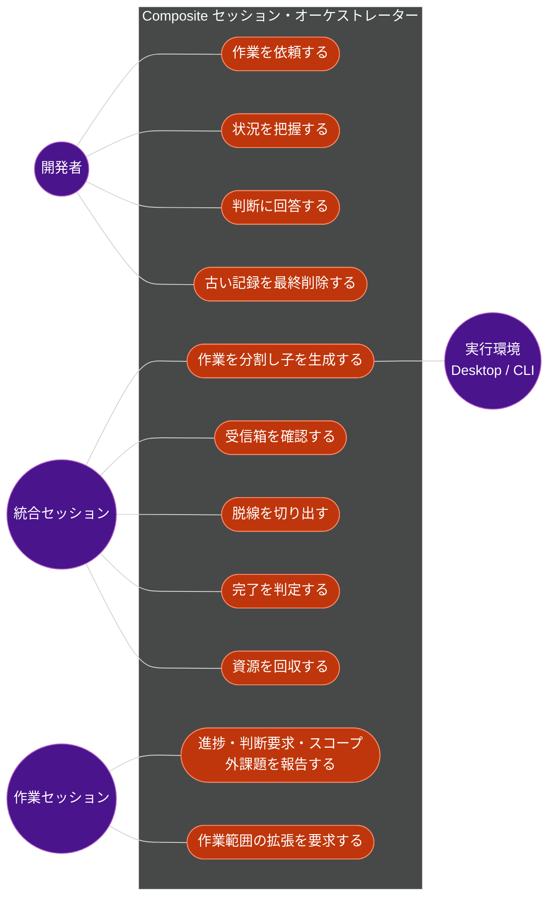
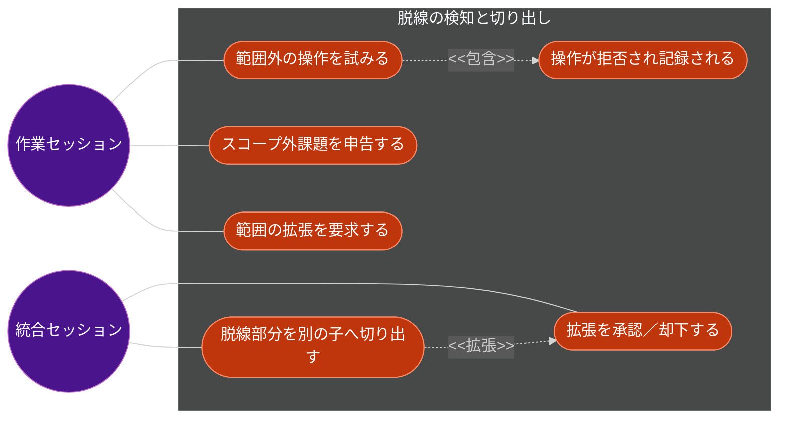
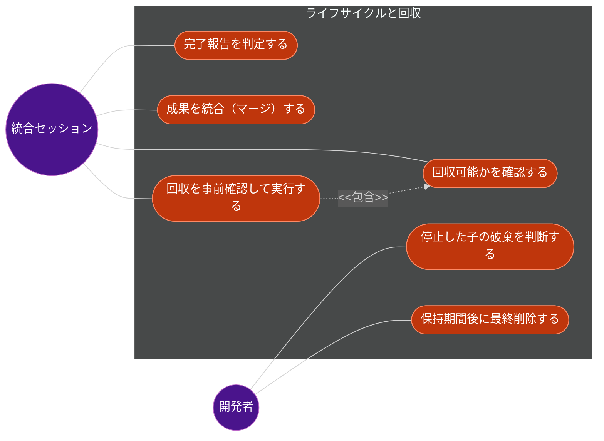

# Composite セッション・オーケストレーター 要求仕様書

## 概要

本ドキュメントは、複数の Claude セッションを「統合セッション 1 対 作業セッション n」の木構造（Composite パターン）で束ね、人間が最上位の統合セッションとだけ対話すれば、並列で進む実装・レビュー・調査を依頼・把握・判断できるようにするシステムの要求を定義する。

**背景と目的**

- 複数の作業を並列にエージェントへ任せると、人間がセッションを行き来して状況を把握し、判断を配る負担が大きい。
- 各作業セッションは本筋から外れやすく、外れたことに人間が気づくのは遅れがちである。
- 統合セッション自身は自分の応答ターンでしか動けないため、監視・常時表示・画面からの入力受付を統合セッションに任せる設計は構造的に成り立たない。

本システムは、状態・監視・表示・判断の受付を統合セッションの外（常駐する仕組み）に置き、統合セッションには「子の情報をまとめ、適切な順序で上位または人間へ伝え、判断する」役割だけを与える。

**対象範囲**

- Claude Desktop と Claude Code CLI の両環境で動作するローカル開発者向けツール
- 単一の開発者のマシン上での利用（チームへの配布は対象、チームでの同時共有実行は対象外）

---

# 1. 要求図の読み方

## 1.1. 要求タイプ

- **requirement**: 一般的な要求（本 PRD ではユーザー要求 UR と非機能要求 NFR の一部に使用）
- **functionalRequirement**: 機能要求（FR）
- **performanceRequirement**: パフォーマンス要求（NFR の性能項目）
- **interfaceRequirement**: インターフェース要求（IR）
- **designConstraint**: 設計制約（DC）

## 1.2. リスクレベル

- **High**: 高リスク（ビジネスクリティカル、実装困難、前提が未検証）
- **Medium**: 中リスク（重要だが代替可能）
- **Low**: 低リスク（Nice to have）

## 1.3. 検証方法

- **Analysis**: 分析による検証
- **Test**: テストによる検証
- **Demonstration**: デモンストレーションによる検証
- **Inspection**: インスペクション（レビュー）による検証

## 1.4. 関係タイプ

- **contains**: 包含関係（親要求が子要求を含む）
- **derives**: 派生関係（要求から別の要求が導出される）
- **traces**: トレース関係（要求間の追跡可能性）

---

# 2. 要求一覧

## 2.1. ユースケース図（概要）

### アクター

| アクター | 説明 |
|:--|:--|
| 開発者 | システムの利用者。最上位の統合セッションとだけ対話し、HTML 画面で状況を見て判断する |
| 統合セッション | 子の情報をまとめ、順序付けて上位（または開発者）へ伝え、子への指示・切り出し・完了判定を行う Claude セッション。最上位と中間の二種類がある。自ら実装・レビュー・調査はしない |
| 作業セッション | 実装・レビュー・調査・マージのいずれかを担う Claude セッション。作業指示（ブリーフ）だけを持って開始する |
| 実行環境 | 子セッションを実際に起動する環境。Claude Desktop または Claude Code CLI |

### ユースケース

| ID | ユースケース | 主アクター | 概要 |
|:--|:--|:--|:--|
| UC1 | 作業を依頼する | 開発者 | 最上位の統合セッションに達成したいことを伝える |
| UC2 | 作業を分割し子を生成する | 統合セッション | ブリーフを作り、子セッション（作業または中間統合）を生成する |
| UC3 | 状況を把握する | 開発者 | 木全体の最新状態を HTML 画面またはチャットの一覧表で確認する |
| UC4 | 判断に回答する | 開発者 | 選択肢または自由入力で判断を返す。画面・チャットどちらでも良い |
| UC5 | 受信箱を確認する | 統合セッション | 優先度と依存関係の順に並んだ報告・判断要求を取得する |
| UC6 | 脱線を切り出す | 統合セッション | 本筋から外れた部分を別の子へ移し、元の子を本筋に戻すか停止する |
| UC7 | 完了を判定する | 統合セッション | 子の完了報告を受け入れ基準と根拠に照らして受理または差し戻す |
| UC8 | 報告する | 作業セッション | 進捗、判断要求、スコープ外の課題を親へ報告する |
| UC9 | 作業範囲の拡張を要求する | 作業セッション | 許可されていない場所・操作が必要になったとき、理由を添えて親に拡張を求める |
| UC10 | 資源を回収する | 統合セッション | 回収可能な子の作業ツリーとブランチを回収し、記録をアーカイブする |
| UC11 | 古い記録を最終削除する | 開発者 | 保持期間を過ぎたアーカイブを木単位で削除する（エージェントからは実行不可） |

## 2.2. ユースケース図（詳細）

### 脱線の検知と切り出し

### ライフサイクルと回収

## 2.3. 機能一覧（テキスト形式）

- セッション構造
    - 統合ノードと作業ノードからなる木構造の管理
    - 統合ノードの入れ子
    - 中間統合ノードへの必要時のみのセッション割り当て
    - 統合セッションの役割制約（自ら作業しない）
- 子セッションの生成と制御
    - ブリーフ（目的・受け入れ基準・作業範囲・依存関係）からの生成
    - 子ごとに分離された作業ツリーとブランチ
    - 親の会話履歴を引き継がない開始
    - 依存する先行作業の完了待ち
    - 稼働中の子への追加指示
    - 子の停止
- 報告と受信箱
    - 子から親への報告（進捗・判断要求・スコープ外課題）
    - 優先度・依存関係順に整列した受信箱（統合セッションからの取得時のみ）
    - 中間統合ノードからの要約報告
- 脱線の検知と切り出し
    - 作業範囲外の操作の拒否と記録
    - 狭い初期範囲と拡張要求の承認フロー
    - 脱線部分の切り出し（一操作）
    - 兄弟ノード間の作業範囲重複の警告
- 人間の判断
    - 選択肢と自由入力による判断要求
    - 画面とチャットの回答の一本化（先着優先）
- 状態の表示
    - チャット用の一覧表（状態から決定的に生成）
    - 常時最新の HTML 画面
- 完了判定と統合
    - 根拠付きの完了報告
    - システムによる決定的な事実の添付
    - 親による受理・差し戻し
    - 専用ノードによる統合（マージ）とコンフリクト解消
- 回収と最終削除
    - 回収可能の決定的判定と理由表示
    - 親子の回収不変条件（別サブツリーからの依存を含む）
    - 事前確認付きの回収
    - 自動回収ポリシー
    - 木単位の最終削除
- 実行環境
    - Claude Desktop での子の生成と紐付け
    - Claude Code CLI での外部制御可能な子の実行
    - 実行環境ごとの可能操作の明示
    - 子の中身を妨げずに覗く手段
    - Desktop の子に対する親への操作代行依頼

---

# 3. 要求図（SysML Requirements Diagram）

## 3.1. 全体要求図

```mermaid
%%{init: {'theme': 'dark'}}%%
requirementDiagram
    requirement Orchestrator {
        id: REQ_001
        text: "人間が最上位の統合セッションとだけ対話して並列作業を依頼・把握・判断できる"
        risk: high
        verifymethod: demonstration
    }

    requirement SingleContact {
        id: UR_001
        text: "人間は最上位統合セッションとだけ対話すればよい"
        risk: medium
        verifymethod: demonstration
    }

    requirement Hierarchy {
        id: UR_002
        text: "作業を階層的に分割・統合できる"
        risk: medium
        verifymethod: demonstration
    }

    requirement StayOnTrack {
        id: UR_003
        text: "子は本筋から外れず、外れたら切り出される"
        risk: high
        verifymethod: demonstration
    }

    requirement Visibility {
        id: UR_004
        text: "全体状態を常に最新で把握し画面上で判断できる"
        risk: medium
        verifymethod: demonstration
    }

    requirement QualityGate {
        id: UR_005
        text: "子の成果は親の判定を経てから統合される"
        risk: medium
        verifymethod: demonstration
    }

    requirement Cleanup {
        id: UR_006
        text: "完了した作業の資源が安全に回収され長期的に蓄積しない"
        risk: medium
        verifymethod: demonstration
    }

    requirement BothRuntimes {
        id: UR_007
        text: "Claude Desktop と Claude Code CLI の両方で使える"
        risk: high
        verifymethod: demonstration
    }

    requirement Distributable {
        id: UR_008
        text: "チームに配布し任意のリポジトリで使える"
        risk: low
        verifymethod: demonstration
    }

    requirement Quality {
        id: REQ_002
        text: "非機能要求（信頼性・安全性・セキュリティ・性能）"
        risk: high
        verifymethod: test
    }

    interfaceRequirement CommonInterface {
        id: IR_001
        text: "統合セッション・子セッションとの接続は両環境共通の標準プロトコルで提供する"
        risk: medium
        verifymethod: inspection
    }

    interfaceRequirement HookInterface {
        id: IR_002
        text: "子の操作の記録と拒否はセッションのフック機構を通じて行う"
        risk: high
        verifymethod: test
    }

    interfaceRequirement BrowserUI {
        id: IR_003
        text: "状態画面はローカルのブラウザで閲覧・操作できる"
        risk: low
        verifymethod: demonstration
    }

    designConstraint PluginDelivery {
        id: DC_001
        text: "提供形態は Claude Code plugin とし private marketplace で配布する"
        risk: low
        verifymethod: inspection
    }

    designConstraint Worktree {
        id: DC_002
        text: "子の作業は git worktree で分離する"
        risk: low
        verifymethod: inspection
    }

    designConstraint NoAgentPurge {
        id: DC_003
        text: "最終削除はエージェントが実行できる操作として公開しない"
        risk: medium
        verifymethod: inspection
    }

    designConstraint TranscriptOwnership {
        id: DC_004
        text: "セッションの transcript は削除対象にしない"
        risk: low
        verifymethod: inspection
    }

    Orchestrator - contains -> SingleContact
    Orchestrator - contains -> Hierarchy
    Orchestrator - contains -> StayOnTrack
    Orchestrator - contains -> Visibility
    Orchestrator - contains -> QualityGate
    Orchestrator - contains -> Cleanup
    Orchestrator - contains -> BothRuntimes
    Orchestrator - contains -> Distributable
    Orchestrator - contains -> Quality
    BothRuntimes - derives -> CommonInterface
    StayOnTrack - derives -> HookInterface
    Visibility - derives -> BrowserUI
    Distributable - derives -> PluginDelivery
    Hierarchy - derives -> Worktree
    Cleanup - derives -> NoAgentPurge
    Cleanup - derives -> TranscriptOwnership
```

## 3.2. 主要サブシステム詳細図

### セッション構造・生成・報告

```mermaid
%%{init: {'theme': 'dark'}}%%
requirementDiagram
    requirement SingleContact {
        id: UR_001
        text: "人間は最上位統合セッションとだけ対話すればよい"
        risk: medium
        verifymethod: demonstration
    }
    requirement Hierarchy {
        id: UR_002
        text: "作業を階層的に分割・統合できる"
        risk: medium
        verifymethod: demonstration
    }
    functionalRequirement Tree {
        id: FR_001
        text: "統合ノードと作業ノードの木構造を管理する"
        risk: low
        verifymethod: test
    }
    functionalRequirement Nesting {
        id: FR_002
        text: "統合ノードは子に統合ノードを持てる"
        risk: medium
        verifymethod: test
    }
    functionalRequirement LazySession {
        id: FR_003
        text: "中間統合ノードには必要時のみセッションを割り当てる"
        risk: medium
        verifymethod: test
    }
    functionalRequirement RoleLimit {
        id: FR_004
        text: "統合セッションは自ら実装・レビュー・調査を行わない"
        risk: medium
        verifymethod: inspection
    }
    functionalRequirement SpawnFromBrief {
        id: FR_005
        text: "ブリーフから子を生成する"
        risk: medium
        verifymethod: test
    }
    functionalRequirement Isolation {
        id: FR_006
        text: "子ごとに分離された作業ツリーとブランチで作業する"
        risk: low
        verifymethod: test
    }
    functionalRequirement FreshContext {
        id: FR_007
        text: "子は親の会話履歴を引き継がずブリーフのみで開始する"
        risk: medium
        verifymethod: test
    }
    functionalRequirement WaitDeps {
        id: FR_008
        text: "依存する先行作業の完了まで子の起動を待つ"
        risk: low
        verifymethod: test
    }
    functionalRequirement Instruct {
        id: FR_009
        text: "稼働中の子に追加指示を送る"
        risk: medium
        verifymethod: test
    }
    functionalRequirement Stop {
        id: FR_010
        text: "子を停止する"
        risk: medium
        verifymethod: test
    }
    functionalRequirement ChildReport {
        id: FR_011
        text: "子は親にのみ報告し人間には直接連絡しない"
        risk: low
        verifymethod: inspection
    }
    functionalRequirement Inbox {
        id: FR_012
        text: "受信箱を優先度と依存関係順に整列し取得時のみ返す"
        risk: medium
        verifymethod: test
    }
    functionalRequirement ReportUp {
        id: FR_013
        text: "中間統合ノードは配下を要約して上位へ報告する"
        risk: medium
        verifymethod: test
    }

    Hierarchy - contains -> Tree
    Hierarchy - contains -> Nesting
    Hierarchy - contains -> LazySession
    Hierarchy - contains -> SpawnFromBrief
    Hierarchy - contains -> Isolation
    Hierarchy - contains -> WaitDeps
    Hierarchy - contains -> ReportUp
    SingleContact - contains -> RoleLimit
    SingleContact - contains -> ChildReport
    SingleContact - contains -> Inbox
    SpawnFromBrief - derives -> FreshContext
    SpawnFromBrief - derives -> Instruct
    SpawnFromBrief - derives -> Stop
    Nesting - traces -> ReportUp
```

### 脱線・判断・表示・完了判定

```mermaid
%%{init: {'theme': 'dark'}}%%
requirementDiagram
    requirement StayOnTrack {
        id: UR_003
        text: "子は本筋から外れず、外れたら切り出される"
        risk: high
        verifymethod: demonstration
    }
    requirement Visibility {
        id: UR_004
        text: "全体状態を常に最新で把握し画面上で判断できる"
        risk: medium
        verifymethod: demonstration
    }
    requirement QualityGate {
        id: UR_005
        text: "子の成果は親の判定を経てから統合される"
        risk: medium
        verifymethod: demonstration
    }
    functionalRequirement ScopeGuard {
        id: FR_014
        text: "作業範囲外の操作を決定的に拒否し記録する"
        risk: high
        verifymethod: test
    }
    functionalRequirement ScopeExpansion {
        id: FR_015
        text: "初期範囲は狭くし、子の拡張要求を親が判定する"
        risk: medium
        verifymethod: test
    }
    functionalRequirement Redirect {
        id: FR_016
        text: "脱線部分の切り出しを一操作で行う"
        risk: medium
        verifymethod: test
    }
    functionalRequirement OverlapWarn {
        id: FR_017
        text: "兄弟ノードの作業範囲の重複を警告する"
        risk: low
        verifymethod: test
    }
    functionalRequirement AskHuman {
        id: FR_018
        text: "選択肢と自由入力で人間に判断を求める"
        risk: low
        verifymethod: demonstration
    }
    functionalRequirement OneAnswer {
        id: FR_019
        text: "画面とチャットの回答を一本化し先着を採用する"
        risk: medium
        verifymethod: test
    }
    functionalRequirement OverviewTable {
        id: FR_020
        text: "状態から決定的に一覧表を生成する"
        risk: low
        verifymethod: test
    }
    functionalRequirement LiveScreen {
        id: FR_021
        text: "HTML 画面を常時最新に保つ"
        risk: medium
        verifymethod: demonstration
    }
    functionalRequirement Evidence {
        id: FR_022
        text: "子は受け入れ基準ごとの根拠を付けて完了報告する"
        risk: low
        verifymethod: test
    }
    functionalRequirement Facts {
        id: FR_023
        text: "システムが決定的な事実を完了報告に添付する"
        risk: medium
        verifymethod: test
    }
    functionalRequirement Review {
        id: FR_024
        text: "親が完了を受理または差し戻す"
        risk: low
        verifymethod: test
    }
    functionalRequirement MergeNode {
        id: FR_025
        text: "統合とコンフリクト解消は専用の作業ノードが行う"
        risk: medium
        verifymethod: demonstration
    }

    StayOnTrack - contains -> ScopeGuard
    StayOnTrack - contains -> ScopeExpansion
    StayOnTrack - contains -> Redirect
    StayOnTrack - contains -> OverlapWarn
    Visibility - contains -> AskHuman
    Visibility - contains -> OneAnswer
    Visibility - contains -> OverviewTable
    Visibility - contains -> LiveScreen
    QualityGate - contains -> Evidence
    QualityGate - contains -> Facts
    QualityGate - contains -> Review
    QualityGate - contains -> MergeNode
    ScopeGuard - traces -> Facts
    ScopeExpansion - traces -> Redirect
```

### 回収・最終削除・実行環境

```mermaid
%%{init: {'theme': 'dark'}}%%
requirementDiagram
    requirement Cleanup {
        id: UR_006
        text: "完了した作業の資源が安全に回収され長期的に蓄積しない"
        risk: medium
        verifymethod: demonstration
    }
    requirement BothRuntimes {
        id: UR_007
        text: "Claude Desktop と Claude Code CLI の両方で使える"
        risk: high
        verifymethod: demonstration
    }
    functionalRequirement Reclaimable {
        id: FR_026
        text: "回収可能かを決定的に判定する"
        risk: medium
        verifymethod: test
    }
    functionalRequirement Reasons {
        id: FR_027
        text: "回収できない理由を根本の子を名指しして示す"
        risk: low
        verifymethod: test
    }
    functionalRequirement Invariant {
        id: FR_028
        text: "親子の回収不変条件を別サブツリーの依存も含めて守る"
        risk: medium
        verifymethod: test
    }
    functionalRequirement TwoStep {
        id: FR_029
        text: "回収は事前確認と実行の二段階で行い実行時に再判定する"
        risk: medium
        verifymethod: test
    }
    functionalRequirement AutoPolicy {
        id: FR_030
        text: "既定の自動回収ポリシーを適用する"
        risk: medium
        verifymethod: test
    }
    functionalRequirement Purge {
        id: FR_031
        text: "保持期間後に木単位で最終削除する"
        risk: medium
        verifymethod: test
    }
    functionalRequirement DesktopSpawn {
        id: FR_032
        text: "Desktop では Desktop のタスク生成機能で子を起動し紐付ける"
        risk: high
        verifymethod: demonstration
    }
    functionalRequirement CliSpawn {
        id: FR_033
        text: "CLI では外部から起動・指示・停止できる非対話実行で子を動かす"
        risk: medium
        verifymethod: test
    }
    functionalRequirement Capabilities {
        id: FR_034
        text: "実行環境ごとの可能操作を明示し不可操作は代替手段を示す"
        risk: medium
        verifymethod: test
    }
    functionalRequirement Peek {
        id: FR_035
        text: "人間が子の中身を本体を妨げずに覗ける"
        risk: low
        verifymethod: demonstration
    }
    functionalRequirement Delegate {
        id: FR_036
        text: "直接操作できない Desktop の子は親に操作を代行依頼する"
        risk: high
        verifymethod: demonstration
    }

    Cleanup - contains -> Reclaimable
    Cleanup - contains -> Reasons
    Cleanup - contains -> Invariant
    Cleanup - contains -> TwoStep
    Cleanup - contains -> AutoPolicy
    Cleanup - contains -> Purge
    BothRuntimes - contains -> DesktopSpawn
    BothRuntimes - contains -> CliSpawn
    BothRuntimes - contains -> Capabilities
    BothRuntimes - contains -> Peek
    BothRuntimes - contains -> Delegate
    Reclaimable - derives -> Reasons
    Reclaimable - derives -> Invariant
    DesktopSpawn - derives -> Delegate
```

---

# 4. 要求の詳細説明

## 4.0. ユーザー要求

| ID | 要求 | 優先度 | リスク |
|:--|:--|:--|:--|
| UR_001 | 人間は最上位の統合セッションとだけ対話すれば、並列に進む作業を依頼・把握・判断できる | Must | Medium |
| UR_002 | 作業を階層的に分割し、成果を階層的に統合できる | Must | Medium |
| UR_003 | 作業セッションは本筋から外れず、外れた場合は外れた部分が別の作業として切り出される | Must | High |
| UR_004 | 全体の状態を常に最新の状態で視覚的に把握でき、画面上で判断や自由入力ができる | Must | Medium |
| UR_005 | 作業セッションの成果は、受け入れ基準に照らした親の判定を経てから統合される | Must | Medium |
| UR_006 | 完了した作業の資源は安全に回収され、記録も長期的には蓄積しない | Should | Medium |
| UR_007 | Claude Desktop と Claude Code CLI のどちらからでも利用できる | Must | High |
| UR_008 | チームに配布でき、任意のリポジトリで利用できる | Should | Low |

## 4.1. 機能要求

### FR_001: 木構造の管理

統合ノードと作業ノード（実装・レビュー・調査・マージ）からなる木構造を管理する。各ノードは共通の問い合わせ（状態、要約、未処理の判断）に応答できる。

- 派生元: UR_002 ／ 優先度: Must ／ リスク: Low
- **検証方法:** テスト（木の生成・走査・集計のユニットテスト）

### FR_002: 統合ノードの入れ子

統合ノードは、作業ノードに加えて統合ノードを子に持てる。

- 派生元: UR_002 ／ 優先度: Must ／ リスク: Medium
- **検証方法:** テスト（3 階層以上の木での集計・報告）

### FR_003: 中間統合ノードへの必要時のみのセッション割り当て

中間統合ノードは、配下の数が閾値を超えたとき、または独立した判断が必要なときにのみ独立したセッションを割り当てる。それ以外は状態の集計やブロッカーの伝播を決定的に行う。

- 派生元: UR_002 ／ 優先度: Should ／ リスク: Medium
- **検証方法:** テスト（閾値前後でのセッション割り当ての有無）

### FR_004: 統合セッションの役割制約

統合セッションは実装・レビュー・調査・コンフリクト解消を自ら行わない。これらが必要な場合は子を生成する。

- 派生元: UR_001 ／ 優先度: Must ／ リスク: Medium
- **検証方法:** インスペクション（役割定義のレビュー）とデモンストレーション

### FR_005: ブリーフからの子の生成

目的、受け入れ基準、作業範囲、依存関係を含む作業指示（ブリーフ）から子ノードを生成し、起動する。生成要求は即座に受け付け結果を返し、起動は非同期に行う。

- 派生元: UR_002, UR_003 ／ 優先度: Must ／ リスク: Medium
- **検証方法:** テスト

### FR_006: 分離された作業ツリーとブランチ

各子は親ノードのブランチから切った専用のブランチと作業ツリーで作業する。git 管理外の必要ファイル（ローカル設定など）は作業ツリーに引き継がれる。

- 派生元: UR_002 ／ 優先度: Must ／ リスク: Low
- **実行環境ごとの扱い:**
    - CLI: `options.cwd` に作業ツリーを指定して起動できることを確認済み（Spike 02 #7）。システムが作業ツリーを用意し、子の起動に使う。
    - Desktop（手動確認待ち: 項目 5）: `cwd` は渡せるが、作業ツリー化は人間のチップ操作に依存し、主チェックアウトで始まる報告もある。Desktop では「専用の作業ツリーをシステムが保証する」とは言えない。子の起動後に、作業ツリーであることをシステムが検証して記録し、そうでない場合は子の作業開始を許可しない（仮置き）。
- **検証方法:** テスト

### FR_007: 親の会話履歴を引き継がない開始

子は統合セッションの会話履歴を複製せず、ブリーフだけを文脈として開始する。会話の複製による分岐は「同じ文脈から別案を試す」補助手段に限る。

- 派生元: UR_003 ／ 優先度: Must ／ リスク: Medium
- **検証方法:** テスト（子の初期文脈にブリーフ以外が含まれないこと）

### FR_008: 先行作業の完了待ち

ブリーフに依存先が指定された子は、依存先が完了するまで起動しない。

- 派生元: UR_002 ／ 優先度: Should ／ リスク: Low
- **検証方法:** テスト

### FR_009: 稼働中の子への追加指示

統合セッションは稼働中の子に追加の指示を送れる。作業範囲の拡大は追加指示ではなく FR_015 または FR_016 で扱う。追加指示は即時には処理されない場合があり、届いたことをシステムが確認する。

- **実行環境ごとの扱い:**
    - CLI: 待機中の子にも実行中の子にも送れる。実行中の子への指示は、実行中のツールの完了後に届く（即時ではない。Spike 02 #2）。
    - Desktop（手動確認待ち: 項目 2）: 送信自体は可能だが、届き方は受信側の作業状況と権限モードに依存し、保留・破棄され得る。「届かない場合がある」ことを前提とし、未達をシステムが検知して受信箱へ通知する（仮置き）。
- 派生元: UR_003 ／ 優先度: Must ／ リスク: Medium（実行環境により可否が異なる。FR_034 参照）
- **検証方法:** テスト

### FR_010: 子の停止

統合セッションは子を停止できる。穏当な停止と即時停止を選べる。穏当な停止は 2 段階で行う。(1) 子に停止指示をメッセージで送り、区切りのよい所で成果を保存して止まるよう依頼する。(2) 設定可能な猶予時間内に止まらなければ、実行中の処理を打ち切って止める。いずれの場合も、書き込み済みの成果は残し、再開可能な状態にする。即時停止は猶予なしで打ち切る。停止しても作業ツリーは既定で残す。停止後に作業ツリーを使うプロセスが残っていないことを確認できるまで、停止したとは扱わない。

- **穏当な停止の定義:** 一般的なグレースフルシャットダウンの型とする。CLI の `interrupt()` は実行中のツールを待たずに打ち切るため単独では穏当ではなく（Spike 02 #3）、2 段階目の打ち切りに使う。停止指示のメッセージは実行中のツール完了後に届く（FR_009）ため、猶予時間は、実行中のツールの長さを考慮して設定する。猶予時間は設定値とし、既定値は仕様で定める。
- **実行環境ごとの扱い:**
    - CLI: 穏当な停止の 2 段階目は `interrupt()`、即時停止は `abort()` に当たる。`interrupt()` は streaming input で起動した子にのみ使える。フォアグラウンドの Bash の子プロセスは停止後に残らなかったが、バックグラウンド起動したプロセスと SIGTERM / SIGKILL は未検証。
    - Desktop（手動確認待ち: 項目 2）: 専用の停止操作を確認できない。穏当／即時の区別は提供できず、FR_036 の代行と FR_014 の拒否で担保する。
- 派生元: UR_003 ／ 優先度: Must ／ リスク: Medium（実行環境により可否が異なる。FR_034 参照）
- **検証方法:** テスト

### FR_011: 子から親への報告

子は進捗、判断要求、スコープ外課題の申告を親へ報告する。子は人間に直接連絡する手段を持たず、判断は必ず親を経由する。

- 派生元: UR_001 ／ 優先度: Must ／ リスク: Low
- **検証方法:** インスペクション（子に公開される操作の一覧に人間宛てのものがないこと）とテスト

### FR_012: 受信箱

子の報告、判断要求、範囲違反、回収可能化、人間の回答を一つの受信箱に集約し、優先度（要判断 ＞ 失敗 ＞ 完了 ＞ 進捗 ＞ 情報）、依存関係、時刻の順に整列して返す。項目の種類ごとの優先度は次のとおりとする。判断要求と人間の回答は要判断、範囲違反と子の失敗報告は失敗、子の完了報告は完了、進捗報告は進捗、回収可能化の通知は情報とする。人間の回答は待機中の子を再開させる必要があるため、判断要求と同じ最上位に置く。前回取得以降の差分だけを取得できる。受信箱は統合セッションから取得を要求されたときにのみ返す（システムから統合セッションへ能動的に送らない）。各項目には次に取るべき操作の候補を添える。

- 派生元: UR_001 ／ 優先度: Must ／ リスク: Medium
- **検証方法:** テスト（整列順の決定性、差分取得）

### FR_013: 中間統合ノードの要約報告

中間統合ノードは配下の状況を要約し、優先度を付けて上位の受信箱へ送る。システムが起動・管理する中間統合ノードは、受信箱に新しい項目が届いたときにシステムが起こしてよい。

- 派生元: UR_002 ／ 優先度: Should ／ リスク: Medium
- **検証方法:** テスト

### FR_014: 作業範囲外の操作の拒否と記録

ブリーフで宣言した作業範囲（書き込みを許可する場所、禁止する場所、実行を許可するコマンド）の外にある操作を、エージェントの判断を介さず決定的に拒否し、範囲違反として記録する。読み込みは制限しない。コマンド経由の書き込みで範囲を迂回できないよう、作業範囲は場所とコマンドの両方を対象とする。

- **実行環境ごとの扱い:**
    - CLI: 起動時に注入する PreToolUse フックで拒否できることを確認済み（Spike 02 #5）。利用者設定のフックの混入を防ぐため、設定ファイルの読み込みは明示的に絞る。
    - Desktop（手動確認待ち: 項目 4）: 子にフックが効くかは未確認。効かない場合、Desktop の子には範囲外の拒否を保証できない。その場合の扱い（起動直後は作業させず、フックの動作を確認してから作業を許可する）を仮置きとする。
- 派生元: UR_003 ／ 優先度: Must ／ リスク: High
- **検証方法:** テスト（範囲外の書き込み・コマンドが拒否され記録されること）

### FR_015: 狭い初期範囲と拡張要求

作業範囲は狭く始める。子は範囲外の操作が必要になったとき、対象と理由を添えて拡張を要求できる。親は承認（範囲を広げて続行）、却下、切り出し（FR_016）のいずれかで判定する。拡張要求と判定結果は記録し、ブリーフの初期範囲の見直しに使えるようにする。

- 派生元: UR_003 ／ 優先度: Must ／ リスク: Medium
- **検証方法:** テスト

### FR_016: 脱線部分の切り出し

統合セッションは、脱線部分を新しい子として生成する操作と、元の子を本筋に戻すか停止する操作を、一回の操作で原子的に行える。

- **実行環境ごとの扱い:** 子の生成は両環境で可能。元の子を本筋に戻す・停止する操作は FR_009・FR_010 の環境差に従う（Desktop は手動確認待ち: 項目 2）。Desktop では、新しい子の作業ツリー化が人間のチップ操作に依存する（FR_006）。
- 派生元: UR_003 ／ 優先度: Must ／ リスク: Medium
- **検証方法:** テスト（途中失敗時に片方だけ反映されないこと）

### FR_017: 兄弟ノード間の作業範囲重複の警告

子の生成時に、兄弟ノードと書き込み範囲が重なる場合は警告する。

- 派生元: UR_003 ／ 優先度: Should ／ リスク: Low
- **検証方法:** テスト

### FR_018: 人間への判断要求

統合セッションは、選択肢（各選択肢の説明付き）と自由入力欄を持つ判断要求を人間に提示できる。判断要求は回答を待たずに受け付け結果を返し、回答は受信箱に届く。判断待ちの間、指定した子を一時停止できる。

- 派生元: UR_004 ／ 優先度: Must ／ リスク: Low
- **検証方法:** デモンストレーション

### FR_019: 回答の一本化

同じ判断要求に対して画面とチャットの両方から回答があった場合、先に確定した回答を採用し、後から来た回答は却下して、採用された回答を伝える。

- 派生元: UR_004 ／ 優先度: Must ／ リスク: Medium
- **検証方法:** テスト

### FR_020: チャット用の一覧表

木の状態（ID、役割、タイトル、状態、進捗、要対応件数、回収可否と理由）を、エージェントの生成に頼らず状態から決定的に生成した一覧表として返す。アーカイブ済みのノードは既定で表示しない。

- 派生元: UR_004 ／ 優先度: Must ／ リスク: Low
- **検証方法:** テスト

### FR_021: 常時最新の HTML 画面

統合セッションの応答ターンとは無関係に、状態の変化を HTML 画面へ即座に反映する。画面では判断要求への回答（選択・自由入力）と、回収の指示ができる。画面からの操作は FR_019 の一本化を経由する。blocking な項目は目立たせ、統合セッションへの確認を促す。

- 派生元: UR_004 ／ 優先度: Must ／ リスク: Medium
- **検証方法:** デモンストレーション

### FR_022: 根拠付きの完了報告

子は受け入れ基準ごとに、満たしたことを示す根拠（テスト名、実行結果、コミットなど）を付けて完了を報告する。完了報告直後の状態は「完了（未検証）」とする。

- **実行環境ごとの扱い:** 完了報告は、子がシステムの MCP ツールで報告することで成立する（両環境共通）。Desktop で子の完了を自動検知できるか（手動確認待ち: 項目 3）は未確認で、検知できない場合は、親が読みに行く運用とする（仮置き）。
- 派生元: UR_005 ／ 優先度: Must ／ リスク: Low
- **検証方法:** テスト

### FR_023: 決定的な事実の添付

システムは完了報告に、テストや静的検査の終了結果、変更が作業範囲内に収まっているかといった決定的な事実を添付する。

- 派生元: UR_005 ／ 優先度: Should ／ リスク: Medium
- **検証方法:** テスト

### FR_024: 親による完了判定

親は完了報告と添付された事実をもとに、受理（検証済みへ進める）または差し戻し（未達項目と追加指示を付けて子を再開する）を判定する。根拠だけで判定できない場合、親はレビュー役の子を生成する。

- 派生元: UR_005 ／ 優先度: Must ／ リスク: Low
- **検証方法:** テスト

### FR_025: 専用ノードによる統合

子の成果の親ブランチへの統合と、コンフリクトの解消は、マージ役の作業ノードが行う。

- 派生元: UR_002, UR_005 ／ 優先度: Must ／ リスク: Medium
- **検証方法:** デモンストレーション

### FR_026: 回収可能の判定

次の条件をすべて満たすノードを回収可能と決定的に判定する。

1. 成果が親ブランチに統合済みである
2. 作業ツリーに未保存の変更がない
3. このノードに依存する未完了ノードがない（別サブツリーからの依存を含む）
4. このノードに紐づく未回答の判断がない
5. 統合ノードの場合、配下がすべて回収可能以降の状態にある
6. 作業ツリー配下で動作中のプロセスがない

停止したノードは条件 1 を満たさないため、破棄してよいという判断を経た場合に限り回収可能とする。回収可能になった時点で受信箱へ通知する。

- 停止後も、バックグラウンド起動などのプロセスが作業ツリーを書き換えうる（未検証。Spike 02）。その場合、条件 2 を満たしても安全に回収できないため、条件 6 を加える。

- 派生元: UR_006 ／ 優先度: Must ／ リスク: Medium
- **検証方法:** テスト（各条件の網羅）

### FR_027: 回収不可の理由表示

回収できないノードには、満たしていない条件を短い理由として示す。統合ノードの場合は、原因となっている配下のノードを名指しする。

- 派生元: UR_006 ／ 優先度: Must ／ リスク: Low
- **検証方法:** テスト

### FR_028: 親子の回収不変条件

親が回収可能なら配下はすべて回収可能であり、回収は配下へ連鎖する。配下に一つでも回収できないノードがあれば、親は回収できない。判定は木の外からの依存関係も考慮する。

- 派生元: UR_006 ／ 優先度: Must ／ リスク: Medium
- **検証方法:** テスト（性質ベースのテストを含む）

### FR_029: 事前確認付きの回収

回収は、何が回収されるかを示す事前確認と、その確認に基づく実行の二段階で行う。実行は事前確認で示した対象に限られ、実行時に判定条件を再確認する。回収するのは作業ツリーと統合済みのブランチであり、ノードの記録はアーカイブとして残す。回収操作は、失うものがある場合には拒否される安全な操作だけを用い、強制的な削除は破棄判断を経た停止ノードに限る。

- 派生元: UR_006 ／ 優先度: Must ／ リスク: Medium
- **検証方法:** テスト

### FR_030: 自動回収ポリシー

既定では次のポリシーを適用する。

| 対象 | 既定の挙動 |
|:--|:--|
| 統合済みの作業ツリーとブランチ | 回収可能になってから 24 時間後に自動回収する。猶予期間は、FR_026 の条件をすべて満たして回収可能と判定された時刻から数える |
| 停止したノード | 自動回収しない。停止から 7 日後に、破棄してよいかの確認を受信箱へ出す |
| 作業ツリー数が上限（既定 10）を超えた場合 | 猶予期間を短縮し、古い順に回収する |

手動回収のみのポリシーも選択できる。

- 派生元: UR_006 ／ 優先度: Should ／ リスク: Medium
- **検証方法:** テスト（時刻を制御したテスト）

### FR_031: 最終削除

アーカイブされた記録は、最上位の木単位で、木全体のアーカイブから 90 日経過後に削除する。削除後に 1 行の墓標（タイトル、結果、最終コミット、日付）を残すかを選べる。最終削除は保持ポリシーまたは人間が実行するコマンドでのみ行い、エージェントが実行できる操作としては公開しない。

- 派生元: UR_006 ／ 優先度: Should ／ リスク: Medium
- **検証方法:** テスト

### FR_032: Desktop での子の生成と紐付け

Claude Desktop 環境では、統合セッションが Desktop のタスク生成機能で子を起動する。システムは一回限りの紐付けコードを発行し、子はそれを使って自分を対応するノードの子ロールに紐付ける。紐付け後、子には子に許可された操作だけが見える。

- **前提の条件（手動確認待ち: 項目 4・6）:**
    - タスク生成機能の戻り値は `task_id` のみで、子のセッション識別子は含まれない。ノードとの対応は、紐付けコードで取る。
    - 子は、外部の接続設定（MCP）を持たずに始まり、最初の人間のメッセージ後に使えるようになる、という報告がある。起動時の指示が「人間のメッセージ」として扱われない場合、起動直後は紐付けを実行できない。その場合は、紐付けを起動直後ではなく、初回メッセージ後に行わせる（仮置き）。

- 派生元: UR_007 ／ 優先度: Must ／ リスク: High（実証実験で前提を確認する。6 章参照）
- **検証方法:** デモンストレーション

### FR_033: CLI での外部制御可能な子の実行

Claude Code CLI 環境では、システムが子を非対話で起動し、追加指示と停止をシステムから行える方式で動かす。

- 子は常にストリーミング入力（逐次メッセージ入力）で起動する。単発の非対話起動では、穏当な停止（FR_010）と、実行中の追加指示（FR_009）ができない。
- 親から継承される環境変数のうち、セッション識別子に関わるものは除いて起動する。除かないと、子のセッション識別子が親と同一になり、記録（NFR_011）と覗き見（FR_035）に影響する（Spike 02 #6）。

- 派生元: UR_007 ／ 優先度: Must ／ リスク: Medium
- **検証方法:** テスト

### FR_034: 実行環境ごとの可能操作の明示

実行環境ごとに可能な操作（停止、追加指示、切り出し、記録・拒否）を定義し、ノードごとに参照できるようにする。そのノードで不可能な操作が要求された場合は、理由と代替手段を示して失敗させる。

- 派生元: UR_007 ／ 優先度: Must ／ リスク: Medium
- **検証方法:** テスト

### FR_035: 子の中身を覗く手段

人間は、子の作業を妨げずにその会話を開いて確認できる。CLI 環境では会話の複製を開く方式、Desktop 環境では Desktop の画面を用いる。

- CLI: 複製は会話履歴のみを分岐し、ファイルシステムは共有する。覗き見側の書き込みが子の作業を妨げないよう、複製は読み取り専用で開く。
- Desktop（手動確認待ち: 項目 6）: 画面で覗くことはできるが、ノードとセッションの対応付けは、セッション識別子が得られるかに依存する。

- 派生元: UR_007 ／ 優先度: Should ／ リスク: Low
- **検証方法:** デモンストレーション

### FR_036: Desktop の子に対する操作代行

システムが直接操作できない Desktop の子に停止などが必要になった場合、システムは受信箱を通じて親に代行を依頼し、親が Desktop の機能で実行した結果をシステムに報告する。代行が実行されるのは親の応答ターンに限られるため、その間の安全は FR_014 の拒否によって担保する。

- **実行環境の条件（手動確認待ち: 項目 1・2）:** Desktop には、メッセージ送信とアーカイブはあるが、停止の専用操作を確認できない。停止は代行依頼の対象とするが、実行中の処理を止められるかは不明である。FR_014 のフックが Desktop の子に効かない場合、代行までの間の安全を担保できない（FR_014 参照）。

- 派生元: UR_007 ／ 優先度: Should ／ リスク: High（実証実験で前提を確認する。6 章参照）
- **検証方法:** デモンストレーション

## 4.2. 非機能要求

| ID | 要求 | カテゴリ | 優先度 | リスク | 検証方法 |
|:--|:--|:--|:--|:--|:--|
| NFR_001 | 統合セッション、すべての子セッション、HTML 画面が単一の状態を参照する（状態が分裂しない）。CLI では別の作業ツリー・別の作業ディレクトリの 3 つの子の同時起動でセッション識別子が混ざらないことを確認済み。同一ディレクトリの共有、4 つ以上、長時間実行は未確認 | 信頼性 | Must | High | テスト |
| NFR_002 | システムが再起動しても、木の状態・受信箱・判断待ちを復元し再開できる。Desktop の親を閉じたときの子の挙動は手動確認待ち（項目 7）で、子の存続に依存した復元は仮置きとする | 信頼性 | Must | Medium | テスト |
| NFR_003 | 子の生成、判断要求、回収、回答登録は再試行しても重複しない（冪等） | 信頼性 | Must | Medium | テスト |
| NFR_004 | 各セッションには役割に応じた操作だけを公開する（子は子の生成・停止・人間宛ての連絡ができない） | セキュリティ | Must | Medium | インスペクション |
| NFR_005 | システムはローカルからの接続のみを受け付け、ノードごとの資格情報で接続元を識別し、ノード停止時に失効させる。資格情報は接続設定のヘッダで子ごとに渡せる（CLI で確認済み）が、ローカルのみの受付と失効はシステム側の実装で満たす。資格情報が子のログや初期メッセージに現れないことも確認する | セキュリティ | Must | Medium | テスト |
| NFR_006 | 破壊的な操作は、失うものがある場合に拒否される安全な手段で行う | 安全性 | Must | Medium | テスト |
| NFR_007 | 回収判定、受信箱の整列、親子の不変条件は決定的であり、自動テストで網羅できる | 保守性 | Must | Low | インスペクション |
| NFR_008 | 状態の変化が HTML 画面に反映されるまでの遅延は、目標 2 秒以内とする（仮の目標値） | 性能 | Should | Low | テスト |
| NFR_009 | エージェント向けの応答は簡潔版と詳細版を選べ、一覧は分割取得できる（トークン消費の抑制） | 効率性 | Should | Low | テスト |
| NFR_010 | 操作の失敗時には、原因と次に取るべき操作を示す | 使用性 | Should | Low | インスペクション |
| NFR_011 | すべての操作、判断、範囲違反、状態遷移を時系列の記録として残す。子の識別は、CLI ではセッション識別子（親の識別子を継承させない）、Desktop では識別子が得られるか手動確認待ち（項目 6）で、得られない場合はタスク識別子とノード名で行う（仮置き） | 監査性 | Must | Low | テスト |
| NFR_012 | 特定のリポジトリ構成に依存せず、任意のリポジトリで導入できる | 移植性 | Should | Low | デモンストレーション |

## 4.3. インターフェース要求

### IR_001: 両環境共通の接続インターフェース

統合セッションと子セッションがシステムを操作するインターフェースは、Claude Desktop と Claude Code CLI の双方が対応する標準プロトコル（MCP）で提供する。すべてのセッションが単一のシステムに接続できる方式とする（NFR_001）。

**検証方法:** インスペクション

### IR_002: フック機構による記録と拒否

子の操作の記録と作業範囲外の操作の拒否は、セッションのフック機構を通じて行う。

- CLI: 起動時にフックを注入でき、記録と拒否が機能することを確認済み（Spike 02 #5）。
- Desktop: 子にフックが継承されるかは手動確認待ち（項目 4）。継承されない場合、Desktop の子には記録と拒否を保証できない（FR_014 参照）。

**検証方法:** テスト（Desktop 環境での有効性は手動確認で確認する）

### IR_003: ブラウザでの状態画面

状態画面はローカルのブラウザで閲覧・操作でき、明暗両方の配色に対応する。

**検証方法:** デモンストレーション

## 4.4. 設計制約

### DC_001: 提供形態

Claude Code plugin として提供し、private marketplace で配布する。役割定義、フック、接続設定、起動手段を plugin に含める。

**検証方法:** インスペクション

### DC_002: 作業ツリーの分離

子の作業は git worktree で分離する。

**検証方法:** インスペクション

### DC_003: 最終削除をエージェントに公開しない

取り返しのつかない最終削除は、エージェントが実行できる操作として公開しない。エージェントに公開する破壊的操作は回収（FR_029）のみとする。

**検証方法:** インスペクション

### DC_004: transcript を削除対象にしない

セッションの会話記録（transcript）は Claude Code 側の管理物とし、本システムは削除しない。

**検証方法:** インスペクション

## 4.5. 要求サマリー

| 区分 | 件数 | Must | Should | Could |
|:--|--:|--:|--:|--:|
| UR | 8 | 6 | 2 | 0 |
| FR | 36 | 27 | 9 | 0 |
| NFR | 12 | 8 | 4 | 0 |
| IR | 3 | — | — | — |
| DC | 4 | — | — | — |

---

# 5. 制約事項

## 5.1. 技術的制約

- 統合セッションは自分の応答ターンでしか動作できない。監視・常時表示・判断の受付はセッションの外に置く必要がある。
- 対話中の CLI セッションは外部から停止・指示できない。システムが起動した非対話の子は、ストリーミング入力で起動した場合に限り、停止・指示できる。
- Desktop のタスク生成機能は、Desktop 上のモデルからのみ呼び出せる。戻り値は `task_id` のみで、子のセッション識別子は得られない。
- Desktop の子への追加指示は、受信側の作業状況と権限モードにより、保留・破棄される場合がある。Desktop の専用の停止操作は確認できない。
- 受信箱は取得要求時のみ返すため、最上位の統合セッションは人間が話しかけるまで新しい項目を処理しない。

## 5.2. ビジネス的制約

- 当面は単一開発者のローカル環境での利用に限る。
- 起動するセッション数に比例して利用コストが増える。木あたりの同時実行数と費用の上限は仕様化の段階で定める。

---

# 6. 前提条件

- 利用者の環境に Claude Desktop または Claude Code CLI と git が導入されている。
- 検証の根拠は [01-desktop-spawn-task.md](../../docs/spikes/01-desktop-spawn-task.md)（Desktop）と [02-agent-sdk-headless.md](../../docs/spikes/02-agent-sdk-headless.md)（CLI）に記録している。
- Desktop 環境の前提は、公開情報だけでは確定せず、人間による手動確認（Spike 01 の項目 1〜7）が未実施である。次の表で「手動確認待ち」とした箇所は仮置きであり、確認後に確定する。現時点の評価を示す。

| # | 確認項目 | 影響する要求 | 現時点の評価（Spike 01） | 状態 |
|:--|:--|:--|:--|:--|
| 1 | Desktop のセッション機能に、タスク生成以外の操作（メッセージ送信、停止、状態取得）があるか | FR_036 | 条件付き。一覧・読み取り・送信・名前変更・アーカイブはある。停止と状態取得の専用操作は記載がない | 手動確認待ち |
| 2 | 親から Desktop の子へメッセージを送れるか、停止できるか | FR_009, FR_010, FR_016 | 条件付き。送信は可だが保留・破棄され得る。停止の専用操作は確認できない | 手動確認待ち |
| 3 | Desktop の子の完了や結果を親が取得できるか | FR_022 | 条件付き。子の返信と読み取りは可。完了の自動検知は未確認 | 手動確認待ち |
| 4 | Desktop の子が接続設定とフックを引き継ぐか | FR_014, FR_032, IR_002 | 要確認。子が外部の接続設定を持たずに始まる報告がある。フックの継承は未検証。最大のリスク | 手動確認待ち |
| 5 | Desktop の子の作業ディレクトリを指定できるか | FR_006 | 条件付き。指定できるが、作業ツリー化は人間のチップ操作に依存する | 手動確認待ち |
| 6 | Desktop の子のセッション識別子を取得できるか | FR_035, NFR_011 | 要確認。タスク生成の戻り値には識別子がない | 手動確認待ち |
| 7 | 親セッションを閉じたときに Desktop の子がどうなるか | NFR_002 | 要確認。公式に記載がない | 手動確認待ち |

- CLI 環境の前提は、技術検証（Spike 02）で確認した（検証環境: cloud 環境の Linux、Agent SDK 0.3.303）。結果は次のとおり。

| 確認項目 | 影響する要求 | 結果 |
|:--|:--|:--|
| 非対話での起動 | FR_033 | 可 |
| 追加指示 | FR_009 | 可。実行中の子へはツール完了後に届く |
| 停止 | FR_010 | 条件付き。ストリーミング入力で起動した場合のみ穏当な停止ができる。バックグラウンド起動プロセスと SIGTERM / SIGKILL は未検証 |
| 接続設定の注入 | IR_001, NFR_005 | 可。子ごとの資格情報をヘッダで渡せる |
| フックの注入 | FR_014, IR_002 | 可。記録と拒否ができる |
| セッション識別子と覗き見 | FR_035, NFR_011 | 条件付き。継承される識別子の環境変数を除く必要がある。複製はファイルシステムを共有するため読み取り専用で開く |
| 作業ディレクトリの指定 | FR_006 | 可 |
| 3 つの子の同時起動 | NFR_001 | 可。それ以上と同一ディレクトリの共有は未確認 |

- CLI 環境の変数名など、一部の検証結果は検証環境に固有の可能性がある。ローカルや Desktop では別の変数が継承される場合があるため、子の起動時に継承された環境変数を確認する。

---

# 7. スコープ外

- 複数人での同時共有実行、リモートマシンでの実行（将来、Workflow Automation の実行基盤との統合を検討する）
- システムから最上位統合セッションへの能動的な通知
- 作業範囲における外部 API・ネットワークアクセスの制限（必要になった時点で追加する）
- 人間が子セッションに直接介入して指示する経路（覗く手段 FR_035 は対象）
- セッションの会話記録（transcript）の削除

---

# 8. 用語集

| 用語 | 定義 |
|:--|:--|
| 統合セッション | 子の情報をまとめて上位へ伝え、子への指示・切り出し・完了判定を行うセッション。自ら作業はしない |
| 最上位統合セッション | 人間が直接対話する唯一の統合セッション |
| 中間統合ノード | 親を持つ統合ノード。必要時のみ独立セッションを割り当てる |
| 作業セッション（子） | 実装・レビュー・調査・マージのいずれかを担うセッション |
| ノード | 木構造の要素。統合ノードまたは作業ノード |
| ブリーフ | 子の生成時に渡す作業指示書。目的、受け入れ基準、作業範囲、依存関係を含む |
| 作業範囲（scope） | 子が書き込んでよい場所、書き込みを禁止する場所、実行してよいコマンドの宣言 |
| 脱線 | 子が作業範囲やブリーフの目的から外れた作業を始めること |
| 切り出し | 脱線部分を新しい子として生成し、元の子を本筋に戻すか停止すること |
| 受信箱 | 統合セッション宛ての報告・判断要求・通知を整列して返す仕組み |
| 判断要求 | 人間に選択肢または自由入力での回答を求めるもの |
| 回収 | 作業ツリーと統合済みブランチを削除し、ノードをアーカイブすること |
| 回収可能 | 回収の判定条件（FR_026）をすべて満たした状態 |
| アーカイブ | 回収後もノードの記録を保持している状態 |
| 最終削除（purge） | 保持期間を過ぎたアーカイブを木単位で削除すること |
| 墓標 | 最終削除後に残す 1 行の要約記録 |
| 実行環境 | 子を起動する環境。Claude Desktop または Claude Code CLI |
| 紐付けコード | Desktop で起動した子を対応するノードに結び付けるための一回限りのコード |
