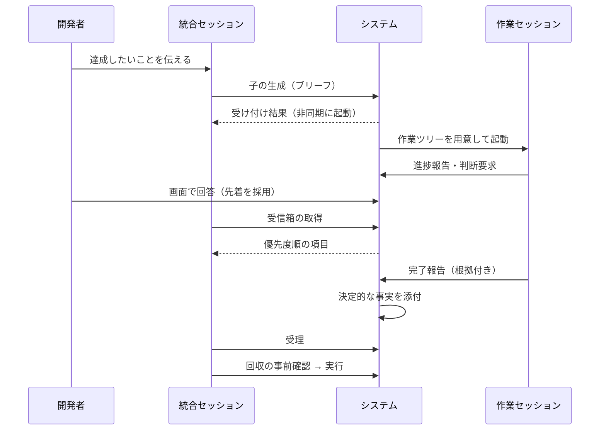

# Composite セッション・オーケストレーター

**関連 Design Draft:** [design-draft.md](../task/initial-spec-design/design-draft.md)（一時ファイル。実装完了後に削除する）
**関連 Decision Log:** [composite-session-orchestrator.md](../adr/composite-session-orchestrator.md)（未作成。タスクのクリーンアップ時に作成する）
**関連 PRD:** [composite-session-orchestrator.md](../requirement/composite-session-orchestrator.md)

---

# 1. 背景

複数の作業をエージェントへ並列に任せると、人間がセッションを行き来して状況を把握し、判断を配る負担が大きい。各作業セッションは本筋から外れやすく、統合セッションは自分の応答ターンでしか動けないため、監視・常時表示・判断の受付を統合セッションに任せる設計は成り立たない。

本仕様は、状態・監視・表示・判断の受付を統合セッションの外（常駐する仕組み）に置き、統合セッションには「子の情報をまとめ、順序付けて伝え、判断する」役割だけを与えるシステムの、抽象的な構造と振る舞いを定める。

# 2. 概要

- 複数の Claude セッションを、統合ノード 1 対 作業ノード n の木構造で管理する。人間は最上位の統合セッションとだけ対話する。
- システムが単一の状態を持ち、統合セッション・子セッション・HTML 画面・人間用コマンドはすべてその状態を通して参照・変更する。
- 子は、ブリーフ（目的・受け入れ基準・作業範囲・依存関係）だけを文脈として、専用の作業ツリーとブランチで作業する。
- 作業範囲外の操作は、エージェントの判断を介さず決定的に拒否され、記録される。
- 子の実行環境は Claude Code CLI（システムが外部から制御できる）と Claude Desktop（制御できる範囲が限られる）の 2 種類があり、環境ごとの可能操作は明示される。
- Desktop 環境の前提のうち未確認のもの（PRD 6 章の項目 1〜7）は「手動確認待ち」であり、本仕様では仮置きとして扱う。確認後に仕様を更新する。

# 3. 要求定義

PRD の要求 ID を正とし、本仕様はそれを満たす振る舞いを定める。要求の本文は PRD を参照する。

## 3.1. 機能要件

| 区分 | PRD の要求 | 本仕様での扱い |
|:--|:--|:--|
| 木構造 | FR_001〜FR_004 | 5.1 節（ノードと木）。統合ノードは自ら作業しない |
| 生成と制御 | FR_005〜FR_010 | 5.2 節（生成）、5.3 節（制御）。環境差は 6 章 |
| 報告と受信箱 | FR_011〜FR_013 | 5.4 節 |
| 脱線 | FR_014〜FR_017 | 5.5 節 |
| 人間の判断と表示 | FR_018〜FR_021 | 5.6 節 |
| 完了判定と統合 | FR_022〜FR_025 | 5.7 節 |
| 回収と最終削除 | FR_026〜FR_031 | 5.8 節 |
| 実行環境 | FR_032〜FR_036 | 6 章 |

## 3.2. 非機能要件

PRD の NFR_001〜NFR_012 を満たす。本仕様で具体化した目標値は次のとおり。

| ID | カテゴリ | 要件 | 目標値 |
|:--|:--|:--|:--|
| NFR_008 | 性能 | 状態の変化が画面に反映されるまでの遅延 | 2 秒以内（仮の目標値。PRD に従う） |
| NFR_001 | 信頼性 | 状態の分裂がない | 3 つの子の同時実行で識別子が混ざらない（CLI で確認済み）。4 つ以上と同一ディレクトリの共有は未確認 |
| NFR_003 | 信頼性 | 再試行の冪等性 | 生成・判断要求・回収・回答登録を同じ要求識別子で再試行しても重複しない |

# 4. API

統合セッション・子セッションが使う操作（MCP ツール）、人間用コマンド、画面の操作を、抽象的な単位で定める。名前・引数の詳細は設計で定める。各ロールには役割に応じた操作だけを公開する（NFR_004）。

## 4.1. 操作の一覧

| 提供先 | 操作 | 概要 | 要求 |
|:--|:--|:--|:--|
| 統合 | 子の生成 | ブリーフから子を生成する。受け付け結果を即座に返し、起動は非同期 | FR_005, FR_008 |
| 統合 | 追加指示 | 稼働中の子へ指示を送る | FR_009 |
| 統合 | 子の停止 | 穏当な停止と即時停止を選ぶ | FR_010 |
| 統合 | 受信箱の取得 | 優先度・依存関係・時刻の順に整列して返す。前回以降の差分を取得できる | FR_012 |
| 統合 | 一覧表の取得 | 状態から決定的に生成した木の一覧表 | FR_020 |
| 統合 | 判断要求の提示 | 選択肢と自由入力欄を持つ判断要求を人間に提示する。回答は受信箱に届く | FR_018 |
| 統合 | 切り出し | 脱線部分を新しい子へ移し、元の子を本筋に戻すか停止する（一操作・原子的） | FR_016 |
| 統合 | 拡張要求の判定 | 子の拡張要求を承認・却下・切り出しのいずれかで判定する | FR_015 |
| 統合 | 完了の判定 | 受理または差し戻し | FR_024 |
| 統合 | 回収の事前確認・実行 | 二段階。実行時に再判定する | FR_029 |
| 統合 | 可能操作の参照 | ノードごとに可能な操作を参照する | FR_034 |
| 子 | 進捗報告・判断要求・スコープ外課題の申告 | 親へのみ報告する | FR_011 |
| 子 | 範囲の拡張要求 | 対象と理由を添える | FR_015 |
| 子 | 完了報告 | 受け入れ基準ごとの根拠を付ける | FR_022 |
| 子 | 紐付け（Desktop のみ） | 紐付けコードで自分をノードの子ロールに結ぶ | FR_032 |
| 人間（画面） | 判断への回答、回収の指示 | 回答は一本化を経由する | FR_019, FR_021 |
| 人間（コマンド） | 最終削除（purge） | エージェントには公開しない | FR_031, DC_003 |

子に公開する操作に、子の生成・停止、人間宛ての連絡、最終削除は含めない（FR_011, NFR_004, DC_003）。

## 4.2. 型定義（論理構造）

```typescript
type NodeRole = 'integrator' | 'implement' | 'review' | 'investigate' | 'merge';

type NodeState =
  | 'pending'      // 依存先の完了待ち
  | 'running'
  | 'waiting'      // 判断待ちで一時停止
  | 'done'         // 完了（未検証）
  | 'verified'     // 受理済み
  | 'stopping'     // 停止要求済み。停止の確認前（猶予時間内を含む）
  | 'stopIncomplete' // 停止要求後もプロセスが残存。停止したとは扱わない
  | 'stopped'
  | 'reclaimable'
  | 'archived';

type Runtime = 'cli' | 'desktop';

interface Brief {
  objective: string;
  acceptanceCriteria: string[];
  scope: Scope;
  dependsOn: string[]; // 先行ノードの ID
}

interface Scope {
  writableLocations: string[];
  forbiddenLocations: string[];
  allowedCommands: string[];
}

type InboxKind = 'decision' | 'answer' | 'violation' | 'failure' | 'stopIncomplete' | 'done' | 'progress' | 'info';
// 優先度: 要判断（decision, answer）＞ 失敗（violation, failure, stopIncomplete）＞ 完了 ＞ 進捗 ＞ 情報
// stopIncomplete: 停止要求後もプロセスが残っている。残っているプロセスと次の操作（再停止、人間の確認）の候補を添える
```

# 5. 振る舞い

## 5.1. ノードと木

- ノードは統合ノードまたは作業ノード（実装・レビュー・調査・マージ）である。統合ノードは統合ノードを子に持てる。
- 各ノードは、状態・要約・未処理の判断の問い合わせに応答する。
- 中間統合ノードには、配下の数が閾値を超えたとき、または独立した判断が必要なときにのみセッションを割り当てる。それ以外は、状態の集計とブロッカーの伝播を決定的に行う。
- 統合セッションは、実装・レビュー・調査・コンフリクト解消を自ら行わず、子を生成する。

## 5.2. 子の生成

- 子はブリーフだけを文脈として、親ノードのブランチから切った専用のブランチと作業ツリーで開始する。親の会話履歴は複製しない（会話の複製による分岐は、同じ文脈から別案を試す補助手段に限る）。
- 依存先が指定された子は、依存先の完了まで起動しない。
- 兄弟ノードと書き込み範囲が重なる場合は、生成時に警告する。
- 生成要求は、同じ要求識別子で再試行しても子を重複して作らない。
- git 管理外の必要ファイル（ローカル設定など）は作業ツリーに引き継ぐ。

## 5.3. 制御

- 追加指示: 作業範囲の拡大は追加指示では行わず、拡張要求（5.5 節）か切り出しで扱う。追加指示は即時には処理されない場合があり、届いたことをシステムが確認する。未達は検知して受信箱へ通知する。
- 停止: 停止しても作業ツリーは既定で残す。停止後に作業ツリーを使うプロセスが残っていない確認ができるまで、停止したとは扱わない。
- 穏当な停止は 2 段階で行う。(1) 子へ停止指示をメッセージで送り、区切りのよい所で成果を保存して止まるよう依頼する。(2) 猶予時間内に止まらなければ打ち切る。猶予時間は設定値で、既定は 60 秒（仮の目標値。実行中のツールの長さを見て見直す）。
- 即時停止は猶予なしで打ち切る。
- いずれも書き込み済みの成果は残し、子を再開可能な状態にする。
- 猶予時間は、停止要求ごとに上書きできる。猶予内に停止したか、猶予を超えて打ち切りに落ちたかを記録し、実測で既定値を見直せるようにする。
- 停止要求後、作業ツリー配下にプロセスが残っている間、ノードは「停止要求済み」（`stopping`）にある。確認できないまま所定の時間を超えたときは「停止未完了」（`stopIncomplete`）とし、失敗として受信箱へ通知する。この状態のノードは、回収可能とは判定しない。所定の時間と再試行の方式は設計で定める。
- 判断待ちの間、指定した子を一時停止できる。

## 5.4. 報告と受信箱

- 子は親にのみ報告する。判断は必ず親を経由する。
- 受信箱は、子の報告、判断要求、範囲違反、回収可能化の通知、人間の回答を集約する。優先度（要判断 ＞ 失敗 ＞ 完了 ＞ 進捗 ＞ 情報）、依存関係、時刻の順に整列する。整列は決定的である。同じ優先度の中では、依存先のノードの項目を依存元のノードの項目より先に置き、依存のない項目どうしは時刻の昇順とする（同時刻は識別子の昇順）。
- 受信箱は、統合セッションから取得を要求されたときにのみ返す。各項目には次に取るべき操作の候補を添える。
- 中間統合ノードは、配下を要約して優先度を付けて上位の受信箱へ送る。システムが管理する中間統合ノードは、新しい項目が届いたときにシステムが起こしてよい。

## 5.5. 脱線の検知と切り出し

- 作業範囲（書き込みを許可する場所、禁止する場所、実行を許可するコマンド）の外にある操作は、フックにより決定的に拒否し、範囲違反として記録する。読み込みは制限しない。
- 許可するコマンドの照合は、連結・パイプで分けた各部分の語の並びが、許可の語の並びで始まること（前方一致）とする。別のコマンドを再解釈・実行するもの（シェル、`eval`、`xargs`、`env`、`sudo` など）は許可の有無にかかわらず拒否する。許可したコマンドの中身（`pnpm test` が走らせるスクリプトなど）が行う書き込みは判定できないため、許可は最小にする。引数で書き込みや実行ができるコマンド（`git diff --output`、`sort -o`、インタプリタの `-e`/`-c` など）は、引数まで含めた許可項目にする。
- 初期範囲は狭くする。子は拡張要求を出し、親が承認（範囲を広げて続行）・却下・切り出しのいずれかで判定する。要求と判定結果は記録する。
- 切り出しは、新しい子の生成と、元の子の復帰または停止を、一回の操作で原子的に行う。途中で失敗した場合、片方だけが反映されない。

## 5.6. 人間の判断と表示

- 判断要求は、選択肢（各説明付き）と自由入力欄を持つ。要求は回答を待たずに受け付け結果を返す。
- 同じ判断要求に画面とチャットの両方から回答があった場合、先に確定した回答を採用し、後から来た回答は却下して採用された回答を伝える。
- 一覧表は状態から決定的に生成する。アーカイブ済みのノードは既定で表示しない。
- HTML 画面は、統合セッションの応答ターンとは無関係に状態の変化を反映する。画面では判断への回答と回収の指示ができ、blocking な項目を目立たせる。明暗両方の配色に対応する。

## 5.7. 完了判定と統合

- 子は受け入れ基準ごとの根拠（テスト名、実行結果、コミットなど）を付けて完了を報告する。報告直後の状態は「完了（未検証）」とする。
- システムは、テストや静的検査の終了結果、変更が作業範囲内に収まっているかなどの決定的な事実を完了報告に添付する。
- 親は受理（検証済みへ進める）または差し戻し（未達項目と追加指示を付けて子を再開）を判定する。根拠だけで判定できないときは、レビュー役の子を生成する。
- 子の成果の親ブランチへの統合とコンフリクトの解消は、マージ役の作業ノードが行う。

## 5.8. 回収と最終削除

次の条件をすべて満たすノードだけを回収可能と判定する（FR_026）。

1. 成果が親ブランチに統合済みである
2. 作業ツリーに未保存の変更がない
3. このノードに依存する未完了ノードがない（別サブツリーからの依存を含む）
4. このノードに紐づく未回答の判断がない
5. 統合ノードの場合、配下がすべて回収可能以降の状態にある
6. 作業ツリー配下で動作中のプロセスがない

- 停止したノードは条件 1 を満たさないため、破棄してよいという判断を経た場合に限り回収可能とする。
- 回収不可の場合は、満たしていない条件を短い理由で示し、統合ノードでは原因の配下ノードを名指しする。
- 親子の不変条件: 親が回収可能なら配下はすべて回収可能で、回収は配下へ連鎖する。配下に回収できないノードが一つでもあれば、親は回収できない。
- 回収は事前確認と実行の二段階で行い、実行時に再判定する。回収するのは作業ツリーと統合済みのブランチで、ノードの記録はアーカイブとして残す。失うものがある場合に拒否される安全な手段だけを用い、強制的な削除は破棄判断を経た停止ノードに限る。
- 自動回収の既定: 統合済みは回収可能になってから 24 時間後。停止したノードは自動回収せず、7 日後に破棄の確認を受信箱へ出す。作業ツリー数が上限（既定 10）を超えたら、猶予を短縮して古い順に回収する。手動回収のみも選べる。
- 最終削除は、最上位の木単位で、木全体のアーカイブから 90 日後に行う。墓標（タイトル、結果、最終コミット、日付）を残すかを選べる。保持ポリシーまたは人間用コマンドでのみ実行し、エージェントには公開しない。transcript は削除しない。

# 6. 実行環境

## 6.1. 可能操作の一覧

ノードごとに可能な操作を参照できる。不可能な操作が要求されたときは、理由と代替手段を示して失敗させる（FR_034）。

| 操作 | CLI | Desktop（手動確認待ち） |
|:--|:--|:--|
| 子の起動 | ○ システムが非対話で起動 | △ タスク生成機能（人間のチップ操作を介する）。戻り値は `task_id` のみ |
| 作業ツリーの指定 | ○ | △ 作業ツリー化は人間のチップ操作に依存。起動後にシステムが検証し、作業ツリーでなければ作業開始を許可しない（仮置き） |
| 追加指示（待機中） | ○ | △ 保留・破棄され得る |
| 追加指示（実行中） | ○ ツール完了後に届く | △ 同上 |
| 穏当な停止 | ○ 2 段階（指示 → 猶予後に打ち切り）。打ち切りはストリーミング入力の子のみ | ✕ 専用操作を確認できない。代行依頼（FR_036） |
| 即時停止 | △ プロセス終了。バックグラウンド起動した子プロセスは未検証 | ✕ 同上 |
| 接続設定の注入 | ○ 子ごとの資格情報を渡せる | △ 初回メッセージ後に使える報告がある |
| フックの注入 | ○ 記録と拒否 | △ 継承が未確認。効かない場合は保証できない |
| 子の識別子の取得 | ○ 継承される識別子を除く | ✕ 戻り値にない |
| 覗き見 | △ 複製を読み取り専用で開く | ○ Desktop の画面（識別子の対応付けは未確認） |
| 完了の検知 | ○ | △ 自動検知は未確認。親が読みに行く |

## 6.2. Desktop の子の紐付け（FR_032）

1. システムが一回限りの紐付けコードを発行する。
2. 統合セッションが、Desktop のタスク生成機能でコードを含む指示を渡して子を起動する。
3. 子は、システムの MCP ツールを使えるようになった時点で、コードを使って自分をノードの子ロールに紐付ける。コードは一回限りで、使用済み・期限切れは拒否する。
4. 紐付け後、子には子に許可された操作だけが見える。

起動時の指示が「人間のメッセージ」として扱われない場合、手順 3 は初回メッセージの後に行う（仮置き）。紐付けまでの間と、作業ツリーであることの検証（FR_006）が済むまでの間は、子に作業を許可しない。

## 6.3. Desktop の子に対する操作代行（FR_036）

システムが直接操作できない停止などが必要になったとき、システムは受信箱を通じて親に代行を依頼し、親が Desktop の機能で実行した結果を報告する。代行までの間の安全は、作業範囲外の拒否（5.5 節）で担保する。フックが Desktop の子に効くことが前提であり、効かない場合は保証できない。

# 7. 用語集

用語は PRD の用語集に従う。

# 8. 使用例

統合セッションが 2 つの子に分けて依頼し、判断を受け、回収するまでの流れ。



# 9. 制約事項

- 統合セッションは自分の応答ターンでしか動けない。監視・表示・判断の受付はセッションの外に置く。
- 受信箱は取得時のみ返すため、最上位の統合セッションは人間が話しかけるまで新しい項目を処理しない。
- Desktop の子は、制御できる範囲が CLI より狭い（6.1 節）。Desktop の手動確認（PRD 6 章）の結果で、本仕様の Desktop に関する記述（△ と ✕）が変わる。
- 単一開発者のローカル環境に限る。同時実行数と費用の上限は、設計で定める。
