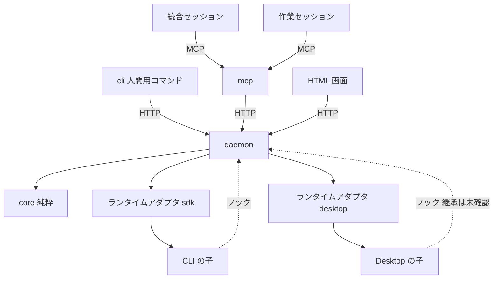

# Composite セッション・オーケストレーター 技術設計

**関連 Spec:** [composite-session-orchestrator_spec.md](../../specification/composite-session-orchestrator_spec.md)
**関連決定ログ:** [composite-session-orchestrator.md](../../adr/composite-session-orchestrator.md)（未作成。クリーンアップ時に作成する）
**関連 PRD:** [composite-session-orchestrator.md](../../requirement/composite-session-orchestrator.md)

> 一時ドラフト。チケット番号が未定のため、ディレクトリ名は `initial-spec-design` とした。実装完了後に決定事項を決定ログへ移して削除する。

---

# 1. 実装ステータス

**ステータス:** 🔴 未実装

| モジュール | ステータス | 備考 |
|:--|:--|:--|
| `packages/core` | 🔴 | 優先度の整列のみ存在 |
| `packages/core` の型の整合 | 🟢 | `NodeStatus` / `Priority` を spec の `NodeState` / `InboxKind` に合わせる（名称の統一、`stopping` / `stopIncomplete` の追加、`Priority` のコメントに `stopIncomplete` は failed の帯と明記）。実装済み（`merged` は spec に無いため削除。`merged` は状態ではなく merge 役ノードの作業であり、統合済みは役割と `verified` で表す） |
| `packages/daemon` | 🔴 | スキャフォールドのみ |
| `packages/mcp` | 🔴 | スキャフォールドのみ |
| `packages/cli` | 🔴 | スキャフォールドのみ |
| `plugin/` | 🔴 | 空 |

# 2. 設計目標

- 状態の窓口を `daemon` に集約し、状態の分裂を防ぐ（B-002, NFR_001）。
- 判定ロジック（回収可能、受信箱の整列、親子の不変条件）を I/O のない純粋関数にする（A-001, NFR_007）。
- CLI の子は SDK で外部から制御し、Desktop の子は制御できる範囲を能力表で明示する（FR_033, FR_034）。
- Desktop の未確認事項の結果で設計が崩れないよう、実行環境をアダプタの背後に閉じる。

# 3. 技術スタック

| 領域 | 採用技術 | 選定理由 |
|:--|:--|:--|
| 言語・実行 | TypeScript（ESM、Node.js 22 以上） | 憲法の技術制約 |
| MCP | MCP TypeScript SDK、zod | Library-First。独自プロトコルを作らない（憲法） |
| 子の起動 | Claude Agent SDK（`query()`） | Spike 02 で起動・指示・停止・フック・接続設定の注入を確認済み |
| 状態の保持 | SQLite（追記型のイベントログ） | 再起動後の復元（NFR_002）と時系列の記録（NFR_011）を 1 つの仕組みで満たす。具体のドライバは着手時点の最新版を確認して決める |
| テスト | Vitest、fast-check | 憲法の技術制約 |

依存は着手時点の最新版を確認して固定する（未追加）。

# 4. アーキテクチャ

## 4.1. システム構成図



## 4.2. モジュール分割

| モジュール | 責務 | 依存 | 配置 |
|:--|:--|:--|:--|
| core | 木、状態遷移、回収判定、受信箱の整列、不変条件。時刻・識別子は引数で受ける | なし | `packages/core` |
| daemon | イベントログ、状態の唯一の窓口、ランタイムアダプタ、フック受付、HTML 画面、自動回収の定期実行 | core | `packages/daemon` |
| mcp | ロール別のツール定義、入力検証（zod）、エラー設計。daemon の窓口を呼ぶ | core | `packages/mcp` |
| cli | 人間用コマンド（purge、回収の指示など） | core | `packages/cli` |
| plugin | 役割定義の skill、フック設定、MCP 設定、起動コマンド | - | `plugin/` |

依存方向の制約により、`mcp`・`cli` は `daemon` に直接依存できない。`daemon` の窓口は、ローカル接続（127.0.0.1 の HTTP）で呼び出す。`mcp`・`cli` は、その接続の型を `core` が持つ契約（型）を通して扱う。

# 5. データモデル

状態はイベントの列から導出する。イベントは追記のみとする。

```typescript
interface OrchEvent {
  seq: number;          // daemon が採番する単調増加の番号
  at: string;           // ISO 8601。daemon が付与する
  requestId: string;    // 冪等性のための要求識別子
  actor: { nodeId: string } | { human: true } | { system: true };
  type: string;         // 'node.created' | 'node.stateChanged' | 'scope.violation' など
  payload: unknown;     // type ごとに zod で検証した値
}
```

- 同じ `requestId` のイベントは重複して追記しない（NFR_003）。
- 現在の状態は、イベント列を `core` の純粋関数で畳み込んで得る。必要に応じて daemon がスナップショットを持つ（写しではなくキャッシュとして扱い、再構築できること）。

# 6. インターフェース定義

## 6.1. ランタイムアダプタ

```typescript
interface RuntimeAdapter {
  readonly kind: 'cli' | 'desktop';
  capabilities(nodeId: string): Capabilities;
  start(node: StartRequest): Promise<StartResult>;
  send(nodeId: string, text: string): Promise<DeliveryResult>;
  stop(nodeId: string, mode: 'graceful' | 'immediate'): Promise<StopResult>;
}

interface Capabilities {
  send: 'ok' | 'delayed' | 'unreliable' | 'unsupported';
  stopGraceful: boolean;
  stopImmediate: boolean;
  hooks: 'ok' | 'unverified' | 'unsupported';
  sessionId: boolean;
}
```

- 不可能な操作は、理由と代替手段を含む失敗を返す（FR_034, NFR_010）。
- `desktop` アダプタの `stop` は常に「代行依頼を受信箱へ出す」結果を返す（FR_036）。`capabilities` は手動確認の結果が出るまで、保守的な値（`unverified`、`unreliable`）とする。

## 6.2. CLI の子の起動

- `query({ prompt: AsyncIterable, options })` で起動する（常にストリーミング入力。`interrupt()` と実行中の追加指示のため）。
- `options.cwd` に作業ツリー、`options.mcpServers` に子ごとの資格情報付きの HTTP 接続、`options.hooks` に記録・拒否のコールバックを渡す。`settingSources` は空にして、利用者設定のフックの混入を防ぐ。
- `options.env` は親の環境変数から、セッション識別子に関わる変数を除いて渡す。継承された `CLAUDE_CODE_*` を起動時に列挙して確認する（検証環境固有の可能性があるため）。
- 穏当な停止は 2 段階とする。(1) 停止指示のメッセージを入力に push する。(2) 猶予時間（設定値、既定 60 秒）内に結果（result）が来なければ `interrupt()` で打ち切る。即時停止は `abort()`。停止後は、作業ツリーを cwd とするプロセスの有無（`lsof +d` / `lsof +D` を第一候補とする。macOS と Linux の両方で使える）を確認し、残っていれば停止とは扱わず、ノードを `stopping` に置く。所定の時間を超えても残っていれば `stopIncomplete` にして、`stopIncomplete` の通知を受信箱へ出す。回収可能の判定（条件 6）は、プロセスの一覧（pid、cwd、開いているファイルの有無）を入力にとる `core` の純粋関数とし、一覧の取得は `daemon` のアダプタが行う。
- 猶予時間は停止要求ごとに上書きでき、停止要求のイベントに猶予時間を、結果のイベントに「猶予内に result が来た」か「`interrupt()` に落ちた」かを記録する。実測で既定値を見直す。
- 覗き見は `--resume <id> --fork-session` を読み取り専用の権限で開く。

## 6.3. フック

- フックの入力（`session_id`、`cwd`、ツール名、引数）を daemon の窓口へ渡し、許可・拒否を決める。拒否は範囲違反としてイベントに記録する。
- 拒否の判定は、`core` の純粋関数（作業範囲と操作を入力にして判定を返す）で行う。
- コマンド経由の書き込みは、許可するコマンドの一覧と、書き込み先の検査の両方で見る。バックグラウンド起動（`run_in_background`、`nohup`、`setsid` など）は既定で拒否する案を、ADR で決める。

# 7. 非機能要件実現方針

| 要件 | 実現方針 |
|:--|:--|
| NFR_001 | 状態の窓口を daemon のみとし、mcp・cli・画面は窓口を呼ぶ |
| NFR_002 | イベントログから状態を復元する。Desktop の子の存続は前提にしない |
| NFR_003 | 要求識別子の一意制約で重複を弾く |
| NFR_004 | ロールごとにツールの集合を分け、子には生成・停止・人間宛て・最終削除を公開しない。公開一覧をテストで固定する |
| NFR_005 | 127.0.0.1 のみに bind し、ノードごとのトークンをノード停止時に失効させる。トークンをログ・初期メッセージ・画面に出さない |
| NFR_006 | 回収は `git worktree remove`（強制なし）と `git branch -d` のみを使う。強制は破棄判断を経た停止ノードに限る |
| NFR_007 | 判定ロジックは `core` の純粋関数にし、時刻・識別子・プロセス一覧は引数で受ける。fast-check で網羅する |
| NFR_008 | 画面への反映は変更イベントの購読（Server-Sent Events 想定）で行う |
| NFR_009 | ツールの応答に簡潔版・詳細版を設け、一覧は分割取得にする |
| NFR_010 | 失敗の応答は原因と次の操作を持つ型（Result）にそろえる（憲法 T-001） |
| NFR_011 | すべての状態変更をイベントとして追記する。拒否した操作も範囲違反として残す |
| NFR_012 | 特定のリポジトリ構成を前提にしない。plugin の設定にリポジトリのパスを埋め込まず、起動時に渡す |

# 8. テスト戦略

| テストレベル | 対象 | 目標 |
|:--|:--|:--|
| ユニット | core の回収判定の全条件、受信箱の整列、状態遷移 | 全条件を網羅 |
| 性質ベース（fast-check） | 親子の回収不変条件、整列の決定性、任意の木での集計 | 任意の木で不変条件を維持 |
| 結合 | PRD の各ユースケースの主要フロー（生成、報告、判断、完了判定、回収） | 各 1 件以上 |
| 冪等性 | 生成、判断要求、回収、回答登録の再試行 | 各 1 件以上 |
| 境界 | 空の木、最大の深さ、重複した要求 | 憲法の標準に従う |
| 実機確認 | CLI の子の起動・停止・フック。Desktop の項目 1〜7（人間が手動） | 手動確認の結果を spike に記録 |

テストは先に書く（D-001）。

# 9. 設計判断

## 9.1. 決定事項

| 決定事項 | 選択肢 | 決定内容 | 理由 |
|:--|:--|:--|:--|
| 状態の保持方式 | イベントログ／状態の直接更新 | イベントログ（追記のみ）から導出 | 復元と時系列の記録を同時に満たす（B-002） |
| 実行環境の抽象 | 環境ごとの分岐／アダプタ | `RuntimeAdapter` と能力表 | Desktop の未確認事項が確定しても影響を閉じ込める |
| CLI の子の入力 | 単発起動／ストリーミング入力 | 常にストリーミング入力 | `interrupt()` と実行中の追加指示に必要（Spike 02） |
| フックの注入 | 設定ファイル／SDK のコールバック | SDK のコールバック。設定の読み込みは空にする | 利用者設定のフックの混入を防ぐ（Spike 02） |
| 穏当な停止 | 単発の打ち切り／2 段階 | 停止指示のメッセージ → 猶予後に `interrupt()`。猶予は設定値 | 一般的なグレースフルシャットダウンの型。メッセージは実行中ツールの完了後に届くため、打ち切りだけでは成果の保存を依頼できない（Spike 02） |
| 停止確認前の状態 | 状態を増やさない／持つ | `stopping`（停止要求済み、確認前）と `stopIncomplete`（停止要求後もプロセスが残存）を導入する | 「停止要求済み」と「停止を確認できた」を区別しないと、プロセスが残ったまま回収可能と判定されるため（B-001） |
| 回収可能の判定 | 条件 5 つ／プロセス不在を加える | 条件 6「作業ツリー配下で動作中のプロセスがない」を加える | 停止後も残るプロセスが作業ツリーを書き換えうるため（Spike 02） |
| Desktop の紐付け | 起動直後に実行／初回メッセージ後 | 暫定は初回メッセージ後。手動確認（項目 4）で確定 | 子が最初の人間のメッセージまで接続設定を持たない報告があるため |
| 窓口の契約の型の置き場所 | `core`／専用パッケージ／各パッケージが個別に持つ | `core` に置く（`Failure`、`Result`、操作の引数・結果、ロールごとの操作表）。操作名・引数は spec 4.1 に対応する仮置きで、各操作の実装タスクで確定する | `mcp`・`cli` は `daemon` に依存できず、`core` だけが全員の依存先のため（A-001, NFR_001）。ADR に残す |
| 受信箱の整列規則 | 依存の深さを時刻より先のキーにする／依存のある組だけを制約にする | 優先度で分け、同優先度内は依存のある組だけを制約とするトポロジカル整列。制約のない組は時刻、次に id。項目を持たない中間ノード経由の依存は `nodeDeps` で渡す。`at` は ISO 8601 UTC（不正値は時刻の最後）、`id` は一意（重複は `seq` が大きい方を残す） | 依存のない項目まで深さで並べ替えると、時刻順が崩れ決定性の説明が難しくなるため（NFR_007） |
| 停止要求を受け付ける元状態 | 全状態で受け付ける／動作中のみ／状態ごとに定める | 状態ごとに定める。`running`: `stopping`（穏当は 2 段階、即時は猶予なし）。`waiting`: `stopping`（猶予なしの即時停止の指示。プロセスの不在を確認するまで `stopped` としない）。`pending`（依存待ちを含む）: `stopped` へ直行（起動の取り消し。プロセス未生成）。`stopping`・`stopIncomplete`・`stopped`: 受け付け済みで、再送は成功（`changed: false`）。状態は変わらない。完了・検証済み・回収可能・アーカイブ（`done`・`verified`・`reclaimable`・`archived`）: 「既に終了」（`alreadyFinished`）を返し何もしない | 動作中でない子にも停止の手段を残しつつ、spec 5.3 の「プロセス不在の確認まで停止したとは扱わない」を守るため。再送の応答を対称にするため、一度受け付けた停止要求の再送は常に成功とする |
| 停止の進行と復帰 | 停止要求の再送／別イベント | `stopTimeout`（`stopping`→`stopIncomplete`）、`retryStop`（`stopIncomplete`→`stopping`。効果は即時停止）、`confirmStopped`（`stopping`・`stopIncomplete`→`stopped`、プロセス不在を確認）を停止要求とは別のイベントにする。`stopping`（穏当な停止の猶予中）に即時停止の要求が来たら、即時停止へ切り替える（状態は `stopping` のまま）。`running`・`waiting` から `stopped` へ至る経路は必ず `confirmStopped` を通る | 停止要求の冪等性を保ち、進行の事実（時間切れ、確認）と指示を分けるため。猶予切れの後の再試行は、猶予なしで止めるのが目的のため |
| 差し戻しと再開 | 自動／指示による | `done`→`running`（差し戻し）と `stopped` からの再開は、人間または統合ノードの指示による。再開は `stopped`→`pending` に戻し、依存先が完了済み（`dependenciesDone`）なら続けて `start` して `running` へ進める（依存待ちを飛ばさない） | spec 5.7（差し戻しは親の判定）、5.3（子を再開可能にする）、5.2（依存先の完了まで起動しない） |
| 停止した子の回収 | 常に可／破棄判断を要する | `stopped`→`reclaimable` は破棄の判断を経た場合のみ（`markReclaimable` の `discarded`）。`verified`→`reclaimable` は回収可能判定（T05）の結果による | spec 5.8（停止したノードは破棄判断を経た場合に限り回収可能） |
| イベントログの永続化（SQLite ドライバー）とサポートする Node（ユーザー決定） | node:sqlite／better-sqlite3 の 12 系（Node 20 対応）／13 系／その他（sqlite3、WASM 系） | **better-sqlite3 13 系**（13.0.3 に固定）。Node 20 のサポートをやめ、Node 22 以上（CI は 22・24）にする。ドライバーは `EventStore` のインターフェース（`packages/daemon/src/event-store.ts`）の裏の `sqlite-store.ts` に閉じ込め、`node:sqlite` へ差し替え可能にする（契約のテストを両実装に課せる）。イベントは追記のみ（`UPDATE`・`DELETE`・既存の `seq`・`request_id` を置き換える `INSERT`（REPLACE）をトリガーで拒否し、INSERT は `OR ABORT` で固定。最終削除（FR_031）は別の経路で設計する）、`seq` は主キー、`request_id` は一意。WAL と `synchronous = FULL`（WAL にできなければ失敗）。daemon は単一プロセスのため、`locking_mode = EXCLUSIVE` と開いた時点の書き込みロックで排他し、二重に開くと `storeLocked` で失敗する。`application_id` に固有値（"CSO1"）を書いて他のデータベースを巻き込まず（`schemaMismatch`）、スキーマの版は `user_version`（新しすぎるファイルは `schemaTooNew`）。開くときの失敗（`prepare` の例外を含む）は例外でなく失敗として返し、データベースを閉じてロックを残さない。追記は 1 トランザクションで、seq 採番・core の `applyEvent` による追記前の検査・保存を行う。スナップショットは最新の 1 件のキャッシュで、core の状態のスキーマの版と、末尾のイベントの行のハッシュが合うときだけ使い、合わない・壊れている場合は捨ててログから再構築する（`verifySnapshot` を指定すると、起動時にログ全体の畳み込みと突き合わせる）。時計が例外・不正な形式なら `invalidClock` で失敗する。ストアを開いた側が閉じる責任を持つ。壊れた行は `corruptRow` の失敗として返す | 13 系は N-API のバイナリ（darwin・linux の arm64・x64）をパッケージに同梱し、ビルド不要で導入できる。Node 20 は 2026-04 に EOL。12 系は `prebuild-install`（保守終了）に依存し、13 系は Node 22 以上のみ。`node:sqlite` は Node 22 で安定度 1.1（実験警告）のため、安定してから差し替えを検討する。pnpm の `onlyBuiltDependencies` への許可は不要（ビルドしない。許可すると `binding.gyp` により不要なコンパイルが走りうる）。導入時の「Ignored build scripts」は情報の警告で、動作に影響しない |
| イベントの種別と状態の導出 | 種別を文字列のまま持つ／型付きの判別共用体 | 型付きの判別共用体で 6 種: `node.created`（`pending` で作成。木の不変条件を検査）、`node.stateChanged`（payload は T03 の `NodeEvent`。遷移は T03 の表で決める）、`scope.violation`（記録のみ。状態は変えない）、`inbox.added`（`seq`・`at` は envelope から、依存先はノードの記録から取る）、`decision.requested`、`decision.answered`（先に確定した回答を採用し、後続は却下として記録。FR_019）。未知の種別は拒否する（無視しない）。状態は `seq` の昇順の畳み込み（`foldEvents`）でのみ導出し、入力順に依存しない。`seq` の重複、木・遷移・回収の不変条件に反するイベントは、`seq` つきの失敗で全体を拒否する。daemon は追記の前に `applyEvent` で検査する（結果の `applied` は、重複として無視したかを示す）。壊れたイベント（null、型の違う payload など）でも例外を出さず、型ガードで値を検証して失敗を返す（全域関数）。計算量は、内部で可変の下書きに畳み込み出力の前に凍結する `foldEvents` が O(n log n)。大きなログは、スナップショットの状態から `foldEvents(以降のイベント, スナップショット)` で再開する。状態遷移と判断要求（`requestDecision` と `decision.requested`）を一組として発行するのは daemon、発行者とイベントの種類の整合は窓口のロール別の操作表（NFR_004）が保証する | 復元（NFR_002）と記録（NFR_011）を同じ列から導くため。将来のイベント追加で黙って無視されないようにするため |
| 子の生成条件（ユーザー決定） | 親の状態を問わない／制約する | 子を作れるのは、親が `running` か `waiting` のときだけ（`parentNotActive`）。`dependsOn` に自分の親・祖先は指定できない（`dependsOnAncestor`。相互に待ち合うのを防ぐ） | 動作を終えた・止まった親の下に新しい作業を足さないため。親の完了を待つ子は、親の完了が子の完了に依存するため決して進めなくなる |
| 停止の記録（猶予時間と観測） | 停止要求のイベントに全部載せる／観測を別イベントにする | 停止要求（`NodeEvent` の `stop`）に任意の `graceMs`（1 以上 3,600,000 以下の整数ミリ秒。穏当な停止だけで、即時停止と、判断待ちのノードへの要求では指定できない。記録用で遷移には影響しない）を持たせる。観測は記録のみの別イベント `node.stopObserved`（`outcome`: `withinGrace` 猶予内に result が来た／`interrupted` 猶予を超えて `interrupt()` に落ちた／`aborted` `abort()` した）にし、`stopSeq`（対応する停止要求のイベントの `seq`）と、そのとき有効だった `graceMs` を持たせる。状態は変えず、`stopping`・`stopIncomplete`・`stopped` のノードにだけ記録でき、`stopSeq` はそのノードの停止の試行（状態を `stopping` に進めた `stop` と `retryStop`）でなければならず（`unknownStopRequest`）、同じ停止の試行につき観測は 1 件だけ（`observationAlreadyRecorded`）。停止の試行は `OrchState.stopRequests`、観測は `stopObservations` に残す（古いスナップショットに無くても畳み込める。壊れた値は `invalidState` の失敗で、復元側はスナップショットを捨てて全ログから再構築する）。`stopping` の最中に別の `graceMs` の停止要求が来ても、状態と進行中の猶予は変えず、`applyEvent` の結果の `ignored: "graceMsIgnored"` で無視されたことを示す。観測の発行者（actor）の信頼性は窓口のロール別の操作表（NFR_004）が保証する | 観測は停止要求の後に分かる事実で、状態遷移とは別の時点のため。どの停止要求の観測かを結び付け、同じ停止の二重の観測や、別のノード・別の試行への観測を防ぐ。猶予の既定値（60 秒）を実測で見直せるようにする（spec 5.3） |
| `requestId` の冪等性 | 内容を問わず無視／内容の違いは拒否 | 同じ `requestId` で同一内容（actor・type・payload。キー順は無視）は無視して成功。内容が違えば `requestIdConflict` で拒否 | 再試行は重複せず（NFR_003）、別の要求が同じ識別子を取り違えたときは気づけるようにするため |
| 依存先の「完了」の解釈（FR_008） | `done`（完了報告済み）／`verified` 以降（受理済み） | `verified` 以降（`verified`・`reclaimable`・`archived`。共通定数 `COMPLETED_STATES`）。`start` は `dependsOn` の全ノードがこのいずれかのときだけ許可し、`done` では許可しない。`restart` の `dependenciesDone` は payload を信用せず、畳み込みが状態から判定する。回収可能判定（T05）の条件 3 でも同じ定数を使う | 未検証の成果の上に後続を始めると、差し戻しのときに後続が無駄になるため（spec 5.7）。依存先が先に回収されても、後続が起動できなくならないようにするため |
| 回収可能判定の入力と理由 | 状態から直接判定／事実を引数で受ける | 事実（統合済みか、きれいか、破棄判断済みか、作業ツリーのパス）、プロセス一覧、未回答の判断を持つノードを引数で受ける純粋関数 `assessReclaim`。戻り値は `{reclaimable, unmet, blockers}`。`unmet` は列挙型（`stateNotEligible`・`discardRequired`・`factsMissing`・`notMerged`・`dirty`・`dependentsIncomplete`・`openDecision`・`descendantsNotReclaimable`・`processesRunning`・`processesUnknown`）、`blockers` は原因のノード・pid（統合ノードでは回収可能以降でない配下を名指し）。T07 の `OrchState` からの変換は `daemon` の責務 | 時刻・識別子・プロセス一覧は引数で受ける（NFR_007）。回収不可の理由を短く示し、原因を名指しするため（spec 5.8） |
| 回収判定の安全側の既定 | 欠けた入力は許可／拒否 | フェイルクローズ。事実は `=== true` のときだけ満たしたとみなし、プロセスの `hasOpenFiles` は `=== false` のときだけ開いていないとみなす（`"unknown"` は動作中）。判定の対象にできる状態は `verified`、`stopped`、`reclaimable`（回収の実行直前の再判定のため。条件 1・`discardRequired` は `merged`・`discarded` の事実で判定し、統合済みでない `reclaimable` は破棄の経路とみなす）。事実が欠ける・作業ツリーのパスが不正（`worktreeRoot` の配下でない場合を含む）なら `factsMissing`、プロセス一覧が取得できなければ `processesUnknown` で回収不可。入力の形が壊れていれば例外を出さず `invalidInput` の失敗を返す。条件 3 の「未完了」は依存元が `COMPLETED_STATES`（`verified`・`reclaimable`・`archived`）以外で、木の外からの依存は daemon が実行時に再判定して拾う。条件 6 は、cwd が作業ツリー配下（`scope.ts` と同じ畳み込み・ディレクトリ境界）または作業ツリー配下のファイルを開いている（または不明）プロセスがあること、cwd が不明（絶対パスでない）なプロセスも動作中として扱う。**破棄の判断を経た停止（`stopped` で `discarded`）は、条件 1 と条件 2（未保存の変更）を免除する（ユーザー決定）**。判断を求めるときは、未保存の変更の一覧を人間に提示する（提示の実装は T12・T23）。パスは daemon のアダプタが realpath にして渡し、`discarded` の情報源は daemon が一つのイベントから導く | 失うものがある場合は拒否する安全な手段だけを使う方針（spec 5.8、NFR_006）。破棄の判断は成果を捨てることを含むため |
| MCP のツール公開 | 各ロールの操作を `mcp` が別に持つ／core の `ROLE_OPERATIONS` を唯一の情報源にする | `core` の `ROLE_OPERATIONS` から導出。MCP で公開するのは統合と子だけで、入口でロールを検査し、それ以外は何も公開しない。人間用（最終削除を含む）は含めない。`node_bind` は公開しない（紐付けは `POST /v1/bind`）。ツール名は操作名の `.` を `_` にしたもの（`toolName` に集約）。未公開のツールの失敗には近い名前の候補を添える。入力検証は `T25` で実装済み（zod 4.6.5＝公開から 2 週間以上の最新安定版を固定。`parseToolInput`。規則は core の `LIMITS`・`isSafeId`・`briefProblem`・`pauseNodeIdsProblem` を呼んで揃え、未知のキーは拒否）。daemon への結線の前提 | 公開一覧の食い違いを防ぐため（NFR_004, DC_003, FR_032） |
| 受信箱の応答（MCP） | 1 回で全件／分割取得 | 型を分ける: daemon→mcp の契約は core の `inbox.fetch`（`items: InboxItem[]`）、mcp→エージェントの応答は `InboxPage`、ツール入力は `InboxFetchInput`（`sinceSeq`・`detail`・`limit`・`offset`・`asOfSeq`）。既定は簡潔版（要約と参照 ID を含み、全文は `decision_get`・`report_get`）。応答の `asOfSeq` を続きの取得に渡すと、その以下の項目だけで整列し、新着による重複・欠落を防ぐ。新着は次回 `sinceSeq = asOfSeq` の差分で拾う。入口で opts・items・各項目の形を検査し、不正は `invalid_argument` | トークン消費の抑制と、分割取得の一貫性のため（NFR_009） |
| 受信箱の次の操作の候補 | 呼び出し側が決める／種類から決まる表 | 種類ごとの表を固定する（統合ロールのツール名）: decision→`decision_get`・`decision_present`・`node_send` / answer→`decision_get`・`node_send` / violation→`scope_decide`・`node_send`・`node_stop` / failure→`report_get`・`node_send`・`node_split`・`node_stop` / stopIncomplete→`node_stop`・`node_capabilities`・`decision_present` / done→`report_get`・`node_review` / progress→`report_get` / info→なし。テストで固定する | 統合セッションが次の操作を迷わないようにする（FR_012）。spec に表がないため、設計で決める |
| `sdk` アダプタの実 SDK 結線（ユーザー決定 Q1） | T10 に含める／別 PR | 別 PR（新タスク「SDK 実バインディング」）。T10 は `AgentLauncher` 抽象とフェイクでの検証まで | 新規依存（`@anthropic-ai/claude-agent-sdk`）のバージョン・ライセンス・Node 22/24 の確認と手動検証を本体の変更から分ける |
| 停止の確認間隔と上限（ユーザー決定 Q3） | 間隔・上限の値／自動再試行の有無 | 1 秒間隔で最大 30 秒（どちらも設定値）で作業ツリー配下のプロセスを確認し、上限で `stopTimeout`（→ `stopIncomplete`、残存 pid を blockers に記録）。自動再試行はせず、`retryStop` の指示でのみ再試行 | 残存プロセスの握り潰しを避け、再開の判断を人間または統合ノードに残す（FR_010） |
| 子の環境変数の除去 | 全継承／名前規則で除去 | 名前が `/^claude.*session/i` に合う識別子系の変数を除去（`CLAUDE_CODE_SESSION_ID` など）。認証・接続に要る `*_TOKEN*`・`*_TOKEN_FILE`・`*_URL` は残す（最終的な規則は T10b の実機検証で調整）。除去した名前だけを返し、値は記録しない | 親のセッションを子が継承する混線を防ぐ（Spike 02） |
| フックの対応づけ | 全許可／ツール別に判定 | 読み取り系と読み取りのみで無害なツール（LS・TodoWrite・ToolSearch・BashOutput。ユーザー決定。ツール名は T10b の実機確認で固定）は許可。Write/Edit/MultiEdit/NotebookEdit は、書き込み先を「最も深い既存の祖先の実パス＋残り」にして（scope の場所も実パス化。解決に失敗したら拒否）`evaluateScope` の書き込み判定、Bash は `command` を判定（`run_in_background` と `dangerouslyDisableSandbox: true` は拒否）。`mcp__node__*` は許可、WebFetch・WebSearch・Task・Agent・未知のツールは拒否（範囲違反ではなく unknownTool。`scope.violation` にせず `node.toolDenied` で記録し、受信箱に載せない）。範囲違反の拒否時は `scope.violation` を記録（記録に失敗しても拒否は維持）。範囲は `updateScope` で更新できる（FR_015） | フェイルクローズ（FR_014、FR_015） |
| 停止の手段の堅牢化 | 例外・時間切れを想定しない／想定する | `interrupt`・`abort`・`close`・`send` の例外を捕らえ、`interrupt` 失敗・時間切れ（既定 10 秒）は `abort`、`abort` 失敗は検証へ進む。観測は行った手段で記録し、記録の失敗は警告にして続行。確認の時間は実時間で数え、検証中の即時停止の要求は `abort` して outcome を合わせる。`stop()` は常に `Result`。停止中への指示は `stopping` で拒否 | 子が戻らない・例外を投げる状況でも、停止の確認（B-001）を止めないため |
| 記録専用イベントと受信箱の中身（core 契約の拡張） | 種別ごとの別状態／記録専用の配列 | `node.toolDenied{nodeId, tool}`（許可していないツールの拒否。範囲違反ではないので `scope.violation` にせず受信箱に載せない）、`node.exited{nodeId, reason}`（子の予期しない終了）、`report.added{reportId, nodeId, kind(progress/done/outOfScope), text, evidence?}`（報告の保存。根拠は完了報告のみ）を追加。いずれも状態は変えず、`OrchState` の `toolDenials`・`exits`・`reports` に残す（未知のノードは `unknownNode`、`reportId` の重複は `duplicateReport`）。`inbox.added` に任意の `summary`（200 文字以下）と `ref`（`decisionId`・`reportId`）、`decision.requested` に任意の `question`・`options` を足す。省略は従来と同じ形（後方互換）。子が入れる文字列・配列に上限（`LIMITS`。報告本文 64KB、問い 8KB、選択肢 20 件×500 文字、根拠 50 件×4KB、理由・ツール名 1KB、要約 200 文字。コードポイントで数える）を設け、タブ・改行以外の制御文字・書式制御文字を拒否する（超過・禁止文字は `invalidPayload`）。選択肢は問いが必須で、空・重複を拒否する。`inbox.added` の `ref` は、記録済み・種類に合う（decision・answer は `decisionId`、done・progress・failure・info は `reportId`。violation・stopIncomplete は持てない）・同じノードのものに限る（`unknownRef`）。報告の種類に `failure` を足す。`node.toolDenied`・`node.exited` は running・waiting・stopping・stopIncomplete のノードにだけ記録できる。外部由来の値は `sanitizeText` で記録できる形にする。アダプタは予期しない終了で `node.exited`・`report.added`（failure）・受信箱の `failure` 項目（`ref` つき）を記録する。`STATE_VERSION` を 3 に上げる（古いスナップショットは破棄してログから再構築） | 未知のツールの拒否と予期しない終了を監査に残す（NFR_011）。受信箱は要約と参照 ID だけを持ち、内容は `decision.get`・`report.get` で読む |
| 統合ノードの読み取り・操作の範囲 | 全ノード／自分の部分木 | 統合ノードのノード・判断・報告を指す操作（`SUBTREE_SCOPED_OPERATIONS`）は、呼び出した統合ノード（`DaemonRequest.caller`。daemon が認証で決める）の部分木に限る。判定は `isInSubtree`（`descendantsOf` を再利用。自分と子孫は真、未知・不正は偽）。窓口での適用は T13 以降 | 兄弟の部分木の内容を読めると、ロールの絞り込み（NFR_004）が意味を失うため |
| daemon の窓口（HTTP API・認証・読める範囲） | 操作ごとに経路／1 本の入口 | `POST /v1/request`（127.0.0.1 だけ。`node:http`、新規依存なし）の 1 本で全操作を受ける。Host・Origin（自分の origin だけ）、ルート・メソッド、認証（401。本文を読む前）、主体の検査（トークンのロールが `NodeRecord.role` と合い、停止後〔stopIncomplete・stopped〕・回収可能・アーカイブのノードのトークンは無効＝401。停止要求中〔stopping〕は成果の保存の報告のため有効）、Content-Type、本文の上限（既定 1 MiB。チャンク転送で超えたら 413 を返して接続を破棄）、封筒、ロールの判定（引数の形を教えないため検証より先）、操作ごとの引数（`LIMITS`・`isBoundedText`・余計なキー拒否。識別子は core の `isSafeId`＝`^[A-Za-z0-9][A-Za-z0-9._:-]{0,127}$`）、認可（403・404）、ハンドラの順に、どこで失敗しても拒否する。応答は常に `Result`、HTTP の状態は失敗の種類（401・403・404・400・413・415・422・500・501）。内部の例外の詳細は返さない。人間の資格情報とノード専用のトークンを分ける（トークンはハッシュだけ保持、定数時間で照合、ノードごとに 1 つで再発行・失効できる）。ロールとノードは認証から決め、封筒の `role`・`caller` は申告として食い違いを拒否するだけ。認可は `ROLE_OPERATIONS`、木にいるノードだけ、統合ノードの操作は core の分類（`INTEGRATOR_OPERATION_CLASS`。subtree・callerFiltered・denied を型で網羅）と、操作ごとの部分木の規則（`SUBTREE_RULES`: strictDescendant＝自分を含まない子孫〔send・stop・split・reclaim*・capabilities・decision.present の pauseNodeIds〕、directChild＝直接の子〔review〕、selfOrDescendant＝自分か子孫〔spawn の parentId、decision.get・report.get は記録のノードで判定し範囲外と未知を区別しない〕）。`scope.decide` は発生元の記録ができるまで統合ロールからは拒否（denied）。受信箱・一覧は core の `visibleState` で呼び出し側の部分木に絞る（ハンドラの責務）。応答の結果は `OperationMap` の result のキーだけに写す（`RESULT_KEYS` は型で網羅）。ハンドラの例外・不正な結果は 500 とし、原因は注入した `logger` に記録して応答には出さない。人間のトークンは `randomBytes(32).base64url`（43 文字）に固定する（`generateHumanToken`）。ハンドラの失敗は 422 に統一する（コードは操作ごとに増えるため、状態に写さない） | 状態の唯一の窓口で権限を決める（NFR_004, DC_003）。申告を信じず、検証と認可を通らない値をハンドラに渡さない |
| トークンの永続化と bind 専用の入口（T13b） | メモリのみ／ファイル／イベントログ | ノードのトークンは `TokenRepository` の裏に置き、既定は JSON ファイル。保存するのはハッシュ・ロール・nodeId・発行日時だけ（トークンそのものは保存しない）。書き込みは一時ファイル（0600）＋`rename`＋親ディレクトリの `fsync`。読み込み（起動）では、置き場所のディレクトリが実のディレクトリでない・所有者違い・グループ／他者から書き込める、ファイルが通常のファイルでない（リンク不可）・所有者違い・権限が緩い（0600 でない）・壊れた・形の不正・ハッシュや nodeId の重複のいずれも、黙って捨てず起動を失敗させる。前回の書き込みの途中で残った `.tokens-*.tmp` は起動時に掃除する。Windows は対象外（POSIX のモード・所有者が前提）。保存に成功してから有効にし、失効の保存に失敗したら例外。人間のトークンは 0600 のファイル（`loadOrCreateHumanToken`。なければ生成。同じ検査に加え、値の形〔`TOKEN_SHAPE`〕と長さを検査し、失敗しても上書きしない）。子は再起動時に再発行できる（再発行で古いトークンは無効）。トークンを持たない子（Desktop）のために、`POST /v1/bind`（Bearer なし。本文は `{ nodeId, bindCode }`。Host・Origin・メソッド・Content-Type・本文の上限〔1 KiB〕は `/v1/request` と同じ順で適用）を別に設ける: bind コード（一度きり・既定 10 分・ノードに結ぶ）で、子ロールのノードトークンを `{nodeId, token}` で返し、そのノードの既存のトークンは無効になる。コードは Crockford base32（I L O U を除く 32 種）から偏りなく選んだ 26 文字（130 ビット）の英数字だけで、`isSafeId` の部分集合（`BIND_CODE_SHAPE`。性質テストで確認）。人が入力しやすいよう、表示は 5-5-5-5-6 に区切れ（`formatBindCodeForDisplay`）、入力は大文字小文字・区切り・空白を問わず I L → 1、O → 0 で読む。コードは正規化したもののハッシュだけを保持し、全エントリを定数時間で比較する。ノードの状態（子ロールで、トークンを持てる状態＝`checkPrincipal`）を先に確かめ、許されたときだけコードを消費する。失敗は区別せず 401。失敗はロックしない（記録するだけ）。本文の nodeId は誰でも申告できるため、ノードごとにロックすると、悪意ある子が「nodeId=X と不正なコード」を送り続けるだけで、正規の子 X の紐付けを妨害できてしまう。推測への対策は、コードの強さ（130 ビット）と、全体の短いスロットル（1 秒あたり 10 回の失敗。不正な本文・型違いも数える。429・Retry-After）で足りる。logger には `bindSucceeded`（nodeId つき）・`bindFailed`（reason: invalid・rejected・malformed）・`bindThrottled` を `at` つきで記録し、コード・ハッシュ・先頭の文字・トークン、失敗時の申告された nodeId は書かない。daemon が生成する ID（bind コード、報告・受信箱の ID）は `isSafeId` を満たす（アダプタは、注入された `newRequestId` が安全でない文字を返しても満たす形にする）。契約の `node.bind`（`OperationMap`）は、この入口ができたため不要になる（外すのは別 PR。T13c） | 再起動で全子が止まらないようにしつつ、盗み見でトークンが漏れないようにする（NFR_002, NFR_005）。トークンのない子が、総当たりされずに紐付けられるようにする（FR_032） |
| 窓口のハンドラ①: イベントログだけで完結する操作 | 操作ごとに個別／共通の追記部品 | `tree.list`（呼び出し側の部分木の一覧表。作成順で決定的）、`inbox.fetch`（部分木の項目を seq の昇順で。`sinceSeq` で差分）、`report.progress`・`report.outOfScope`・`report.done`・`report.decision`（子の報告）、`decision.present`、`decision.answer`、`node.review`。複数イベントの操作は、`EventLog.appendAll`（1 トランザクションで、全件を順に検査しながら書き、1 件でも失敗したら全件をロールバック）で追記する。内部の requestId は `rq-<ハッシュ 32 桁>:<番号>`（呼び出し元と要求 ID から導く固定長。別の呼び出し元が同じ要求 ID を使っても衝突せず、他の呼び出し元の存在が失敗に出ない。長い要求 ID も上限に収まる）。同じ呼び出し元・要求 ID の再試行は、追記済みを重複させず冪等。`report.done` の根拠は、暫定で 1 件以上必須。`node.review` はハンドラでも、呼び出し元がそのノードの親であることを確かめる。採用済みの回答と同じ内容の重複は成功として返し、却下を記録しない。報告・判断・受信箱の ID は、呼び出し元・要求 ID・用途から決定的に導く（`isSafeId`）。受信箱の要約は 1 行にして上限に収める。子の報告は動作中（running・waiting・stopping）だけ。`report.decision` は子を waiting にし、`decision.answer` は回答を記録して受信箱に answer を足し、待っていた子を再開する。後から来た回答は採用せず（却下として記録）、採用された回答を伝える（`alreadyAnswered`。FR_019）。`decision.present` の `pauseNodeIds`（子の一時停止）は、再開の記録先が core にないため `notSupported`（core の変更〔T13d〕後に対応）。`scope.extend`・`scope.decide` は拡張要求の記録が core にないため未実装（T13d） | 状態の変化をイベントの追記だけで表し、再試行しても重複しないようにする（NFR_003, NFR_011） |
| 窓口のハンドラ②: アダプタを伴う操作（`node.send`・`node.stop`・`node.capabilities`） | 停止の完了まで応答を待つ／要求の受付で応答する | `node.send` は動作中（running・waiting）のノードの指示をアダプタへ渡す。`node.stop` は、先に停止要求（`stop`、停止未完了からは `retryStop`）をイベントログに記録し、そのイベントの `seq`（core の停止の試行）を `stopSeq` として、アダプタの 2 段階停止を始める。応答は要求を受け付けた時点（`stopping`）で返し、停止の進行（観測・確認・`stopTimeout`）はアダプタがイベントログへ記録する（応答に猶予・確認の数十秒を待たせない）。起動前（pending）の停止は取り消し（`stopped`）でアダプタを呼ばない。停止の対象でない状態・アダプタがない動作中のノードは、何も書かずに失敗する（alreadyFinished・noRuntime）。猶予中の即時の要求は、同じ停止の `stopSeq` でアダプタを呼び直し、切り替えさせる。`node.capabilities` は、ノードの状態（core の遷移表）、アダプタの能力表（アダプタがなければ send・stop・split・spawn は出さない。停止は穏当か即時のどちらかが可能なときだけ。send は unsupported でないときだけ）、呼び出し元との関係（`SUBTREE_RULES`）で絞って導く。`node.reclaimPreview`・`node.reclaim` は回収の入口に立てる状態（verified・stopped）で出し、実際に回収できるかは回収可能判定（条件 1〜6）で決まる。send・stop・capabilities は、ハンドラでも対象が呼び出し元の自分を含まない子孫であることを確かめる。バックグラウンドの停止が終わったら、結果を受信箱に反映する（停止を確認した＝info、停止未完了＝stopIncomplete〔残っている pid つき〕）。アダプタの停止が失敗したら、stopping のままにせず `stopTimeout` を記録して stopIncomplete にし、受信箱に出す。通知（`onStopSettled`）の例外・アダプタの reject は握りつぶして unhandledRejection にしない。ノードのアダプタは `adapterFor` で引く。`node.spawn`・`node.split` は、契約（`OperationMap`）の params が Brief（役割・作業範囲・依存先・受け入れ基準）を持たないため、契約の拡張（core）の後に実装する | 窓口の応答を、アダプタの時間（猶予・確認）から切り離す。停止の事実は、アダプタが記録した観測と確認から導く（B-001） |
| daemon の組み立てと起動（T10b ①） | ハンドラ側で組み立てる／専用のコンポジションルート | `createDaemon(config, deps)`（`compose.ts`）が、設定（`config.ts`）と、外部への口（`launcher`・`WorktreePorts`・プロセスの調査）を受けて、SQLite のストア・イベントログ（起動時にスナップショットを検証）・認証（人間のトークン・ノードのトークンのハッシュ）・アダプタ・ハンドラ（回収・spawn・pause・scope を含む）・窓口を結ぶ。状態の置き場（`stateDir`）は **`(mode & 0o077) === 0` を必須**（0755 などは起動に失敗）。SQLite のファイルは、作る間の `umask` を 077 にして 0600 にする（`state.db`・`-wal`・`-shm`）。`state.db`・`node-tokens.json`・`human-token`・`root-token` は 0600。根のノード（`rootNodeId`）は、なければ作って開始し、作成だけで止まっていた（pending）なら開始を記録し、根でない・使えない状態（停止など）なら起動を失敗させる（冪等）。根のトークンは、`root-token` があり認証に通るならそのまま、なければ・通らなければ、発行し直して、一時ファイルに書いてから置き換える。置き場の重なりは、リンクを解決（realpath）してから比べる。設定ファイルは、通常のファイルで、所有者がこのプロセスと同じで、グループ・他者が書き込めないこと。`mcpUrl` はユーザー名・パスワードを含めない。`regenerableIgnored`（任意。再生成できる gitignore の対象のディレクトリ名。既定は `node_modules`・`dist`・`.turbo`）を git の口に渡す。`rootScope` の場所の `.` は、根の作業ツリー全体を許す。`stop()` は、アダプタが作ったタイマーを取り消す。ログのスナップショットが全ログと食い違って捨てたときは、運用の記録（`snapshotMismatch`）に残す。`bin` は、モジュールがない（`ERR_MODULE_NOT_FOUND`）ときだけ「未設定」にし、ほかの読み込みの失敗は別のコード（`moduleLoadFailed`）で原因を返す。終了の信号で止まらなければ 10 秒で終了コード 1。捕捉されない例外・拒否された Promise は記録して終了コード 1設定は JSON 1 ファイルで、未知のキーを拒否し、パスは絶対（`..` なし）、`stateDir`・`repoRoot`・`worktreeRoot` は重ならず、`rootCwd` は `repoRoot` の配下、`rootScope`（子の権限の上限）の場所は `rootCwd` からの相対パスで `validateScope` を満たし、`mcpUrl` はループバックの http(s)。起動は `cso-daemon --config <絶対パス>`（daemon パッケージの bin。`cso`〔人間用コマンド〕は daemon に依存しないので、起動は別）。設定がない・不正、launcher・git の口が用意できない、置き場の権限が緩い、ポートが使用中、のいずれも、終了コード 1 で起動しない。実際の launcher（Agent SDK の実バインディング。`sdk/claude-launcher.js`）と git の口（`git-ports.js`）は、`bin` が動的に読み込み、なければ「未設定」で失敗させる（実装は T10b ②・④） | 起動に失敗する条件を、起動の前に確かめる（フェイルクローズ）。cso は daemon に依存させない |
| git の作業ツリーの口（T10b-r。`createGitPorts`） | 状態を持つ／git の登録を正とする | ノードごとのブランチ（`cso/<名前>`）と作業ツリー（`<worktreeRoot>/<名前>`）を、ノード ID から決定的に導く（`<名前>` はノード ID の安全な部分 32 文字以下と、ハッシュ 12 桁。`:` などを git のブランチ名に使わないため）。状態を持たず、`git worktree list --porcelain` の登録を正とする。作成は `git worktree add --track -b`（親のブランチから。根の子は、根の作業ツリーが今チェックアウト中のブランチで、detached HEAD は失敗）。上流を親のブランチにするので、統合済みの判定（上流に含まれるか）とブランチの削除（`-d`）が、親のブランチを基準にできる。再要求は冪等で、登録されていない同名のものがあれば上書きせずに失敗する。削除は **`--force` を使わず**（`git worktree remove`）、ブランチは **`-d`**（`-D` は使わない）。未保存の変更・未追跡のファイルがあれば何も消さずに失敗し、未統合のコミットがあれば、ブランチを残して失敗する（成果を失わない）。`expectedPath` が、そのノードの作業ツリーの実パスと違えば、何もしない。事実は、きれいか（`git status --porcelain --untracked-files=all` が空）と統合済みか。**gitignore の対象**: `git status --ignored=matching` で調べ、再生成できるもの（許可リスト `regenerableIgnored`。既定は `node_modules`・`dist`・`.turbo`。パスの先頭のディレクトリ名で照合）以外の gitignore の対象（`.env` など）が作業ツリーにあれば、きれいでない（回収は拒否される）。`git worktree remove` は gitignore の対象を黙って消すので、削除の直前にも、同じ規則できれいか確かめる。許可リストは設定（`regenerableIgnored`）で指定する。**削除の前に、ブランチが統合済みか**（`merge-base --is-ancestor`。上流が分からなければ未統合として扱う）を確かめ、未統合なら作業ツリーも消さずに失敗する。残っていたブランチを使うときは、上流が親のブランチのままか確かめる（違えば失敗）。git の環境は、`GIT_` で始まる変数をすべて外し、`GIT_CONFIG_NOSYSTEM=1`・`GIT_TERMINAL_PROMPT=0`・`LC_ALL=C` を足す。`status` は `-c core.fsmonitor=false -c core.hooksPath=/dev/null` で、作業ツリーの設定にコマンドを走らせない。`rootCwd` は repoRoot の配下の実在するパスに限る。**前提（信頼）**: `git worktree add`・`remove` が呼ぶリポジトリのフック（`post-checkout` など）は、利用者のものを信頼する（子がフックを書き換えられないことは、子の範囲の禁止の場所に `.git` を入れることで守る。範囲の既定の例は、設定の `rootScope` の `forbiddenLocations: [".git"]`）。**削除がタイムアウトしたとき**（`code: null`）: 作業ツリーが消えたか・ブランチが残っているかが分からないので、`git -C <repoRoot> worktree list --porcelain` で登録の有無、`git branch --list 'cso/*'` でブランチの有無を確かめ、`<worktreeRoot>/<名前>` に中身が残っていれば人間が確認して片付ける。ポートは再実行しても成功する（冪等）ので、確認の後に、もう一度回収してよい。調べられなければ安全側。`repoRoot`・`worktreeRoot` は実パス（リンクを含まない）に限る。git の操作は直列。ポート契約のテストは、実際の git リポジトリを一時ディレクトリに作り、呼び出した引数に `--force`・`-f`・`-D` が含まれないことまで確かめる | 失うものがある場合は拒否する（NFR_006）。ブランチ名をエージェントに決めさせない（DC_003） |
| 起動時の整合（T10b ③。`reconcileOnStartup`） | 起動時に何もしない／記録とプロセスを合わせる | daemon の再起動で、アダプタが管理していた子のセッションは失われる。記録が running・waiting・stopping・stopIncomplete のままのノード（根・アダプタが管理している子〔`has`〕を除く）を、作業ツリーのプロセスの有無（`probe`）に合わせる。**プロセスがない**: running・waiting は、予期しない終了（`node.exited`）として記録し、停止済みにして、受信箱に失敗（報告つき）を出す。stopping・stopIncomplete は、停止を確認して stopped にする。**プロセスが残っている・調べられない・作業ツリーが分からない**: 安全側に、running・waiting は停止の要求（即時）→ `stopTimeout` で停止未完了にし、stopping は `stopTimeout` で停止未完了にして、受信箱に pid を出す。stopIncomplete はそのまま。残っているプロセスは、アダプタが持っていないので `node.stop` では止められない（人間が止めてから再起動すると、停止を確認して stopped にする）。**判断を待っていた子**（未回答の判断要求を持つ waiting）は、プロセスが失われていたら、停止済みにし、停止の要求の requestId を判断から決めて（`reconcile-wait-<decisionId>`）、どの判断を待っていたかを記録（報告・受信箱の failure）に残す。`decision.answer` の側は、判断を出した子自身も再開の対象にし、停止の要求がこの記録だけの子を、#31 の再開の経路（ブリーフと回答を渡して `adapter.start`）で再開する（人間が止めた子・破棄の判断を経た子は除く。再開できなければ `resumePending`）。プロセスが残っているときは、`node.exited` を記録しない（停止の要求と `stopTimeout` だけ）。プロセスの調査は、置き場全体に 1 回だけ行い、各ノードの作業ツリーの配下だけを数える。**「プロセスがない」は、停止の証明ではない**（調べられた範囲に見つからなかっただけ。作業ツリーの外へ出たプロセスは見つけられない）。同じ状態での再実行は何も変えない（冪等）。`RuntimeAdapter.has?(nodeId)` を足した（`SdkRuntimeAdapter` は管理中・起動中の子を返す） | プロセスの不在を確認するまで stopped としない（spec 5.3）。孤児プロセスを、記録の上で見えるようにする（design 9.2） |
| 依存が揃った子の起動（スケジューラ。T10s） | 依存先の完了の通知を持つ／pending を走査する | `tick` が、pending で、親が動作中の統合ノード・依存先がすべて完了（破棄されていない）の子を、記録したブリーフで起動する。契機は `report.done`・`node.review` の成功後と起動時。通知を持たず、毎回記録から判定するので、取りこぼしても次の契機で起動する。起動は spawn と共通の経路で、ノード単位の排他で二重に起動しない | 契機が少ない（`node.review` 以外の完了経路を足すときに見直す。`decision.answer` の再開では呼ぶ）。破棄された依存先を待つ子は、永久に pending のまま残るので、受信箱の失敗で人間に知らせ、`node.stop` で取り消す／作り直す |
| 実 SDK の launcher（T10b ④。`claude-launcher.ts`） | SDK を直接使う／`query` を差し込める形にする | `launcherWith(query)` を作り、`createClaudeLauncher` が実 SDK の `query` を渡す（自動テストはフェイクの `query`）。常にストリーミング入力で起動し、最初の指示を入力の先頭に積む。`settingSources: []`・`cwd`・`env`・MCP（http + ヘッダ）を渡す。**`permissionMode: "dontAsk"`**（事前に許可していない操作は、確認せず拒否）に、PreToolUse フックが許可したツールだけ明示的な `allow` を返す（フックが例外・不正な入力なら `deny`。フェイルクローズ）。`interrupt` は `query.interrupt`、`abort` は `AbortController`。出力の終了・例外は `finished()` に伝える。`strictMcpConfig: true`（利用者・プロジェクトの MCP 設定を読まない）、`maxTurns`（既定 100）・`maxBudgetUsd`（既定 5）を、daemon の設定で変えられる。init の `session_id` が空でない文字列でなければ起動を失敗させる。依存は固定の 0.3.292（公開から 2 週間以上）。推移的な依存のうち公開から 14 日未満だった版は、`overrides` で 14 日以上前の版に固定し、`minimumReleaseAge: 20160` を設定した（既存の開発用ツールは、版を指定して除外。`docs/dependency-release-ages.md`） | `dontAsk` のもとで、フックの `allow` が確認なしに実行されることは、実 SDK での手動確認で確かめる（`docs/manual-verification-sdk.md` の 3）。MCP の起動口がないので、子の `report.*` の確認は T10m の後 |
| 破棄判断のあるノードの強制回収（T10r2） | ポートが判断する／ハンドラが判断して渡す／常に強制 | ハンドラが `force` を決めて渡す（記録上 `discarded` で、stopped または回収可能のノードだけ。判断は `restart` で消える）。ポートは、渡された `force` だけを実行する: `--force`（作業ツリー）・`-D`（ブランチ）、merged・clean の事前確認の省略。`expectedPath` の照合（`pathMismatch`）と、登録されていない場所を消さないこと（`worktreeConflict`）は、`force` でも変えない。再試行（削除に失敗して回収可能のまま）も `force` を渡す。失敗した spawn の後始末は、強制しない | 判断の記録が正（`node.discardDecided`）。人間が破棄を判断していないノードは、未保存の変更があれば、これまでどおり拒否する |
| 実機の確認で発覚した 3 点（T10v・T10c・T10e） | 個別に直す／まとめて | 1 本の PR で直す。(1) T10v: 範囲違反の記録と、受信箱の `violation` の項目を、`EventSink.recordAll` で 1 トランザクションにする（同じ違反は 1 度だけ・ノードごとに 20 件まで）。(2) T10c: 予期しない終了で、終了・停止・失敗の報告・受信箱を 1 トランザクションで記録し、状態を stopped（プロセスなし）か stopIncomplete（残っている・調べられない）にする。(3) T10e: 子の環境変数を、許可リスト（既定 + `childEnvAllow`）にする | 受信箱の項目の上限を超えた違反は、記録（`scope.violation`）だけが残る。許可リストの既定に足りない変数は、設定で足す（実 SDK で、cloud 環境の認証は、既定で足りることを確認した） |
| ロールの問い合わせ（`GET /v1/whoami`。T10m ②） | 操作として足す／専用の GET | 専用の `GET /v1/whoami`（操作の表に足さない）。Bearer（Authorization ヘッダだけ。クエリでは受け取らない）で認証し、`{ ok: true, value: { role } }` だけを返す（`nodeId` は返さない）。Host・Origin の検査と、主体の検査（失効・止まったノード・ロールの食い違いは、理由を教えずに 401）は、`POST /v1/request` と同じ。GET 以外は 405（`allow: GET`） | MCP の入口が、受け取った資格情報のロールを知るため（子・統合のツールの出し分け）。ロールが分かるだけで、ノードは特定できない。**`whoami` の結果を信頼して、権限を決めない**（表示・ツールの出し分けだけに使う）。認可は、毎回、`POST /v1/request` で行う（トークンのロールと、部分木の判定） |
| 最終削除のログからの削除経路（T13f） | 追記のみを緩める／専用の 1 経路／別のファイルへ移す。標識（`node.purged`）を含まない接頭辞では、ログを畳み込めない（`pauseNodeIds` が消えたノードを指す判断要求は、標識の `seq` より小さいときだけ受理し、標識より後の新しい参照は `unknownNode` で拒否する）。標識を書けるのは `purgeTree` だけで、`append` は `node.purged` を受け付けない | `EventStore.purgeRows` の 1 経路だけ（追記・更新の経路には何も足さない）。1 つのトランザクションで、トリガー `events_no_delete` を外し、行を消し、標識の行を追記し、スナップショットを捨て、トリガーを戻す（DDL もロールバックされる）。戻ったことを確かめられなければ `StoreIntegrityError` で、`EventLog` は以降の書き込みを拒否し（`logBroken`）、`onFatal` で daemon を止める（fail closed）。実行前に、残りの行 + 標識を畳み込み、成功と「ノード集合 = 現在 − 木」を確かめる（合わなければ何も消さない）。標識の `seq` は最大 + 1 で、消した `seq` は再利用されない。木の外のノードが木に依存していれば（`dependedOn`）、`node.created` の依存先が欠けて畳み込めないので、拒否する（依存する側を先に削除する） | ファイルに残る本文: SQLite は開くときに常に `secure_delete = ON`（削除した行・捨てたスナップショットのページを 0 で上書き）にし、最終削除のコミット後に `wal_checkpoint(TRUNCATE)` で WAL を切り詰める（実 SQLite の試験で、本文が `state.db` にも WAL にも残らないことを確かめる）。`VACUUM` は全体を書き直すので自動では行わない。**バックアップ・OS のレベルのコピー（スナップショット・ファイルの複製）・トランスクリプトには残りうる**（削除の対象外）。コミット後の処理（トリガーの確認・checkpoint を含む）の例外は、すべて `StoreIntegrityError`（`EventLog` は書き込みを拒否し、`onFatal`）。事前確認（`node.purgePreview`）は、残りのログを畳み込めるかのドライラン（`EventLog.checkPurge`）を行い、実行できない理由を `blockers`（保持期間・`purgeUnsafe` の原因のイベントの種類と seq）で返す。`pauseNodeIds`: 木の外のノード（祖先）の判断要求が、木のノードを止める対象にしていると、残りのログを畳み込めない（`unknownNode`）ので `purgeUnsafe` で拒否する（`decision.requested` の seq を示す）。fold が欠けた止める対象を許す変更は core の fold を触るので、別タスク（T13f-p）。保持期間は、システムの時計（`clock`）に依存する（時計が進むと、早く削除できてしまう）。同じ `requestId` の再送で、標識の `rootId` が違えば `requestIdConflict`。起動時に、ストアにないノードのトークンを失効させる（削除の途中で止まったときの残りを含む）。標識は core の `node.purged`（`rootId`・`nodeIds`・`archivedAt`・任意の墓標〔タイトル・結果・最終コミット〕。日付は標識の `at`）で、載せたノードがまだ存在すれば `purgeInconsistent` で拒否する（行の削除と標識の食い違いの検出）。`OrchState.tombstones` に蓄え、`visibleState` では見せない（人間と daemon だけが直接読む）。木の外からの依存があると、先に依存する側を消す順になる。fold が欠けた依存先を許す変更は、core の fold を触るので別途 |
| T13e への追従（daemon） | 個別に追従／まとめて追従 | `node.send` は、`node.instructed` を記録してから配送し、配送に成功したら `node.instructionDelivered` を記録する（結果は `duplicate` つき。記録済みで未配送の再送は、配送だけをやり直す）。差し戻しの理由（`node.review`）も同じ配送で届け、受理の feedback は報告（`kind: review`）として記録する。`node.reclaimPreview` は `{ reclaimable, unmet, blockers }` を返す（満たしていない条件は失敗でなく結果として返し、配下に回収できないノードがあれば `descendantsNotReclaimable` と、その配下の条件を原因に挙げる）。`node.reclaimInstruct`（人間）は `node.discardDecided` を記録し、回収の再判定の `discarded` は記録（`discardedNodeIds`）から導く。`node.spawn` の結果は `status`（running・pending）と `waitingFor`。拡張要求の受信箱の項目は `ref` で拡張要求を指す。失敗した spawn・split の後始末は、子のプロセスが残っていないと確かめられたとき（`adapter.start` が失敗〔`ok: false`〕で起動していないことが明らかなとき、起動前の失敗、または停止を確認できたとき）だけ、作業ツリーを消し、システムによる破棄の判断を記録してアーカイブまで進める。起動が例外のとき・`start` の記録に失敗したときは、停止（`adapter.stop`）を確認できた場合だけ同じ後始末をし、確認できなければ、トークンの失効と停止の記録だけを行い、作業ツリーを残して停止のままにする（孤児プロセスと、生きている作業ツリーの削除を防ぐ）。**自動の破棄判断は、起動に失敗したノードだけを対象にする**。同じ requestId の `node.send`・`node.review`（差し戻し）の同時の要求は、1 つにまとめる（配送が 1 回）。一時停止の再開で、破棄の判断（`discardDecided`）を経た子は再開しない。拡張の判定（`scope.decide`）は、同じ記録で、受信箱の拡張要求の項目を `inbox.resolved` にする。**応答の型にしない**: 一時停止の再開で「再開しなかった子」は、受信箱の info で伝える（統括の判断） | 契約（core）と daemon の食い違いを残さない |
| 範囲の拡張の要求と判定のハンドラ（`scope.extend`・`scope.decide`） | 判定の入口を作る／認可の拒否のまま | `scope.extend`（子）: 要求と、親の受信箱の項目（`violation`）を 1 トランザクションで記録する。対象は検査して、使えない値を何も記録せずに `invalidTarget` で拒否する（前後の空白・制御文字〔改行を含む〕・書き込み先の絶対パス・`..`・glob 文字・入れ子を含む `.git`・コマンドのシェルの連結子と置換）。受信箱の `ref` は拡張要求を指せない（core の参照先は判断要求・報告だけ）ので、拡張要求の ID は要約に入れる。`scope.decide`（統合ノード。対象の祖先だけ）: 承認は、記録の前に、拡張後の範囲を `validateScope`（対象の作業ツリー）と `isScopeSubset`（親の有効な範囲。ブリーフのない親は `rootScope`）で検査し、許可した対象を記録してから、有効な範囲でアダプタを更新する。承認の検査は、記録する直前に取り直す（検査の間に範囲が変わったら再検査）。**すでに承認済みへの再承認は、記録せず、アダプタの更新だけをやり直して成功する**（requestId が違っても）。動作中（running・waiting）でない子の承認は、記録だけで、アダプタを更新しない（次回の起動で有効な範囲が使われる）。更新の失敗は、判定を記録済みのまま受信箱に `failure` を出して `scopeUpdateFailed`、同じ判定の再送で更新をやり直す。判定の結果（承認・却下・切り出し）は、動作中の子に追加指示（`node.instructed`）として記録して届ける（受信箱の項目を解決済みにする仕組みは core にない。実装 2 の T13e に含める）。却下・切り出しは記録だけ。**統合ロールの `scope.decide` は、発生元の記録（core）ができるまで認可で拒否される（denied）ので、ハンドラはあっても呼べない** | 子が自分の権限を広げられないようにし、承認の反映を記録で確かめられるようにする（FR_015, FR_005） |
| 判断待ちの間の子の一時停止と再開（`decision.present` の `pauseNodeIds`・`decision.answer`） | 判断要求と一体／包んで別に行う | 状態ハンドラ（`allowPause`）の `decision.present`・`decision.answer` を `createPauseHandlers` で包む。止める: 判断要求を記録したあと、対象（running・waiting の子孫だけ。終わった子・止まった子・依存待ちの pending は何も記録せず `notActive`）を、判断と対象から決めた requestId の `node.stop`（穏当）で止める。失敗は判断要求を妨げず `onFailure` に記録。再開: 回答が確定したら（採用済みと同じ回答の再送も含む）、停止済みの対象のうち、**判断の要求より後の停止要求がすべてこの判断が出したもの**（一時停止・再開の失敗の後始末。requestId で判別する）の子だけを再開する。人間などが止めた子は再開せず、判断を出した統合ノードの受信箱（info）に載せる（応答の型〔core〕に載せる欄がないため）。再開は、トークン発行 → `adapter.start`（ブリーフ・範囲・回答を渡す）に成功してから `restart` を記録する（`dependenciesDone` は実際の状態から導く）。同じ判断・同じ子の再開は同時に 1 つだけ。停止の途中の子は `resumePending`（回答は記録済み。同じ回答の再送で再開をやり直す）。起動に失敗したらトークンを失効し（失効の失敗は応答に警告）、停止のまま | 判断待ちの間に子が先へ進むのを防ぎ、回答のあとに戻す（FR_018）。人間の停止を優先し、二重に起動しない |
| 窓口のハンドラ②b-2: 子の生成（`node.spawn`・`node.split`） | 記録を先に／作業ツリーを先に作って範囲を検査してから記録 | 作業ツリーを作り（`provisionWorktree`）、子の範囲を子の作業ツリーで `validateScope`（必須）し、親の有効な範囲に `isScopeSubset` で収まるか検査してから、ノードを記録する（検査に落ちたら記録せず、作業ツリーを片付ける）。**相対パスは、子も親も親の作業ツリーを基準に比べる**（作業ツリーが別々なので、絶対パスは収まらず、ブリーフは作業ツリーの内側の相対パスで書く）。**ブリーフの場所は相対パスに限り、絶対パスは validate で拒否する**。親にブリーフがなければ（根など）、daemon の設定の根の範囲（`rootScope`。書き込み可能な場所は根の作業ツリーの下、`allowedCommands` は設定のリスト）と比べる。設定がなければ `rootScopeUnconfigured` で失敗させる（根の子を経由した権限の昇格を防ぐ）。設定が根の作業ツリーの規則を満たさなければ `rootScopeInvalid`。親の作業ツリーは `cwdOf(parentId)`（アダプタ側を正とし、取得できなければ失敗＝安全側）。記録は、検査に通ってから `node.created`（ブリーフつき。pending）を記録し、依存が揃っていれば、トークン発行 → `adapter.start` → **起動に成功してから `start` を記録する**（記録だけが残る経路をなくす。記録に失敗したら、起動した子を止めて後始末する）。範囲の収まりの検査は、作業ツリーを作る前に行う。ポートが返す作業ツリーのパスは、絶対パスで置き場（`worktreeRoot`）の配下に限る（外のパスは消しもしない）。**同じ requestId の処理は、同時に 1 つだけ**（同じ Promise を共有し、内容が違えば `requestIdConflict`。後始末が走らない）。再試行は、記録済みのとき、ノードが後始末済み・停止なら `spawnFailedEarlier`（成功として返さない）、pending で依存が揃っていれば「記録済み・未起動」として起動だけをやり直す。応答の原因は定型にし、詳細は `onFailure` に出す。起動の指示に、範囲と依存先を含める。依存が未完了なら pending を記録して返し、起動はスケジューラ（依存の完了時。tasks）が担う。SDK ランタイムでは、`spawn` がトークンを発行して `adapter.start` に直接渡す（`bind` は Desktop 専用。保存に成功してから有効になる）。失敗（トークン・起動）の後始末は冪等で、トークンの失効・作業ツリーの削除・記録済みノードの停止（プロセスがないので、停止要求→停止確認を記録）。後始末の失敗は例外にせず `onFailure` に記録する。`node.split` は、元のノードの役割・親で同じ手順を行い、`keep: stop` なら起動のあとで元を `node.stop`（graceful）する（止められなかったら新しいノードの ID を添えて `splitStopFailed`。同じ要求の再送で止める操作だけをやり直す）。`keep: mainline` なら元のノードに「mainline に戻る」指示を記録して届ける。失敗した生成の後始末のあと、ノードを `archive` まで進めるには、破棄の判断（`markReclaimable{discarded}`）が要るので、core の T13e（`discardDecided`）の後に検討する | 子が親より広い権限を持てないようにする（FR_005）。起動の二重化と、失敗時の資源の残りを防ぐ |
| 窓口のハンドラ③: 回収（`node.reclaimPreview`・`node.reclaim`） | 判定を事前確認と実行で共有／別々 | 事実（統合済みか・きれいか・作業ツリーのパス）・プロセスの調査・作業ツリーの削除は、注入するポート（`ReclaimPorts`）が担い、判定は core の `assessReclaim`。対象と配下を後順（配下から先）に判定し、先に回収可能と判定した配下は、親の判定では回収可能とみなす。1 つでも回収できなければ、何も書かず `notReclaimable`（理由と原因のノード・pid を日本語で示す）で失敗する。実行は、事前確認とは独立に再判定し、ノードごとに「回収可能にする → 作業ツリーを消す → アーカイブ」の順。削除の失敗はそこで止め（記録は回収可能のまま）、再試行はアーカイブ済みを飛ばして続きから完了する。`discarded` は常に false（停止したノードは `discardRequired`。破棄の判断の記録は core の設計待ち）。`node.reclaimInstruct`・`node.purge`・`node.purgePreview` は notSupported。**レビューの反映**: 各ノードの記録の直前に、そのノードだけ事実とプロセスを取り直して再判定する（失敗したらそこで止め、回収済みを示す）。回収は daemon 全体で直列（実行中は `busy`）。最初の一括判定のプロセス調査は、作業ツリー置き場に対して 1 回だけ行って共有する。ポートの取得失敗・例外は回収不可（安全側）、応答の原因は要約にし、生の文言は `onFailure` にだけ渡す。ポートの契約（`ReclaimPorts`）: `removeWorktree` は `--force` なし・ブランチは `-d`（`-D` は使わない）・`expectedPath` の照合。応答時間は、プロセス調査（置き場全体に 1 回）と、ノード数 × （事実の取得・プロセス調査・削除）で決まる。調査の上限時間はアダプタ（T10b）が持つ | 失うものがある場合は拒否する（spec 5.8、NFR_006）。事前確認と実行の間の状況変化に備える |
| 最終削除の墓標と事前確認 | 常に残す／選べる | `node.purge` に任意の `tombstone`（ユーザー方針により省略時の既定は「残す」＝`DEFAULT_PURGE_TOMBSTONE`。監査 NFR_011 と誤削除の追跡のため安全側。daemon の保持ポリシーの設定で変えられる）、人間用の `node.purgePreview`（削除される木・アーカイブ日・経過日数。何も変えない）を追加。`decision.get`・`report.get` は統合ノードの操作表に加える | FR_031 の「墓標を残すかを選べる」と、取り返しのつかない操作の事前確認（NFR_006） |
| 停止の観測の結びつけ | stopSeq なし／あり | `node.stopObserved` に `stopSeq` と `graceMs`（穏当のみ）を付けて記録。猶予内に停止／中断／打ち切りを区別 | 猶予時間の見直し材料（9.2） |
| プロセス確認の限界 | 全プロセスを確認／読めるものだけ | `lsof` で cwd が作業ツリー配下か開いているファイルがあるプロセスを確認。他ユーザーのプロセスで cwd が読めないものは無視する。cwd 一覧が取れなければ失敗（`hasOpenFiles` は不明を許容）。realpath はアダプタが行う | 権限差のある環境での偽陽性を避けつつ失敗側に倒す |
| 人間のコマンドの認証 | 窓口が人間を区別しない／MCP と同じトークン／人間専用の資格情報 | 人間のコマンドだけが読めるファイル（権限 0600 など）の資格情報を窓口が要求する。MCP の子・統合のトークンとは別にする | 最終削除などの人間用操作を、エージェントの資格情報では呼べないようにするため（DC_003, NFR_004）。窓口の実装時に具体化する |
| 人間のコマンドの再実行 | 毎回新しい識別子／結果不明のとき同じ識別子で再実行 | 結果が確認できないとき、同じ `requestId`（`--request-id`）で再実行できる。ノード ID と `--request-id` は core の `isSafeId` で検査する（cli と mcp の入口で同じ規則） | 冪等性（NFR_003）と誤操作の防止（NFR_006）のため |
| 識別子の検査（書き込みと読み取り） | 読み取り側だけで検査／書き込み側でも検査 | 書き込み側（core の `events.ts`）でも、ノード・親・依存先・受信箱の項目と参照・判断・報告・`requestId` を `isSafeId` で検査し、合わなければ `invalidPayload`（`requestId` は `invalidRequestId`）。daemon の封筒の `requestId`・cli・mcp の入口も同じ規則。mcp の読み取りでは、合わない項目だけを除外して件数（`excluded`）を知らせ、受信箱全体は失敗にしない。項目が配列でないなど保存データの不備は `internal_data`（管理者に知らせる・ログを確認する） | 書き込みを通った識別子を、読み取り側が拒否して項目が消えるのを防ぐため。`summary`・`at` は core が書き込み時に保証する |
| 子の生成・切り出しの引数（ブリーフ） | 文字列 1 つ／ブリーフ（spec 5.2）の構造 | `node.spawn` は `parentId`・`role` と、`objective`・`acceptanceCriteria`・`scope`・`dependsOn?`。`node.split` は `nodeId`・`keep` と同じブリーフ（役割は元のノードと同じ）。**作業ツリーとブランチは params に含めず、アダプタが親ブランチから決める**。検査は core の `briefProblem`（形・件数・長さ・文字・重複・場所の `..` と `/` だけ。パスの中身は作業ツリーの確定後に `validateScope(scope, cwd)` で必ず検査する）。`node.created` に `objective`・`acceptanceCriteria`・`scope` を持たせ、`NodeRecord` に保持する（完了報告の根拠の確認〔FR_022〕に使う。根や以前の記録では省略可、付けるなら 3 つとも） | 子はブリーフだけを文脈に作業するため（spec 5.2）。ブランチ名をエージェントに決めさせない（DC_003） |
| 完了の判定の理由 | 任意／差し戻しは必須 | `node.review` の `feedback`: 差し戻し（reject）は必須（空白だけは不可、`LIMITS.feedback` 以下）、受理（accept）は任意 | 子が直す手がかりが要るため（FR_024） |
| 判断待ちの間に止める子 | 判断要求と別操作／判断要求に添える | `decision.requested` の `pauseNodeIds`（任意）: 要求したノードの**子孫**（自分を含まない・存在する・重複なし・`LIMITS.pauseNodeCount` 以下・`isSafeId`）。記録だけで、止める操作は別のイベント（`node.stateChanged`）で行う | 判断待ちの間に子が先へ進むのを防ぐ（FR_018）。止める操作の失敗が判断要求の記録を妨げないようにする |
| 範囲の拡張要求の記録 | 状態に持たない／イベントと記録を持つ | `scope.extensionRequested`（`extensionId`・`nodeId`・`target`・`reason`。要求できるのは `running`・`waiting` のノード。`target` の形は次の行）と `scope.extensionDecided`（`extensionId`・`decision`: approve／reject／split）。`OrchState.extensions` に `open`→`approved`／`rejected`／`split` で残し、再判定は `extensionAlreadyDecided` で拒否する。**範囲そのものはここでは変えない**（承認の結果の反映は別のイベント） | 判定の履歴を時系列に残す（NFR_011）。先に確定した判定を守る（FR_019 と同じ考え方） |
| 紐付けの入口 | 契約の操作／専用の入口 | `node.bind` は契約（`OperationMap`・`ROLE_OPERATIONS`）から外し、`POST /v1/bind` に一本化する | 紐付けは認証の前の操作で、子ロールの操作ではないため（FR_032, NFR_004） |
| 追加指示の受け付け | 結果で配達を示す／受け付けを示す | `node.send` の結果は `{ status: "queued" }`（届いたかではなく、受け付けたこと）。`node.instructed`（`nodeId`・`text`。`LIMITS.reportText` 以下、空・制御文字は不可）を記録のみで残し（`running`・`waiting`・`stopping`・`stopIncomplete` のノードだけ）、届ける操作はアダプタが別に行う。契約の破壊的変更だが、利用者がいない今のうちに行う | 届いたかはアダプタ次第で、同期の結果に出せないため（FR_009）。指示の履歴を残す（NFR_011） |
| 停止の猶予時間 | 設定値だけ／要求ごとに指定 | `node.stop` に任意の `graceMs`（1〜`MAX_GRACE_MS` の整数）。穏当な停止（graceful）のときだけ指定でき、即時停止（immediate）には猶予がない。停止の `node.stateChanged` の payload にも載せる | 停止の要求ごとに猶予を調整できるようにする（FR_010） |
| 子の範囲の検査（親の範囲に収まること） | ハンドラ任せ／core の関数 | core の `isScopeSubset(child, parent, cwds)`: コマンドは親の許可の語の並びの前方一致に含まれる、書き込み可能な場所は親の下、禁止は親の禁止をすべて含む。`node.spawn`・`node.split` のハンドラで検査する（T14②）。`briefProblem` は形・重複・`..`・`/` だけを見るので、cwd 確定後の `validateScope` は必須 | 子が親より広い権限を持てないようにする（FR_005, NFR_004） |
| 範囲の拡張の対象と承認 | 文字列／構造化 | `scope.extend` の対象は `{ kind: "write" | "command", value }`（`value` は `LIMITS.extensionTarget` 以下）。承認（approve）のときは `scope.extensionDecided` に許可した対象 `granted`（要求と同じ種類）を記録し、却下・切り出しには付けない。有効な範囲 `effectiveScope` は、ブリーフの範囲に承認済みの `granted` を判定の順に加えて導く（状態に二重に持たない）。未判定（open）の要求は、ノードごとに `LIMITS.openExtensionsPerNode`（10 件）まで（超えたら `tooManyOpenExtensions`） | 何を許可したかを記録で確かめられるようにし、承認の反映（アダプタの `updateScope`）の入力を一意にする。未判定の要求の積み上げを防ぐ（FR_015） |
| 未回答の判断要求の上限 | 上限なし／ノードごとに件数で制限 | 未回答（open）の `decision.requested` は、ノードごとに `LIMITS.openDecisionsPerNode`（10 件）まで（超えたら `tooManyOpenDecisions`。回答済みは数えない）。**数えるのは、そのノードの直近の `start`・`restart`・完了の差し戻し（`reject`。done から running）より後に出た要求だけ**（`runStartedSeq` と `requestedSeq` で判定。判定を O(1) にするため、fold の下書きにノードごとの「今の実行の件数」の表 `runCounts` を持つ。状態から導ける写しで、スナップショットの読み込み時に作り直す）。それ以前の古い要求は、回答できる状態のまま残し、数には入れない。古い要求は、人間が回答して減らす（回答すれば `answered` になる）。古いスナップショットの要求（`requestedSeq` なし）は 0 とみなし、数に入れない。受信箱の未解決の件数には、ノードごとの上限を設けない（項目は core・daemon が状況から生成し、上限で落とすと違反・完了などの信号を失う。子が入れる量は、判断・拡張・報告の各上限で抑える）。検証（fold の検査）を強めると、ログの replay にも効く（過去のイベントも同じ規則で再検査される。既存のログで上限を超えるものは、起動時に拒否されうるため、数える範囲を再開後に限って影響を抑える） | 判断要求の積み上げを防ぐ（FR_018, NFR_011）。拡張要求の上限と同じ考え方。再開した子が、前回の未回答のために判断を出せなくならないようにする |
| 子が入れる報告の件数 | 上限なし／件数で制限／件数＋レート | 子が入れる報告（`progress`・`outOfScope`）は、ノードごとに `LIMITS.reportsPerNode`（200 件）まで（超えたら `tooManyReports`）。数えるのは直近の `start`・`restart`・差し戻しより後だけ（`runCounts` で O(1)）で、`done`・`failure`・`review` は数えない（完了報告は常に受け付ける）。時刻に依存しないので replay でも決定的。検証（fold の検査）を強めると、ログの replay にも効く（過去のイベントも同じ規則で再検査される）。レート（頻度）の制限は、時刻の入力を検査する daemon の窓口の将来課題 | 受信箱の未解決の件数に上限を設けない代わりに、子が入れる量を抑える（NFR_011） |
| 判断待ちの止める子の一覧の検査 | 各所で別々に／core で共有 | core の `pauseNodeIdsProblem`（識別子の重複なしの配列、上限以下）を、fold と daemon の validate で共有する | 検査の食い違いを防ぐため |
| 破棄の判断とアーカイブ時刻（T13e） | 回収の入力に直接持つ／イベントから導く | `node.discardDecided`（`nodeId`。判断した者は封筒の `actor`）を、停止したノード（`stopped`）にだけ記録し、`NodeRecord.discarded`（`seq`・`at`・`by`）に持つ。二度目は `alreadyDiscarded`、再開（`restart`）で消える。`markReclaimable` の `discarded` は payload を信用せず、この記録から判定する（`restart` の `dependenciesDone` と同じ）。回収の再判定の入力 `facts.discarded` の情報源は `discardedNodeIds(state)`（二重に持たない）。`NodeRecord.archivedAt` は `archive` のイベントの `at` | 破棄の判断を一つのイベントから導き、申告で回収可能にできないようにする（FR_026, FR_028） |
| 追加指示の配送の記録 | 指示の記録に配送済みを書き換える／別のイベント | `node.instructionDelivered`（`instructedSeq`）を記録のみで残し、`InstructionRecord.deliveredSeq` で指示ごとの配送済みを導く（存在しない指示は `unknownInstruction`。二度目は最初の記録を残す） | 追記のみのログで、配送の結果を後から確かめられるようにする（NFR_011） |
| 報告の種類 `review` と根拠の検査 | 完了の判定のコメントを別に持つ／報告の種類を足す | `REPORT_KINDS` に `review`（`node.review` の accept の `feedback`）。完了報告（`done`）の根拠（`evidence`）は、空白だけを拒否する | 判定のコメントを報告と同じ記録で残す（FR_024）。根拠の水増しを防ぐ（FR_022） |
| 受信箱の `ref` が指す拡張要求 | 新しい種類を足す／既存の種類の `ref` を広げる | `violation` の `ref` は、同じノードの拡張要求（`extensionId`）を指せる（種類は増やさない。優先度・次の操作の候補は変えない） | 範囲違反から拡張の判定（`scope.decide`）へつなぐ（FR_015） |
| 拡張要求の判定の権限 | 統合のみ／人間も | `scope.decide` を人間にも開放する（全ノード）。統合ロールは、拡張の発生元のノード（拡張要求の `nodeId`）が自分の子孫（自分を含まない）のときだけ（`SUBTREE_RULES`・`INTEGRATOR_OPERATION_CLASS`。範囲外と未知は区別しない） | 発生元の記録ができたので、フェイルクローズの拒否を外す（NFR_004） |
| 契約の結果の形（T13e） | 最小限／実装が必要とする形 | `node.send` は `{ status: "queued", duplicate }`、`node.spawn` は `{ nodeId, status: running \| pending, waitingFor? }`、`node.reclaimPreview` は `assessReclaim` の結果の構造（`reclaimable`・`unmet`・`blockers`）。ブリーフの `scope` の場所は、作業ツリー（cwd）を基準にした相対パスだけを使う前提で、絶対パスは `briefProblem` で拒否する（`isScopeSubset` も同じ前提で、絶対パスが混じる範囲は収まらないとする） | 呼び出し側が結果で次の操作を決められるようにする。作業ツリーはアダプタが決めるので、絶対パスは指定できない |
| fold の検証の強化と replay（T13e） | 検証を緩めたまま／強める | 追加した検査（`markReclaimable` の `discarded` を記録から判定、完了報告の `criterion`・`evidence` の空白だけの拒否、識別子の `isSafeId`、ブリーフの検査）は、イベントログの replay にも効く。強めた検査に反する古い記録があれば、その `seq` で replay が失敗する（フェイルクローズ）。状態の版を上げた（スナップショットは捨てて再構築される）ので、反する古い記録がないかは、版を上げた最初の起動で分かる | 申告や不正な値を、記録に紛れ込ませない（NFR_011）。replay が失敗したら、`seq` と原因で直す |
| ブリーフの `forbiddenLocations`（T13e） | 絶対パスも許す／相対パスだけ | ブリーフで指定する `forbiddenLocations` も `writableLocations` と同じく、作業ツリー（cwd）基準の相対パスだけ（絶対パスは `briefProblem` で拒否）。親の禁止を子へ引き継ぐ（`isScopeSubset`）ときも、相対パスで比べる | 作業ツリーはアダプタが決めるので、絶対パスでは指定できない。親の禁止の継承は、同じ cwd 基準で比べる |
| 受信箱の解決済み（`inbox.resolved`） | 項目を消す／記録を残して除く | `inbox.resolved`（`itemId`。解決した者は封筒の `actor`）を記録のみで残し、`InboxItem.resolved`（`seq`・`at`・`by`）を付ける。項目は消えない（二度目は最初の記録を残し、存在しない項目は `unknownInboxItem`）。`inbox.fetch` は、解決済みの項目を返さない（`unresolvedInbox`）。どの項目をいつ解決するか（`scope.decide` の後に拡張要求の `violation` を解決する、など）は、ハンドラの配線（実装 3） | 追記のみのログで、対応済みの項目を受信箱から外す（FR_012, NFR_011） |
| `node.send` の記録と `duplicate`（T13e） | 記録せず届けるだけ／記録してから届ける | ハンドラは `node.instructed` を記録してからアダプタへ渡し、届けたら `node.instructionDelivered` を記録する。同じ `requestId` の再送は、配送済みなら `duplicate: true`（アダプタへ二度渡さない）、未配送（アダプタが失敗した）なら配送をやり直す（`duplicate: false`） | 指示の履歴と配送の結果を残し、再送を安全にする（FR_009, NFR_003） |
| `scope.decide` の人間の扱い（T13e） | 人間も部分木の判定 | ハンドラは、ロールが人間なら部分木の判定を外し（全ノードを対象）、判定者を人間（`{ human: true }`）として記録する。統合ロールは、発生元が自分の子孫のときだけ | 人間は全体を見る立場（NFR_004） |

## 9.2. 未解決の課題

| 課題 | 影響度 | 対応方針 |
|:--|:--|:--|
| 停止後に残るプロセス（バックグラウンド起動、SIGTERM / SIGKILL）の挙動 | 高 | 未検証。実装前に検証し、結果を spike に記録する。結果次第でバックグラウンド起動の拒否（フック）を採用する |
| 猶予時間の既定値 60 秒 | 低 | 仮の値。猶予内に停止した件数と打ち切りに落ちた件数の記録から見直す |
| プロセス確認の OS 差（`lsof` の有無、権限、速度、macOS の挙動） | 中 | `lsof +d` / `lsof +D` を第一候補とし、`/proc/*/cwd` は Linux の補助にする。実装前に macOS と Linux で検証する |
| `stopping` から `stopIncomplete` へ落とす所定の時間、再試行の方式（自動か手動か） | 中 | 実装前に決める。遷移そのもの（`stopTimeout`、`retryStop`、`confirmStopped`）は 9.1 のとおり `core`（T03）で定義済み。確認できない場合は失敗として受信箱へ出し、人間の確認を促す |
| Desktop の手動確認（項目 1〜7） | 高 | 人間が実施。結果で `desktop` アダプタの能力表と紐付け手順を確定する |
| 木あたりの同時実行数と費用の上限 | 中 | 実装前に定める |
| 作業ツリー・プロセスの cwd の実パス化（realpath）の OS 差 | 中 | `core`（T05）はシンボリックリンクを解決しない。daemon のアダプタが realpath にして渡す前提で、macOS（`/var` と `/private/var` など）と Linux の差を T10 の OS 差の検証に含める |
| スナップショットの保存間隔（既定 1000 件）とログの肥大化への対応 | 低 | 実測で見直す。最終削除（FR_031）での行の削除は、追記のみのトリガーとの整合を含めて別途設計する。Node 24 での動作は CI で確認する |
| `OrchState.requests`（冪等性の判定用の要求識別子の一覧）の保持期間とスナップショットの肥大 | 低 | `requests` はログと同じだけ増え、スナップショットにも載る。古い要求識別子の打ち切り（再試行が来うる期間を決める）と、差分のスナップショットを、実測で必要になった時点で設計する |
| `start`・`resume`・`restart` に伴う作用（起動、再開の指示など）が必要か | 低 | `core` の遷移（T03）は作用を返さない。`daemon` のアダプタ実装（T10）で確認し、必要なら `TransitionEffect` を足す |
| バックグラウンド起動（`&`、`nohup`、`setsid` など）の拒否の方針 | 中 | `core` の範囲判定（T06）は既定で拒否として実装済み。ADR で確定する |
| 場所の比較の大文字小文字・Unicode 正規化 | 高 | `core`（T06）は大文字小文字を畳み込み、NFC 正規化して比較する（区別する FS では過剰拒否で安全側）。シンボリックリンクの実パス解決と、判定に渡すパスの正規化は `daemon` のアダプタの責務。ADR で確定する |
| コマンド判定の方針（ADR 候補） | 中 | (1) `2>&1` など一部のリダイレクトも一律拒否している。許す範囲を ADR で決める。(2) 判定不能（`unparsable`）の細分化は将来課題。(3) 再解釈・実行コマンドの固定リストの見直し。(4) スクリプト経由の書き込みは構造上判定できない（spec 5.5） |
| `node.exited` を受けたときの状態遷移（停止扱いにするか、失敗として留めるか） | 中 | 受信箱の `failure` 項目（`ref` つき）は追加する。状態を動かすかは未決。決める主体は T10b と窓口（T13 以降） |
| `reports`・`toolDenials`・`exits` の保持上限（件数・期間）とスナップショットの肥大 | 低 | 現状は上限なしで、ログと同じだけ増える。実測で必要になった時点で設計する（`requests` と同様） |
| 書式制御文字（Cf）の拒否により、ゼロ幅接合子（ZWJ）を使う絵文字の合字などが使えない | 低 | 安全側の既定（表示の偽装を防ぐ）。必要になれば、ZWJ・ZWNJ など個別の文字だけ許可に緩める候補 |
| 窓口のハンドラの実体（`node.spawn`・`node.send`・`node.stop` など、アダプタと状態遷移を伴う操作）、受信箱・一覧の部分木への絞り込み | 高 | 窓口は入口と権限の判定まで（`decision.get`・`report.get` のみ実体あり）。残りは未実装（501）。受信箱・一覧は caller の部分木に絞る（ハンドラの責務） |
| トークンの配布・永続化・失効の運用、認証失敗の回数制限、HTML 画面（T23）の Origin の扱い | 中 | bind コードはメモリ上だけ（再起動で無効。再発行する）。子へのトークンの受け渡しは、アダプタの MCP 注入（CLI）と bind の入口（Desktop）。認証失敗の回数制限は bind の入口だけ（`/v1/request` は未実装。127.0.0.1 のみの前提）。画面は同一 origin だけ許可している |
| ノードのトークンの最大有効期間（例: 30 日）と、期限後の再発行の方針 | 低 | 現状は失効（`revokeNode`）か再発行まで有効。発行日時は保存しているので、最大有効期間を超えたトークンを無効にする方針（例: 30 日。長期間動く子は、期限前に再発行）を、運用が見えた時点で実装する |
| 入れ子の作業ツリー（作業ツリーの配下に別の作業ツリーがある場合）の範囲判定とプロセス確認 | 中 | 未検証。親の作業ツリーの確認（`lsof +D`・cwd）に子のプロセスが含まれうる。T10b の実機検証で扱いを決める |
| daemon の再起動後の孤児（再起動前に起動した子のプロセス） | 中 | 未解決。アダプタは稼働中のノードをメモリで持つため、再起動後は子を管理できない。復元時にプロセスの確認（`lsof`）で孤児を検出し、人間に提示する設計を T10b 以降で行う |
| `@types/node` と `engines` の対応 | 低 | `engines` は Node 22 以上、`@types/node` は 22 系（下限に合わせる）。Node 24 は CI で動作を確認する |
| 状態の保持に使う SQLite ドライバ | 低 | 着手時点の最新版を確認して決める |
| 受信箱の整列の計算量 | 低 | 現状は O(n³)（1000 件で約 541ms を実測）。Kahn 法と優先度付きキューで O(n log n) にできる。件数が増えてから見直す |


# 10. 変更履歴

## v0.1

- 初版。
