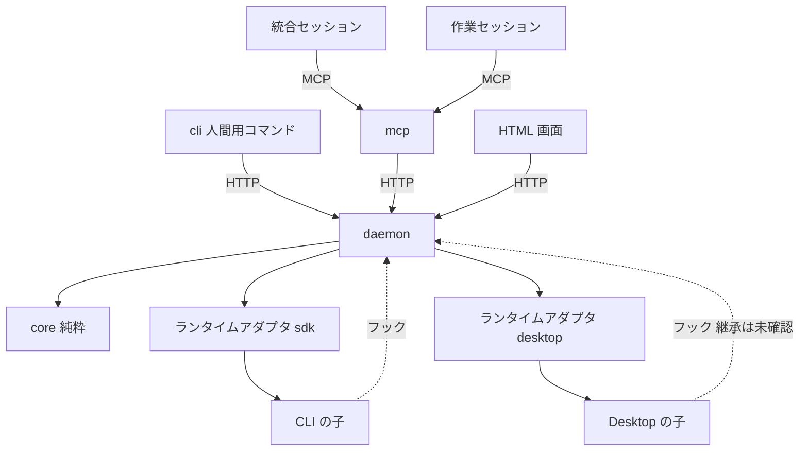

# Composite セッション・オーケストレーター 技術設計

**関連 Spec:** [composite-session-orchestrator_spec.md](../../specification/composite-session-orchestrator_spec.md)
**関連決定ログ:** [composite-session-orchestrator.md](../../adr/composite-session-orchestrator.md)（未作成。クリーンアップ時に作成する）
**関連 PRD:** [composite-session-orchestrator.md](../../requirement/composite-session-orchestrator.md)

> 一時ドラフト。チケット番号が未定のため、ディレクトリ名は `initial-spec-design` とした。実装完了後に決定事項を決定ログへ移して削除する。

---

# 1. 実装ステータス

**ステータス:** 🔴 未実装

| モジュール | ステータス | 備考 |
|:--|:--|:--|
| `packages/core` | 🔴 | 優先度の整列のみ存在 |
| `packages/core` の型の整合 | 🟢 | `NodeStatus` / `Priority` を spec の `NodeState` / `InboxKind` に合わせる（名称の統一、`stopping` / `stopIncomplete` の追加、`Priority` のコメントに `stopIncomplete` は failed の帯と明記）。実装済み（`merged` は spec に無いため削除。`merged` は状態ではなく merge 役ノードの作業であり、統合済みは役割と `verified` で表す） |
| `packages/daemon` | 🔴 | スキャフォールドのみ |
| `packages/mcp` | 🔴 | スキャフォールドのみ |
| `packages/cli` | 🔴 | スキャフォールドのみ |
| `plugin/` | 🔴 | 空 |

# 2. 設計目標

- 状態の窓口を `daemon` に集約し、状態の分裂を防ぐ（B-002, NFR_001）。
- 判定ロジック（回収可能、受信箱の整列、親子の不変条件）を I/O のない純粋関数にする（A-001, NFR_007）。
- CLI の子は SDK で外部から制御し、Desktop の子は制御できる範囲を能力表で明示する（FR_033, FR_034）。
- Desktop の未確認事項の結果で設計が崩れないよう、実行環境をアダプタの背後に閉じる。

# 3. 技術スタック

| 領域 | 採用技術 | 選定理由 |
|:--|:--|:--|
| 言語・実行 | TypeScript（ESM、Node.js 20 以上） | 憲法の技術制約 |
| MCP | MCP TypeScript SDK、zod | Library-First。独自プロトコルを作らない（憲法） |
| 子の起動 | Claude Agent SDK（`query()`） | Spike 02 で起動・指示・停止・フック・接続設定の注入を確認済み |
| 状態の保持 | SQLite（追記型のイベントログ） | 再起動後の復元（NFR_002）と時系列の記録（NFR_011）を 1 つの仕組みで満たす。具体のドライバは着手時点の最新版を確認して決める |
| テスト | Vitest、fast-check | 憲法の技術制約 |

依存は着手時点の最新版を確認して固定する（未追加）。

# 4. アーキテクチャ

## 4.1. システム構成図



## 4.2. モジュール分割

| モジュール | 責務 | 依存 | 配置 |
|:--|:--|:--|:--|
| core | 木、状態遷移、回収判定、受信箱の整列、不変条件。時刻・識別子は引数で受ける | なし | `packages/core` |
| daemon | イベントログ、状態の唯一の窓口、ランタイムアダプタ、フック受付、HTML 画面、自動回収の定期実行 | core | `packages/daemon` |
| mcp | ロール別のツール定義、入力検証（zod）、エラー設計。daemon の窓口を呼ぶ | core | `packages/mcp` |
| cli | 人間用コマンド（purge、回収の指示など） | core | `packages/cli` |
| plugin | 役割定義の skill、フック設定、MCP 設定、起動コマンド | - | `plugin/` |

依存方向の制約により、`mcp`・`cli` は `daemon` に直接依存できない。`daemon` の窓口は、ローカル接続（127.0.0.1 の HTTP）で呼び出す。`mcp`・`cli` は、その接続の型を `core` が持つ契約（型）を通して扱う。

# 5. データモデル

状態はイベントの列から導出する。イベントは追記のみとする。

```typescript
interface OrchEvent {
  seq: number;          // daemon が採番する単調増加の番号
  at: string;           // ISO 8601。daemon が付与する
  requestId: string;    // 冪等性のための要求識別子
  actor: { nodeId: string } | { human: true } | { system: true };
  type: string;         // 'node.created' | 'node.stateChanged' | 'scope.violation' など
  payload: unknown;     // type ごとに zod で検証した値
}
```

- 同じ `requestId` のイベントは重複して追記しない（NFR_003）。
- 現在の状態は、イベント列を `core` の純粋関数で畳み込んで得る。必要に応じて daemon がスナップショットを持つ（写しではなくキャッシュとして扱い、再構築できること）。

# 6. インターフェース定義

## 6.1. ランタイムアダプタ

```typescript
interface RuntimeAdapter {
  readonly kind: 'cli' | 'desktop';
  capabilities(nodeId: string): Capabilities;
  start(node: StartRequest): Promise<StartResult>;
  send(nodeId: string, text: string): Promise<DeliveryResult>;
  stop(nodeId: string, mode: 'graceful' | 'immediate'): Promise<StopResult>;
}

interface Capabilities {
  send: 'ok' | 'delayed' | 'unreliable' | 'unsupported';
  stopGraceful: boolean;
  stopImmediate: boolean;
  hooks: 'ok' | 'unverified' | 'unsupported';
  sessionId: boolean;
}
```

- 不可能な操作は、理由と代替手段を含む失敗を返す（FR_034, NFR_010）。
- `desktop` アダプタの `stop` は常に「代行依頼を受信箱へ出す」結果を返す（FR_036）。`capabilities` は手動確認の結果が出るまで、保守的な値（`unverified`、`unreliable`）とする。

## 6.2. CLI の子の起動

- `query({ prompt: AsyncIterable, options })` で起動する（常にストリーミング入力。`interrupt()` と実行中の追加指示のため）。
- `options.cwd` に作業ツリー、`options.mcpServers` に子ごとの資格情報付きの HTTP 接続、`options.hooks` に記録・拒否のコールバックを渡す。`settingSources` は空にして、利用者設定のフックの混入を防ぐ。
- `options.env` は親の環境変数から、セッション識別子に関わる変数を除いて渡す。継承された `CLAUDE_CODE_*` を起動時に列挙して確認する（検証環境固有の可能性があるため）。
- 穏当な停止は 2 段階とする。(1) 停止指示のメッセージを入力に push する。(2) 猶予時間（設定値、既定 60 秒）内に結果（result）が来なければ `interrupt()` で打ち切る。即時停止は `abort()`。停止後は、作業ツリーを cwd とするプロセスの有無（`lsof +d` / `lsof +D` を第一候補とする。macOS と Linux の両方で使える）を確認し、残っていれば停止とは扱わず、ノードを `stopping` に置く。所定の時間を超えても残っていれば `stopIncomplete` にして、`stopIncomplete` の通知を受信箱へ出す。回収可能の判定（条件 6）は、プロセスの一覧（pid、cwd、開いているファイルの有無）を入力にとる `core` の純粋関数とし、一覧の取得は `daemon` のアダプタが行う。
- 猶予時間は停止要求ごとに上書きでき、停止要求のイベントに猶予時間を、結果のイベントに「猶予内に result が来た」か「`interrupt()` に落ちた」かを記録する。実測で既定値を見直す。
- 覗き見は `--resume <id> --fork-session` を読み取り専用の権限で開く。

## 6.3. フック

- フックの入力（`session_id`、`cwd`、ツール名、引数）を daemon の窓口へ渡し、許可・拒否を決める。拒否は範囲違反としてイベントに記録する。
- 拒否の判定は、`core` の純粋関数（作業範囲と操作を入力にして判定を返す）で行う。
- コマンド経由の書き込みは、許可するコマンドの一覧と、書き込み先の検査の両方で見る。バックグラウンド起動（`run_in_background`、`nohup`、`setsid` など）は既定で拒否する案を、ADR で決める。

# 7. 非機能要件実現方針

| 要件 | 実現方針 |
|:--|:--|
| NFR_001 | 状態の窓口を daemon のみとし、mcp・cli・画面は窓口を呼ぶ |
| NFR_002 | イベントログから状態を復元する。Desktop の子の存続は前提にしない |
| NFR_003 | 要求識別子の一意制約で重複を弾く |
| NFR_004 | ロールごとにツールの集合を分け、子には生成・停止・人間宛て・最終削除を公開しない。公開一覧をテストで固定する |
| NFR_005 | 127.0.0.1 のみに bind し、ノードごとのトークンをノード停止時に失効させる。トークンをログ・初期メッセージ・画面に出さない |
| NFR_006 | 回収は `git worktree remove`（強制なし）と `git branch -d` のみを使う。強制は破棄判断を経た停止ノードに限る |
| NFR_007 | 判定ロジックは `core` の純粋関数にし、時刻・識別子・プロセス一覧は引数で受ける。fast-check で網羅する |
| NFR_008 | 画面への反映は変更イベントの購読（Server-Sent Events 想定）で行う |
| NFR_009 | ツールの応答に簡潔版・詳細版を設け、一覧は分割取得にする |
| NFR_010 | 失敗の応答は原因と次の操作を持つ型（Result）にそろえる（憲法 T-001） |
| NFR_011 | すべての状態変更をイベントとして追記する。拒否した操作も範囲違反として残す |
| NFR_012 | 特定のリポジトリ構成を前提にしない。plugin の設定にリポジトリのパスを埋め込まず、起動時に渡す |

# 8. テスト戦略

| テストレベル | 対象 | 目標 |
|:--|:--|:--|
| ユニット | core の回収判定の全条件、受信箱の整列、状態遷移 | 全条件を網羅 |
| 性質ベース（fast-check） | 親子の回収不変条件、整列の決定性、任意の木での集計 | 任意の木で不変条件を維持 |
| 結合 | PRD の各ユースケースの主要フロー（生成、報告、判断、完了判定、回収） | 各 1 件以上 |
| 冪等性 | 生成、判断要求、回収、回答登録の再試行 | 各 1 件以上 |
| 境界 | 空の木、最大の深さ、重複した要求 | 憲法の標準に従う |
| 実機確認 | CLI の子の起動・停止・フック。Desktop の項目 1〜7（人間が手動） | 手動確認の結果を spike に記録 |

テストは先に書く（D-001）。

# 9. 設計判断

## 9.1. 決定事項

| 決定事項 | 選択肢 | 決定内容 | 理由 |
|:--|:--|:--|:--|
| 状態の保持方式 | イベントログ／状態の直接更新 | イベントログ（追記のみ）から導出 | 復元と時系列の記録を同時に満たす（B-002） |
| 実行環境の抽象 | 環境ごとの分岐／アダプタ | `RuntimeAdapter` と能力表 | Desktop の未確認事項が確定しても影響を閉じ込める |
| CLI の子の入力 | 単発起動／ストリーミング入力 | 常にストリーミング入力 | `interrupt()` と実行中の追加指示に必要（Spike 02） |
| フックの注入 | 設定ファイル／SDK のコールバック | SDK のコールバック。設定の読み込みは空にする | 利用者設定のフックの混入を防ぐ（Spike 02） |
| 穏当な停止 | 単発の打ち切り／2 段階 | 停止指示のメッセージ → 猶予後に `interrupt()`。猶予は設定値 | 一般的なグレースフルシャットダウンの型。メッセージは実行中ツールの完了後に届くため、打ち切りだけでは成果の保存を依頼できない（Spike 02） |
| 停止確認前の状態 | 状態を増やさない／持つ | `stopping`（停止要求済み、確認前）と `stopIncomplete`（停止要求後もプロセスが残存）を導入する | 「停止要求済み」と「停止を確認できた」を区別しないと、プロセスが残ったまま回収可能と判定されるため（B-001） |
| 回収可能の判定 | 条件 5 つ／プロセス不在を加える | 条件 6「作業ツリー配下で動作中のプロセスがない」を加える | 停止後も残るプロセスが作業ツリーを書き換えうるため（Spike 02） |
| Desktop の紐付け | 起動直後に実行／初回メッセージ後 | 暫定は初回メッセージ後。手動確認（項目 4）で確定 | 子が最初の人間のメッセージまで接続設定を持たない報告があるため |
| 停止要求を受け付ける元状態 | 全状態で受け付ける／動作中のみ／状態ごとに定める | 状態ごとに定める。`running`: `stopping`（穏当は 2 段階、即時は猶予なし）。`waiting`: `stopping`（猶予なしの即時停止の指示。プロセスの不在を確認するまで `stopped` としない）。`pending`（依存待ちを含む）: `stopped` へ直行（起動の取り消し。プロセス未生成）。`stopping`・`stopIncomplete`: 受け付けず、進行中の停止を継続（同じ要求は冪等で結果不変）。終了状態（`done`・`verified`・`stopped`・`reclaimable`・`archived`）: 「既に終了」を返し何もしない | 動作中でない子にも停止の手段を残しつつ、spec 5.3 の「プロセス不在の確認まで停止したとは扱わない」を守るため |
| 停止の進行と復帰 | 停止要求の再送／別イベント | `stopTimeout`（`stopping`→`stopIncomplete`）、`retryStop`（`stopIncomplete`→`stopping`）、`confirmStopped`（`stopping`・`stopIncomplete`→`stopped`、プロセス不在を確認）を停止要求とは別のイベントにする | 停止要求の冪等性を保ち、進行の事実（時間切れ、確認）と指示を分けるため |
| 差し戻しと再開 | 自動／指示による | `done`→`running`（差し戻し）と `stopped`→`running`（再開）は、人間または統合ノードの指示による | spec 5.7（差し戻しは親の判定）、5.3（子を再開可能にする） |
| 停止した子の回収 | 常に可／破棄判断を要する | `stopped`→`reclaimable` は破棄の判断を経た場合のみ（`markReclaimable` の `discarded`）。`verified`→`reclaimable` は回収可能判定（T05）の結果による | spec 5.8（停止したノードは破棄判断を経た場合に限り回収可能） |

## 9.2. 未解決の課題

| 課題 | 影響度 | 対応方針 |
|:--|:--|:--|
| 停止後に残るプロセス（バックグラウンド起動、SIGTERM / SIGKILL）の挙動 | 高 | 未検証。実装前に検証し、結果を spike に記録する。結果次第でバックグラウンド起動の拒否（フック）を採用する |
| 猶予時間の既定値 60 秒 | 低 | 仮の値。猶予内に停止した件数と打ち切りに落ちた件数の記録から見直す |
| プロセス確認の OS 差（`lsof` の有無、権限、速度、macOS の挙動） | 中 | `lsof +d` / `lsof +D` を第一候補とし、`/proc/*/cwd` は Linux の補助にする。実装前に macOS と Linux で検証する |
| `stopping` から `stopIncomplete` へ落とす所定の時間、再試行の方式（自動か手動か） | 中 | 実装前に決める。遷移そのもの（`stopTimeout`、`retryStop`、`confirmStopped`）は 9.1 のとおり `core`（T03）で定義済み。確認できない場合は失敗として受信箱へ出し、人間の確認を促す |
| Desktop の手動確認（項目 1〜7） | 高 | 人間が実施。結果で `desktop` アダプタの能力表と紐付け手順を確定する |
| `mcp`・`cli` から daemon への接続の契約をどのパッケージが持つか | 中 | `core` に契約の型を置く案で着手し、ADR に残す |
| 木あたりの同時実行数と費用の上限 | 中 | 実装前に定める |
| バックグラウンド起動（`&`、`nohup`、`setsid` など）の拒否の方針 | 中 | `core` の範囲判定（T06）は既定で拒否として実装済み。ADR で確定する |
| 場所の比較の大文字小文字・Unicode 正規化 | 高 | `core`（T06）は大文字小文字を畳み込み、NFC 正規化して比較する（区別する FS では過剰拒否で安全側）。シンボリックリンクの実パス解決と、判定に渡すパスの正規化は `daemon` のアダプタの責務。ADR で確定する |
| コマンド判定の方針（ADR 候補） | 中 | (1) `2>&1` など一部のリダイレクトも一律拒否している。許す範囲を ADR で決める。(2) 判定不能（`unparsable`）の細分化は将来課題。(3) 再解釈・実行コマンドの固定リストの見直し。(4) スクリプト経由の書き込みは構造上判定できない（spec 5.5） |
| 状態の保持に使う SQLite ドライバ | 低 | 着手時点の最新版を確認して決める |

# 10. 変更履歴

## v0.1

- 初版。
