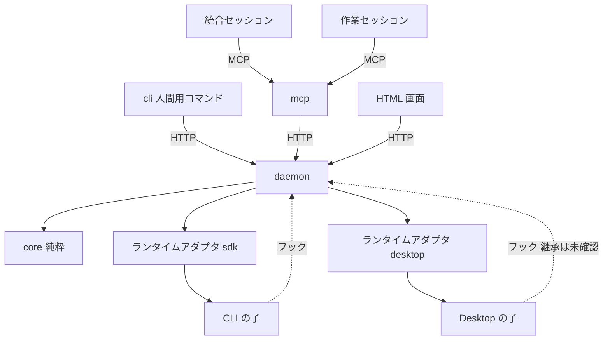

# Composite セッション・オーケストレーター 技術設計

**関連 Spec:** [composite-session-orchestrator_spec.md](../../specification/composite-session-orchestrator_spec.md)
**関連決定ログ:** [composite-session-orchestrator.md](../../adr/composite-session-orchestrator.md)（未作成。クリーンアップ時に作成する）
**関連 PRD:** [composite-session-orchestrator.md](../../requirement/composite-session-orchestrator.md)

> 一時ドラフト。チケット番号が未定のため、ディレクトリ名は `initial-spec-design` とした。実装完了後に決定事項を決定ログへ移して削除する。

---

# 1. 実装ステータス

**ステータス:** 🔴 未実装

| モジュール | ステータス | 備考 |
|:--|:--|:--|
| `packages/core` | 🔴 | 優先度の整列のみ存在 |
| `packages/core` の型の整合 | 🟢 | `NodeStatus` / `Priority` を spec の `NodeState` / `InboxKind` に合わせる（名称の統一、`stopping` / `stopIncomplete` の追加、`Priority` のコメントに `stopIncomplete` は failed の帯と明記）。実装済み（`merged` は spec に無いため削除。`merged` は状態ではなく merge 役ノードの作業であり、統合済みは役割と `verified` で表す） |
| `packages/daemon` | 🔴 | スキャフォールドのみ |
| `packages/mcp` | 🔴 | スキャフォールドのみ |
| `packages/cli` | 🔴 | スキャフォールドのみ |
| `plugin/` | 🔴 | 空 |

# 2. 設計目標

- 状態の窓口を `daemon` に集約し、状態の分裂を防ぐ（B-002, NFR_001）。
- 判定ロジック（回収可能、受信箱の整列、親子の不変条件）を I/O のない純粋関数にする（A-001, NFR_007）。
- CLI の子は SDK で外部から制御し、Desktop の子は制御できる範囲を能力表で明示する（FR_033, FR_034）。
- Desktop の未確認事項の結果で設計が崩れないよう、実行環境をアダプタの背後に閉じる。

# 3. 技術スタック

| 領域 | 採用技術 | 選定理由 |
|:--|:--|:--|
| 言語・実行 | TypeScript（ESM、Node.js 22 以上） | 憲法の技術制約 |
| MCP | MCP TypeScript SDK、zod | Library-First。独自プロトコルを作らない（憲法） |
| 子の起動 | Claude Agent SDK（`query()`） | Spike 02 で起動・指示・停止・フック・接続設定の注入を確認済み |
| 状態の保持 | SQLite（追記型のイベントログ） | 再起動後の復元（NFR_002）と時系列の記録（NFR_011）を 1 つの仕組みで満たす。具体のドライバは着手時点の最新版を確認して決める |
| テスト | Vitest、fast-check | 憲法の技術制約 |

依存は着手時点の最新版を確認して固定する（未追加）。

# 4. アーキテクチャ

## 4.1. システム構成図



## 4.2. モジュール分割

| モジュール | 責務 | 依存 | 配置 |
|:--|:--|:--|:--|
| core | 木、状態遷移、回収判定、受信箱の整列、不変条件。時刻・識別子は引数で受ける | なし | `packages/core` |
| daemon | イベントログ、状態の唯一の窓口、ランタイムアダプタ、フック受付、HTML 画面、自動回収の定期実行 | core | `packages/daemon` |
| mcp | ロール別のツール定義、入力検証（zod）、エラー設計。daemon の窓口を呼ぶ | core | `packages/mcp` |
| cli | 人間用コマンド（purge、回収の指示など） | core | `packages/cli` |
| plugin | 役割定義の skill、フック設定、MCP 設定、起動コマンド | - | `plugin/` |

依存方向の制約により、`mcp`・`cli` は `daemon` に直接依存できない。`daemon` の窓口は、ローカル接続（127.0.0.1 の HTTP）で呼び出す。`mcp`・`cli` は、その接続の型を `core` が持つ契約（型）を通して扱う。

# 5. データモデル

状態はイベントの列から導出する。イベントは追記のみとする。

```typescript
interface OrchEvent {
  seq: number;          // daemon が採番する単調増加の番号
  at: string;           // ISO 8601。daemon が付与する
  requestId: string;    // 冪等性のための要求識別子
  actor: { nodeId: string } | { human: true } | { system: true };
  type: string;         // 'node.created' | 'node.stateChanged' | 'scope.violation' など
  payload: unknown;     // type ごとに zod で検証した値
}
```

- 同じ `requestId` のイベントは重複して追記しない（NFR_003）。
- 現在の状態は、イベント列を `core` の純粋関数で畳み込んで得る。必要に応じて daemon がスナップショットを持つ（写しではなくキャッシュとして扱い、再構築できること）。

# 6. インターフェース定義

## 6.1. ランタイムアダプタ

```typescript
interface RuntimeAdapter {
  readonly kind: 'cli' | 'desktop';
  capabilities(nodeId: string): Capabilities;
  start(node: StartRequest): Promise<StartResult>;
  send(nodeId: string, text: string): Promise<DeliveryResult>;
  stop(nodeId: string, mode: 'graceful' | 'immediate'): Promise<StopResult>;
}

interface Capabilities {
  send: 'ok' | 'delayed' | 'unreliable' | 'unsupported';
  stopGraceful: boolean;
  stopImmediate: boolean;
  hooks: 'ok' | 'unverified' | 'unsupported';
  sessionId: boolean;
}
```

- 不可能な操作は、理由と代替手段を含む失敗を返す（FR_034, NFR_010）。
- `desktop` アダプタの `stop` は常に「代行依頼を受信箱へ出す」結果を返す（FR_036）。`capabilities` は手動確認の結果が出るまで、保守的な値（`unverified`、`unreliable`）とする。

## 6.2. CLI の子の起動

- `query({ prompt: AsyncIterable, options })` で起動する（常にストリーミング入力。`interrupt()` と実行中の追加指示のため）。
- `options.cwd` に作業ツリー、`options.mcpServers` に子ごとの資格情報付きの HTTP 接続、`options.hooks` に記録・拒否のコールバックを渡す。`settingSources` は空にして、利用者設定のフックの混入を防ぐ。
- `options.env` は親の環境変数から、セッション識別子に関わる変数を除いて渡す。継承された `CLAUDE_CODE_*` を起動時に列挙して確認する（検証環境固有の可能性があるため）。
- 穏当な停止は 2 段階とする。(1) 停止指示のメッセージを入力に push する。(2) 猶予時間（設定値、既定 60 秒）内に結果（result）が来なければ `interrupt()` で打ち切る。即時停止は `abort()`。停止後は、作業ツリーを cwd とするプロセスの有無（`lsof +d` / `lsof +D` を第一候補とする。macOS と Linux の両方で使える）を確認し、残っていれば停止とは扱わず、ノードを `stopping` に置く。所定の時間を超えても残っていれば `stopIncomplete` にして、`stopIncomplete` の通知を受信箱へ出す。回収可能の判定（条件 6）は、プロセスの一覧（pid、cwd、開いているファイルの有無）を入力にとる `core` の純粋関数とし、一覧の取得は `daemon` のアダプタが行う。
- 猶予時間は停止要求ごとに上書きでき、停止要求のイベントに猶予時間を、結果のイベントに「猶予内に result が来た」か「`interrupt()` に落ちた」かを記録する。実測で既定値を見直す。
- 覗き見は `--resume <id> --fork-session` を読み取り専用の権限で開く。

## 6.3. フック

- フックの入力（`session_id`、`cwd`、ツール名、引数）を daemon の窓口へ渡し、許可・拒否を決める。拒否は範囲違反としてイベントに記録する。
- 拒否の判定は、`core` の純粋関数（作業範囲と操作を入力にして判定を返す）で行う。
- コマンド経由の書き込みは、許可するコマンドの一覧と、書き込み先の検査の両方で見る。バックグラウンド起動（`run_in_background`、`nohup`、`setsid` など）は既定で拒否する案を、ADR で決める。

# 7. 非機能要件実現方針

| 要件 | 実現方針 |
|:--|:--|
| NFR_001 | 状態の窓口を daemon のみとし、mcp・cli・画面は窓口を呼ぶ |
| NFR_002 | イベントログから状態を復元する。Desktop の子の存続は前提にしない |
| NFR_003 | 要求識別子の一意制約で重複を弾く |
| NFR_004 | ロールごとにツールの集合を分け、子には生成・停止・人間宛て・最終削除を公開しない。公開一覧をテストで固定する |
| NFR_005 | 127.0.0.1 のみに bind し、ノードごとのトークンをノード停止時に失効させる。トークンをログ・初期メッセージ・画面に出さない |
| NFR_006 | 回収は `git worktree remove`（強制なし）と `git branch -d` のみを使う。強制は破棄判断を経た停止ノードに限る |
| NFR_007 | 判定ロジックは `core` の純粋関数にし、時刻・識別子・プロセス一覧は引数で受ける。fast-check で網羅する |
| NFR_008 | 画面への反映は変更イベントの購読（Server-Sent Events 想定）で行う |
| NFR_009 | ツールの応答に簡潔版・詳細版を設け、一覧は分割取得にする |
| NFR_010 | 失敗の応答は原因と次の操作を持つ型（Result）にそろえる（憲法 T-001） |
| NFR_011 | すべての状態変更をイベントとして追記する。拒否した操作も範囲違反として残す |
| NFR_012 | 特定のリポジトリ構成を前提にしない。plugin の設定にリポジトリのパスを埋め込まず、起動時に渡す |

# 8. テスト戦略

| テストレベル | 対象 | 目標 |
|:--|:--|:--|
| ユニット | core の回収判定の全条件、受信箱の整列、状態遷移 | 全条件を網羅 |
| 性質ベース（fast-check） | 親子の回収不変条件、整列の決定性、任意の木での集計 | 任意の木で不変条件を維持 |
| 結合 | PRD の各ユースケースの主要フロー（生成、報告、判断、完了判定、回収） | 各 1 件以上 |
| 冪等性 | 生成、判断要求、回収、回答登録の再試行 | 各 1 件以上 |
| 境界 | 空の木、最大の深さ、重複した要求 | 憲法の標準に従う |
| 実機確認 | CLI の子の起動・停止・フック。Desktop の項目 1〜7（人間が手動） | 手動確認の結果を spike に記録 |

テストは先に書く（D-001）。

# 9. 設計判断

## 9.1. 決定事項

| 決定事項 | 選択肢 | 決定内容 | 理由 |
|:--|:--|:--|:--|
| 状態の保持方式 | イベントログ／状態の直接更新 | イベントログ（追記のみ）から導出 | 復元と時系列の記録を同時に満たす（B-002） |
| 実行環境の抽象 | 環境ごとの分岐／アダプタ | `RuntimeAdapter` と能力表 | Desktop の未確認事項が確定しても影響を閉じ込める |
| CLI の子の入力 | 単発起動／ストリーミング入力 | 常にストリーミング入力 | `interrupt()` と実行中の追加指示に必要（Spike 02） |
| フックの注入 | 設定ファイル／SDK のコールバック | SDK のコールバック。設定の読み込みは空にする | 利用者設定のフックの混入を防ぐ（Spike 02） |
| 穏当な停止 | 単発の打ち切り／2 段階 | 停止指示のメッセージ → 猶予後に `interrupt()`。猶予は設定値 | 一般的なグレースフルシャットダウンの型。メッセージは実行中ツールの完了後に届くため、打ち切りだけでは成果の保存を依頼できない（Spike 02） |
| 停止確認前の状態 | 状態を増やさない／持つ | `stopping`（停止要求済み、確認前）と `stopIncomplete`（停止要求後もプロセスが残存）を導入する | 「停止要求済み」と「停止を確認できた」を区別しないと、プロセスが残ったまま回収可能と判定されるため（B-001） |
| 回収可能の判定 | 条件 5 つ／プロセス不在を加える | 条件 6「作業ツリー配下で動作中のプロセスがない」を加える | 停止後も残るプロセスが作業ツリーを書き換えうるため（Spike 02） |
| Desktop の紐付け | 起動直後に実行／初回メッセージ後 | 暫定は初回メッセージ後。手動確認（項目 4）で確定 | 子が最初の人間のメッセージまで接続設定を持たない報告があるため |
| 窓口の契約の型の置き場所 | `core`／専用パッケージ／各パッケージが個別に持つ | `core` に置く（`Failure`、`Result`、操作の引数・結果、ロールごとの操作表）。操作名・引数は spec 4.1 に対応する仮置きで、各操作の実装タスクで確定する | `mcp`・`cli` は `daemon` に依存できず、`core` だけが全員の依存先のため（A-001, NFR_001）。ADR に残す |
| 受信箱の整列規則 | 依存の深さを時刻より先のキーにする／依存のある組だけを制約にする | 優先度で分け、同優先度内は依存のある組だけを制約とするトポロジカル整列。制約のない組は時刻、次に id。項目を持たない中間ノード経由の依存は `nodeDeps` で渡す。`at` は ISO 8601 UTC（不正値は時刻の最後）、`id` は一意（重複は `seq` が大きい方を残す） | 依存のない項目まで深さで並べ替えると、時刻順が崩れ決定性の説明が難しくなるため（NFR_007） |
| 停止要求を受け付ける元状態 | 全状態で受け付ける／動作中のみ／状態ごとに定める | 状態ごとに定める。`running`: `stopping`（穏当は 2 段階、即時は猶予なし）。`waiting`: `stopping`（猶予なしの即時停止の指示。プロセスの不在を確認するまで `stopped` としない）。`pending`（依存待ちを含む）: `stopped` へ直行（起動の取り消し。プロセス未生成）。`stopping`・`stopIncomplete`・`stopped`: 受け付け済みで、再送は成功（`changed: false`）。状態は変わらない。完了・検証済み・回収可能・アーカイブ（`done`・`verified`・`reclaimable`・`archived`）: 「既に終了」（`alreadyFinished`）を返し何もしない | 動作中でない子にも停止の手段を残しつつ、spec 5.3 の「プロセス不在の確認まで停止したとは扱わない」を守るため。再送の応答を対称にするため、一度受け付けた停止要求の再送は常に成功とする |
| 停止の進行と復帰 | 停止要求の再送／別イベント | `stopTimeout`（`stopping`→`stopIncomplete`）、`retryStop`（`stopIncomplete`→`stopping`。効果は即時停止）、`confirmStopped`（`stopping`・`stopIncomplete`→`stopped`、プロセス不在を確認）を停止要求とは別のイベントにする。`stopping`（穏当な停止の猶予中）に即時停止の要求が来たら、即時停止へ切り替える（状態は `stopping` のまま）。`running`・`waiting` から `stopped` へ至る経路は必ず `confirmStopped` を通る | 停止要求の冪等性を保ち、進行の事実（時間切れ、確認）と指示を分けるため。猶予切れの後の再試行は、猶予なしで止めるのが目的のため |
| 差し戻しと再開 | 自動／指示による | `done`→`running`（差し戻し）と `stopped` からの再開は、人間または統合ノードの指示による。再開は `stopped`→`pending` に戻し、依存先が完了済み（`dependenciesDone`）なら続けて `start` して `running` へ進める（依存待ちを飛ばさない） | spec 5.7（差し戻しは親の判定）、5.3（子を再開可能にする）、5.2（依存先の完了まで起動しない） |
| 停止した子の回収 | 常に可／破棄判断を要する | `stopped`→`reclaimable` は破棄の判断を経た場合のみ（`markReclaimable` の `discarded`）。`verified`→`reclaimable` は回収可能判定（T05）の結果による | spec 5.8（停止したノードは破棄判断を経た場合に限り回収可能） |
| イベントログの永続化（SQLite ドライバー）とサポートする Node（ユーザー決定） | node:sqlite／better-sqlite3 の 12 系（Node 20 対応）／13 系／その他（sqlite3、WASM 系） | **better-sqlite3 13 系**（13.0.3 に固定）。Node 20 のサポートをやめ、Node 22 以上（CI は 22・24）にする。ドライバーは `EventStore` のインターフェース（`packages/daemon/src/event-store.ts`）の裏の `sqlite-store.ts` に閉じ込め、`node:sqlite` へ差し替え可能にする（契約のテストを両実装に課せる）。イベントは追記のみ（`UPDATE`・`DELETE`・既存の `seq`・`request_id` を置き換える `INSERT`（REPLACE）をトリガーで拒否し、INSERT は `OR ABORT` で固定。最終削除（FR_031）は別の経路で設計する）、`seq` は主キー、`request_id` は一意。WAL と `synchronous = FULL`（WAL にできなければ失敗）。daemon は単一プロセスのため、`locking_mode = EXCLUSIVE` と開いた時点の書き込みロックで排他し、二重に開くと `storeLocked` で失敗する。`application_id` に固有値（"CSO1"）を書いて他のデータベースを巻き込まず（`schemaMismatch`）、スキーマの版は `user_version`（新しすぎるファイルは `schemaTooNew`）。開くときの失敗（`prepare` の例外を含む）は例外でなく失敗として返し、データベースを閉じてロックを残さない。追記は 1 トランザクションで、seq 採番・core の `applyEvent` による追記前の検査・保存を行う。スナップショットは最新の 1 件のキャッシュで、core の状態のスキーマの版と、末尾のイベントの行のハッシュが合うときだけ使い、合わない・壊れている場合は捨ててログから再構築する（`verifySnapshot` を指定すると、起動時にログ全体の畳み込みと突き合わせる）。時計が例外・不正な形式なら `invalidClock` で失敗する。ストアを開いた側が閉じる責任を持つ。壊れた行は `corruptRow` の失敗として返す | 13 系は N-API のバイナリ（darwin・linux の arm64・x64）をパッケージに同梱し、ビルド不要で導入できる。Node 20 は 2026-04 に EOL。12 系は `prebuild-install`（保守終了）に依存し、13 系は Node 22 以上のみ。`node:sqlite` は Node 22 で安定度 1.1（実験警告）のため、安定してから差し替えを検討する。pnpm の `onlyBuiltDependencies` への許可は不要（ビルドしない。許可すると `binding.gyp` により不要なコンパイルが走りうる）。導入時の「Ignored build scripts」は情報の警告で、動作に影響しない |
| イベントの種別と状態の導出 | 種別を文字列のまま持つ／型付きの判別共用体 | 型付きの判別共用体で 6 種: `node.created`（`pending` で作成。木の不変条件を検査）、`node.stateChanged`（payload は T03 の `NodeEvent`。遷移は T03 の表で決める）、`scope.violation`（記録のみ。状態は変えない）、`inbox.added`（`seq`・`at` は envelope から、依存先はノードの記録から取る）、`decision.requested`、`decision.answered`（先に確定した回答を採用し、後続は却下として記録。FR_019）。未知の種別は拒否する（無視しない）。状態は `seq` の昇順の畳み込み（`foldEvents`）でのみ導出し、入力順に依存しない。`seq` の重複、木・遷移・回収の不変条件に反するイベントは、`seq` つきの失敗で全体を拒否する。daemon は追記の前に `applyEvent` で検査する（結果の `applied` は、重複として無視したかを示す）。壊れたイベント（null、型の違う payload など）でも例外を出さず、型ガードで値を検証して失敗を返す（全域関数）。計算量は、内部で可変の下書きに畳み込み出力の前に凍結する `foldEvents` が O(n log n)。大きなログは、スナップショットの状態から `foldEvents(以降のイベント, スナップショット)` で再開する。状態遷移と判断要求（`requestDecision` と `decision.requested`）を一組として発行するのは daemon、発行者とイベントの種類の整合は窓口のロール別の操作表（NFR_004）が保証する | 復元（NFR_002）と記録（NFR_011）を同じ列から導くため。将来のイベント追加で黙って無視されないようにするため |
| 子の生成条件（ユーザー決定） | 親の状態を問わない／制約する | 子を作れるのは、親が `running` か `waiting` のときだけ（`parentNotActive`）。`dependsOn` に自分の親・祖先は指定できない（`dependsOnAncestor`。相互に待ち合うのを防ぐ） | 動作を終えた・止まった親の下に新しい作業を足さないため。親の完了を待つ子は、親の完了が子の完了に依存するため決して進めなくなる |
| 停止の記録（猶予時間と観測） | 停止要求のイベントに全部載せる／観測を別イベントにする | 停止要求（`NodeEvent` の `stop`）に任意の `graceMs`（1 以上 3,600,000 以下の整数ミリ秒。穏当な停止だけで、即時停止と、判断待ちのノードへの要求では指定できない。記録用で遷移には影響しない）を持たせる。観測は記録のみの別イベント `node.stopObserved`（`outcome`: `withinGrace` 猶予内に result が来た／`interrupted` 猶予を超えて `interrupt()` に落ちた／`aborted` `abort()` した）にし、`stopSeq`（対応する停止要求のイベントの `seq`）と、そのとき有効だった `graceMs` を持たせる。状態は変えず、`stopping`・`stopIncomplete`・`stopped` のノードにだけ記録でき、`stopSeq` はそのノードの停止の試行（状態を `stopping` に進めた `stop` と `retryStop`）でなければならず（`unknownStopRequest`）、同じ停止の試行につき観測は 1 件だけ（`observationAlreadyRecorded`）。停止の試行は `OrchState.stopRequests`、観測は `stopObservations` に残す（古いスナップショットに無くても畳み込める。壊れた値は `invalidState` の失敗で、復元側はスナップショットを捨てて全ログから再構築する）。`stopping` の最中に別の `graceMs` の停止要求が来ても、状態と進行中の猶予は変えず、`applyEvent` の結果の `ignored: "graceMsIgnored"` で無視されたことを示す。観測の発行者（actor）の信頼性は窓口のロール別の操作表（NFR_004）が保証する | 観測は停止要求の後に分かる事実で、状態遷移とは別の時点のため。どの停止要求の観測かを結び付け、同じ停止の二重の観測や、別のノード・別の試行への観測を防ぐ。猶予の既定値（60 秒）を実測で見直せるようにする（spec 5.3） |
| `requestId` の冪等性 | 内容を問わず無視／内容の違いは拒否 | 同じ `requestId` で同一内容（actor・type・payload。キー順は無視）は無視して成功。内容が違えば `requestIdConflict` で拒否 | 再試行は重複せず（NFR_003）、別の要求が同じ識別子を取り違えたときは気づけるようにするため |
| 依存先の「完了」の解釈（FR_008） | `done`（完了報告済み）／`verified` 以降（受理済み） | `verified` 以降（`verified`・`reclaimable`・`archived`。共通定数 `COMPLETED_STATES`）。`start` は `dependsOn` の全ノードがこのいずれかのときだけ許可し、`done` では許可しない。`restart` の `dependenciesDone` は payload を信用せず、畳み込みが状態から判定する。回収可能判定（T05）の条件 3 でも同じ定数を使う | 未検証の成果の上に後続を始めると、差し戻しのときに後続が無駄になるため（spec 5.7）。依存先が先に回収されても、後続が起動できなくならないようにするため |
| 回収可能判定の入力と理由 | 状態から直接判定／事実を引数で受ける | 事実（統合済みか、きれいか、破棄判断済みか、作業ツリーのパス）、プロセス一覧、未回答の判断を持つノードを引数で受ける純粋関数 `assessReclaim`。戻り値は `{reclaimable, unmet, blockers}`。`unmet` は列挙型（`stateNotEligible`・`discardRequired`・`factsMissing`・`notMerged`・`dirty`・`dependentsIncomplete`・`openDecision`・`descendantsNotReclaimable`・`processesRunning`・`processesUnknown`）、`blockers` は原因のノード・pid（統合ノードでは回収可能以降でない配下を名指し）。T07 の `OrchState` からの変換は `daemon` の責務 | 時刻・識別子・プロセス一覧は引数で受ける（NFR_007）。回収不可の理由を短く示し、原因を名指しするため（spec 5.8） |
| 回収判定の安全側の既定 | 欠けた入力は許可／拒否 | フェイルクローズ。事実は `=== true` のときだけ満たしたとみなし、プロセスの `hasOpenFiles` は `=== false` のときだけ開いていないとみなす（`"unknown"` は動作中）。判定の対象にできる状態は `verified`、`stopped`、`reclaimable`（回収の実行直前の再判定のため。条件 1・`discardRequired` は `merged`・`discarded` の事実で判定し、統合済みでない `reclaimable` は破棄の経路とみなす）。事実が欠ける・作業ツリーのパスが不正（`worktreeRoot` の配下でない場合を含む）なら `factsMissing`、プロセス一覧が取得できなければ `processesUnknown` で回収不可。入力の形が壊れていれば例外を出さず `invalidInput` の失敗を返す。条件 3 の「未完了」は依存元が `COMPLETED_STATES`（`verified`・`reclaimable`・`archived`）以外で、木の外からの依存は daemon が実行時に再判定して拾う。条件 6 は、cwd が作業ツリー配下（`scope.ts` と同じ畳み込み・ディレクトリ境界）または作業ツリー配下のファイルを開いている（または不明）プロセスがあること、cwd が不明（絶対パスでない）なプロセスも動作中として扱う。**破棄の判断を経た停止（`stopped` で `discarded`）は、条件 1 と条件 2（未保存の変更）を免除する（ユーザー決定）**。判断を求めるときは、未保存の変更の一覧を人間に提示する（提示の実装は T12・T23）。パスは daemon のアダプタが realpath にして渡し、`discarded` の情報源は daemon が一つのイベントから導く | 失うものがある場合は拒否する安全な手段だけを使う方針（spec 5.8、NFR_006）。破棄の判断は成果を捨てることを含むため |
| MCP のツール公開 | 各ロールの操作を `mcp` が別に持つ／core の `ROLE_OPERATIONS` を唯一の情報源にする | `core` の `ROLE_OPERATIONS` から導出。MCP で公開するのは統合と子だけで、入口でロールを検査し、それ以外は何も公開しない。人間用（最終削除を含む）は含めない。`node_bind` は Desktop の子だけ。ツール名は操作名の `.` を `_` にしたもの（`toolName` に集約）。未公開のツールの失敗には近い名前の候補を添える。入力検証（zod）は `T25` で行い、daemon への結線の前提とする | 公開一覧の食い違いを防ぐため（NFR_004, DC_003, FR_032） |
| 受信箱の応答（MCP） | 1 回で全件／分割取得 | 型を分ける: daemon→mcp の契約は core の `inbox.fetch`（`items: InboxItem[]`）、mcp→エージェントの応答は `InboxPage`、ツール入力は `InboxFetchInput`（`sinceSeq`・`detail`・`limit`・`offset`・`asOfSeq`）。既定は簡潔版（要約と参照 ID を含み、全文は `decision_get`・`report_get`）。応答の `asOfSeq` を続きの取得に渡すと、その以下の項目だけで整列し、新着による重複・欠落を防ぐ。新着は次回 `sinceSeq = asOfSeq` の差分で拾う。入口で opts・items・各項目の形を検査し、不正は `invalid_argument` | トークン消費の抑制と、分割取得の一貫性のため（NFR_009） |
| 受信箱の次の操作の候補 | 呼び出し側が決める／種類から決まる表 | 種類ごとの表を固定する（統合ロールのツール名）: decision→`decision_get`・`decision_present`・`node_send` / answer→`decision_get`・`node_send` / violation→`scope_decide`・`node_send`・`node_stop` / failure→`report_get`・`node_send`・`node_split`・`node_stop` / stopIncomplete→`node_stop`・`node_capabilities`・`decision_present` / done→`report_get`・`node_review` / progress→`report_get` / info→なし。テストで固定する | 統合セッションが次の操作を迷わないようにする（FR_012）。spec に表がないため、設計で決める |
| `sdk` アダプタの実 SDK 結線（ユーザー決定 Q1） | T10 に含める／別 PR | 別 PR（新タスク「SDK 実バインディング」）。T10 は `AgentLauncher` 抽象とフェイクでの検証まで | 新規依存（`@anthropic-ai/claude-agent-sdk`）のバージョン・ライセンス・Node 22/24 の確認と手動検証を本体の変更から分ける |
| 停止の確認間隔と上限（ユーザー決定 Q3） | 間隔・上限の値／自動再試行の有無 | 1 秒間隔で最大 30 秒（どちらも設定値）で作業ツリー配下のプロセスを確認し、上限で `stopTimeout`（→ `stopIncomplete`、残存 pid を blockers に記録）。自動再試行はせず、`retryStop` の指示でのみ再試行 | 残存プロセスの握り潰しを避け、再開の判断を人間または統合ノードに残す（FR_010） |
| 子の環境変数の除去 | 全継承／名前規則で除去 | 名前が `/^claude.*session/i` に合う識別子系の変数を除去（`CLAUDE_CODE_SESSION_ID` など）。認証・接続に要る `*_TOKEN*`・`*_TOKEN_FILE`・`*_URL` は残す（最終的な規則は T10b の実機検証で調整）。除去した名前だけを返し、値は記録しない | 親のセッションを子が継承する混線を防ぐ（Spike 02） |
| フックの対応づけ | 全許可／ツール別に判定 | 読み取り系と読み取りのみで無害なツール（LS・TodoWrite・ToolSearch・BashOutput。ユーザー決定。ツール名は T10b の実機確認で固定）は許可。Write/Edit/MultiEdit/NotebookEdit は、書き込み先を「最も深い既存の祖先の実パス＋残り」にして（scope の場所も実パス化。解決に失敗したら拒否）`evaluateScope` の書き込み判定、Bash は `command` を判定（`run_in_background` と `dangerouslyDisableSandbox: true` は拒否）。`mcp__node__*` は許可、WebFetch・WebSearch・Task・Agent・未知のツールは拒否（範囲違反ではなく unknownTool。`scope.violation` にせず `node.toolDenied` で記録し、受信箱に載せない）。範囲違反の拒否時は `scope.violation` を記録（記録に失敗しても拒否は維持）。範囲は `updateScope` で更新できる（FR_015） | フェイルクローズ（FR_014、FR_015） |
| 停止の手段の堅牢化 | 例外・時間切れを想定しない／想定する | `interrupt`・`abort`・`close`・`send` の例外を捕らえ、`interrupt` 失敗・時間切れ（既定 10 秒）は `abort`、`abort` 失敗は検証へ進む。観測は行った手段で記録し、記録の失敗は警告にして続行。確認の時間は実時間で数え、検証中の即時停止の要求は `abort` して outcome を合わせる。`stop()` は常に `Result`。停止中への指示は `stopping` で拒否 | 子が戻らない・例外を投げる状況でも、停止の確認（B-001）を止めないため |
| 記録専用イベントと受信箱の中身（core 契約の拡張） | 種別ごとの別状態／記録専用の配列 | `node.toolDenied{nodeId, tool}`（許可していないツールの拒否。範囲違反ではないので `scope.violation` にせず受信箱に載せない）、`node.exited{nodeId, reason}`（子の予期しない終了）、`report.added{reportId, nodeId, kind(progress/done/outOfScope), text, evidence?}`（報告の保存。根拠は完了報告のみ）を追加。いずれも状態は変えず、`OrchState` の `toolDenials`・`exits`・`reports` に残す（未知のノードは `unknownNode`、`reportId` の重複は `duplicateReport`）。`inbox.added` に任意の `summary`（200 文字以下）と `ref`（`decisionId`・`reportId`）、`decision.requested` に任意の `question`・`options` を足す。省略は従来と同じ形（後方互換）。子が入れる文字列・配列に上限（`LIMITS`。報告本文 64KB、問い 8KB、選択肢 20 件×500 文字、根拠 50 件×4KB、理由・ツール名 1KB、要約 200 文字。コードポイントで数える）を設け、タブ・改行以外の制御文字・書式制御文字を拒否する（超過・禁止文字は `invalidPayload`）。選択肢は問いが必須で、空・重複を拒否する。`inbox.added` の `ref` は、記録済み・種類に合う（decision・answer は `decisionId`、done・progress・failure・info は `reportId`。violation・stopIncomplete は持てない）・同じノードのものに限る（`unknownRef`）。報告の種類に `failure` を足す。`node.toolDenied`・`node.exited` は running・waiting・stopping・stopIncomplete のノードにだけ記録できる。外部由来の値は `sanitizeText` で記録できる形にする。アダプタは予期しない終了で `node.exited`・`report.added`（failure）・受信箱の `failure` 項目（`ref` つき）を記録する。`STATE_VERSION` を 3 に上げる（古いスナップショットは破棄してログから再構築） | 未知のツールの拒否と予期しない終了を監査に残す（NFR_011）。受信箱は要約と参照 ID だけを持ち、内容は `decision.get`・`report.get` で読む |
| 統合ノードの読み取り・操作の範囲 | 全ノード／自分の部分木 | 統合ノードのノード・判断・報告を指す操作（`SUBTREE_SCOPED_OPERATIONS`）は、呼び出した統合ノード（`DaemonRequest.caller`。daemon が認証で決める）の部分木に限る。判定は `isInSubtree`（`descendantsOf` を再利用。自分と子孫は真、未知・不正は偽）。窓口での適用は T13 以降 | 兄弟の部分木の内容を読めると、ロールの絞り込み（NFR_004）が意味を失うため |
| daemon の窓口（HTTP API・認証・読める範囲） | 操作ごとに経路／1 本の入口 | `POST /v1/request`（127.0.0.1 だけ。`node:http`、新規依存なし）の 1 本で全操作を受ける。Host・Origin（自分の origin だけ）、ルート・メソッド、認証（401。本文を読む前）、主体の検査（トークンのロールが `NodeRecord.role` と合い、停止後〔stopIncomplete・stopped〕・回収可能・アーカイブのノードのトークンは無効＝401。停止要求中〔stopping〕は成果の保存の報告のため有効）、Content-Type、本文の上限（既定 1 MiB。チャンク転送で超えたら 413 を返して接続を破棄）、封筒、ロールの判定（引数の形を教えないため検証より先）、操作ごとの引数（`LIMITS`・`isBoundedText`・余計なキー拒否。識別子は core の `isSafeId`＝`^[A-Za-z0-9][A-Za-z0-9._:-]{0,127}$`）、認可（403・404）、ハンドラの順に、どこで失敗しても拒否する。応答は常に `Result`、HTTP の状態は失敗の種類（401・403・404・400・413・415・422・500・501）。内部の例外の詳細は返さない。人間の資格情報とノード専用のトークンを分ける（トークンはハッシュだけ保持、定数時間で照合、ノードごとに 1 つで再発行・失効できる）。ロールとノードは認証から決め、封筒の `role`・`caller` は申告として食い違いを拒否するだけ。認可は `ROLE_OPERATIONS`、木にいるノードだけ、統合ノードの操作は core の分類（`INTEGRATOR_OPERATION_CLASS`。subtree・callerFiltered・denied を型で網羅）と、操作ごとの部分木の規則（`SUBTREE_RULES`: strictDescendant＝自分を含まない子孫〔send・stop・split・reclaim*・capabilities・decision.present の pauseNodeIds〕、directChild＝直接の子〔review〕、selfOrDescendant＝自分か子孫〔spawn の parentId、decision.get・report.get は記録のノードで判定し範囲外と未知を区別しない〕）。`scope.decide` は発生元の記録ができるまで統合ロールからは拒否（denied）。受信箱・一覧は core の `visibleState` で呼び出し側の部分木に絞る（ハンドラの責務）。応答の結果は `OperationMap` の result のキーだけに写す（`RESULT_KEYS` は型で網羅）。ハンドラの例外・不正な結果は 500 とし、原因は注入した `logger` に記録して応答には出さない。人間のトークンは `randomBytes(32).base64url`（43 文字）に固定する（`generateHumanToken`）。ハンドラの失敗は 422 に統一する（コードは操作ごとに増えるため、状態に写さない） | 状態の唯一の窓口で権限を決める（NFR_004, DC_003）。申告を信じず、検証と認可を通らない値をハンドラに渡さない |
| トークンの永続化と bind 専用の入口（T13b） | メモリのみ／ファイル／イベントログ | ノードのトークンは `TokenRepository` の裏に置き、既定は JSON ファイル。保存するのはハッシュ・ロール・nodeId・発行日時だけ（トークンそのものは保存しない）。書き込みは一時ファイル（0600）＋`rename`＋親ディレクトリの `fsync`。読み込み（起動）では、置き場所のディレクトリが実のディレクトリでない・所有者違い・グループ／他者から書き込める、ファイルが通常のファイルでない（リンク不可）・所有者違い・権限が緩い（0600 でない）・壊れた・形の不正・ハッシュや nodeId の重複のいずれも、黙って捨てず起動を失敗させる。前回の書き込みの途中で残った `.tokens-*.tmp` は起動時に掃除する。Windows は対象外（POSIX のモード・所有者が前提）。保存に成功してから有効にし、失効の保存に失敗したら例外。人間のトークンは 0600 のファイル（`loadOrCreateHumanToken`。なければ生成。同じ検査に加え、値の形〔`TOKEN_SHAPE`〕と長さを検査し、失敗しても上書きしない）。子は再起動時に再発行できる（再発行で古いトークンは無効）。トークンを持たない子（Desktop）のために、`POST /v1/bind`（Bearer なし。本文は `{ nodeId, bindCode }`。Host・Origin・メソッド・Content-Type・本文の上限〔1 KiB〕は `/v1/request` と同じ順で適用）を別に設ける: bind コード（一度きり・既定 10 分・ノードに結ぶ）で、子ロールのノードトークンを `{nodeId, token}` で返し、そのノードの既存のトークンは無効になる。コードは Crockford base32（I L O U を除く 32 種）から偏りなく選んだ 26 文字（130 ビット）の英数字だけで、`isSafeId` の部分集合（`BIND_CODE_SHAPE`。性質テストで確認）。人が入力しやすいよう、表示は 5-5-5-5-6 に区切れ（`formatBindCodeForDisplay`）、入力は大文字小文字・区切り・空白を問わず I L → 1、O → 0 で読む。コードは正規化したもののハッシュだけを保持し、全エントリを定数時間で比較する。ノードの状態（子ロールで、トークンを持てる状態＝`checkPrincipal`）を先に確かめ、許されたときだけコードを消費する。失敗は区別せず 401。失敗はロックしない（記録するだけ）。本文の nodeId は誰でも申告できるため、ノードごとにロックすると、悪意ある子が「nodeId=X と不正なコード」を送り続けるだけで、正規の子 X の紐付けを妨害できてしまう。推測への対策は、コードの強さ（130 ビット）と、全体の短いスロットル（1 秒あたり 10 回の失敗。不正な本文・型違いも数える。429・Retry-After）で足りる。logger には `bindSucceeded`（nodeId つき）・`bindFailed`（reason: invalid・rejected・malformed）・`bindThrottled` を `at` つきで記録し、コード・ハッシュ・先頭の文字・トークン、失敗時の申告された nodeId は書かない。daemon が生成する ID（bind コード、報告・受信箱の ID）は `isSafeId` を満たす（アダプタは、注入された `newRequestId` が安全でない文字を返しても満たす形にする）。契約の `node.bind`（`OperationMap`）は、この入口ができたため不要になる（外すのは別 PR。T13c） | 再起動で全子が止まらないようにしつつ、盗み見でトークンが漏れないようにする（NFR_002, NFR_005）。トークンのない子が、総当たりされずに紐付けられるようにする（FR_032） |
| 最終削除の墓標と事前確認 | 常に残す／選べる | `node.purge` に任意の `tombstone`（ユーザー方針により省略時の既定は「残す」＝`DEFAULT_PURGE_TOMBSTONE`。監査 NFR_011 と誤削除の追跡のため安全側。daemon の保持ポリシーの設定で変えられる）、人間用の `node.purgePreview`（削除される木・アーカイブ日・経過日数。何も変えない）を追加。`decision.get`・`report.get` は統合ノードの操作表に加える | FR_031 の「墓標を残すかを選べる」と、取り返しのつかない操作の事前確認（NFR_006） |
| 停止の観測の結びつけ | stopSeq なし／あり | `node.stopObserved` に `stopSeq` と `graceMs`（穏当のみ）を付けて記録。猶予内に停止／中断／打ち切りを区別 | 猶予時間の見直し材料（9.2） |
| プロセス確認の限界 | 全プロセスを確認／読めるものだけ | `lsof` で cwd が作業ツリー配下か開いているファイルがあるプロセスを確認。他ユーザーのプロセスで cwd が読めないものは無視する。cwd 一覧が取れなければ失敗（`hasOpenFiles` は不明を許容）。realpath はアダプタが行う | 権限差のある環境での偽陽性を避けつつ失敗側に倒す |
| 人間のコマンドの認証 | 窓口が人間を区別しない／MCP と同じトークン／人間専用の資格情報 | 人間のコマンドだけが読めるファイル（権限 0600 など）の資格情報を窓口が要求する。MCP の子・統合のトークンとは別にする | 最終削除などの人間用操作を、エージェントの資格情報では呼べないようにするため（DC_003, NFR_004）。窓口の実装時に具体化する |
| 人間のコマンドの再実行 | 毎回新しい識別子／結果不明のとき同じ識別子で再実行 | 結果が確認できないとき、同じ `requestId`（`--request-id`）で再実行できる。ノード ID と `--request-id` は core の `isSafeId` で検査する（cli と mcp の入口で同じ規則） | 冪等性（NFR_003）と誤操作の防止（NFR_006）のため |
| 識別子の検査（書き込みと読み取り） | 読み取り側だけで検査／書き込み側でも検査 | 書き込み側（core の `events.ts`）でも、ノード・親・依存先・受信箱の項目と参照・判断・報告・`requestId` を `isSafeId` で検査し、合わなければ `invalidPayload`（`requestId` は `invalidRequestId`）。daemon の封筒の `requestId`・cli・mcp の入口も同じ規則。mcp の読み取りでは、合わない項目だけを除外して件数（`excluded`）を知らせ、受信箱全体は失敗にしない。項目が配列でないなど保存データの不備は `internal_data`（管理者に知らせる・ログを確認する） | 書き込みを通った識別子を、読み取り側が拒否して項目が消えるのを防ぐため。`summary`・`at` は core が書き込み時に保証する |

## 9.2. 未解決の課題

| 課題 | 影響度 | 対応方針 |
|:--|:--|:--|
| 停止後に残るプロセス（バックグラウンド起動、SIGTERM / SIGKILL）の挙動 | 高 | 未検証。実装前に検証し、結果を spike に記録する。結果次第でバックグラウンド起動の拒否（フック）を採用する |
| 猶予時間の既定値 60 秒 | 低 | 仮の値。猶予内に停止した件数と打ち切りに落ちた件数の記録から見直す |
| プロセス確認の OS 差（`lsof` の有無、権限、速度、macOS の挙動） | 中 | `lsof +d` / `lsof +D` を第一候補とし、`/proc/*/cwd` は Linux の補助にする。実装前に macOS と Linux で検証する |
| `stopping` から `stopIncomplete` へ落とす所定の時間、再試行の方式（自動か手動か） | 中 | 実装前に決める。遷移そのもの（`stopTimeout`、`retryStop`、`confirmStopped`）は 9.1 のとおり `core`（T03）で定義済み。確認できない場合は失敗として受信箱へ出し、人間の確認を促す |
| Desktop の手動確認（項目 1〜7） | 高 | 人間が実施。結果で `desktop` アダプタの能力表と紐付け手順を確定する |
| 木あたりの同時実行数と費用の上限 | 中 | 実装前に定める |
| 作業ツリー・プロセスの cwd の実パス化（realpath）の OS 差 | 中 | `core`（T05）はシンボリックリンクを解決しない。daemon のアダプタが realpath にして渡す前提で、macOS（`/var` と `/private/var` など）と Linux の差を T10 の OS 差の検証に含める |
| スナップショットの保存間隔（既定 1000 件）とログの肥大化への対応 | 低 | 実測で見直す。最終削除（FR_031）での行の削除は、追記のみのトリガーとの整合を含めて別途設計する。Node 24 での動作は CI で確認する |
| `OrchState.requests`（冪等性の判定用の要求識別子の一覧）の保持期間とスナップショットの肥大 | 低 | `requests` はログと同じだけ増え、スナップショットにも載る。古い要求識別子の打ち切り（再試行が来うる期間を決める）と、差分のスナップショットを、実測で必要になった時点で設計する |
| `start`・`resume`・`restart` に伴う作用（起動、再開の指示など）が必要か | 低 | `core` の遷移（T03）は作用を返さない。`daemon` のアダプタ実装（T10）で確認し、必要なら `TransitionEffect` を足す |
| バックグラウンド起動（`&`、`nohup`、`setsid` など）の拒否の方針 | 中 | `core` の範囲判定（T06）は既定で拒否として実装済み。ADR で確定する |
| 場所の比較の大文字小文字・Unicode 正規化 | 高 | `core`（T06）は大文字小文字を畳み込み、NFC 正規化して比較する（区別する FS では過剰拒否で安全側）。シンボリックリンクの実パス解決と、判定に渡すパスの正規化は `daemon` のアダプタの責務。ADR で確定する |
| コマンド判定の方針（ADR 候補） | 中 | (1) `2>&1` など一部のリダイレクトも一律拒否している。許す範囲を ADR で決める。(2) 判定不能（`unparsable`）の細分化は将来課題。(3) 再解釈・実行コマンドの固定リストの見直し。(4) スクリプト経由の書き込みは構造上判定できない（spec 5.5） |
| `node.exited` を受けたときの状態遷移（停止扱いにするか、失敗として留めるか） | 中 | 受信箱の `failure` 項目（`ref` つき）は追加する。状態を動かすかは未決。決める主体は T10b と窓口（T13 以降） |
| `reports`・`toolDenials`・`exits` の保持上限（件数・期間）とスナップショットの肥大 | 低 | 現状は上限なしで、ログと同じだけ増える。実測で必要になった時点で設計する（`requests` と同様） |
| 書式制御文字（Cf）の拒否により、ゼロ幅接合子（ZWJ）を使う絵文字の合字などが使えない | 低 | 安全側の既定（表示の偽装を防ぐ）。必要になれば、ZWJ・ZWNJ など個別の文字だけ許可に緩める候補 |
| 窓口のハンドラの実体（`node.spawn`・`node.send`・`node.stop` など、アダプタと状態遷移を伴う操作）、受信箱・一覧の部分木への絞り込み | 高 | 窓口は入口と権限の判定まで（`decision.get`・`report.get` のみ実体あり）。残りは未実装（501）。受信箱・一覧は caller の部分木に絞る（ハンドラの責務） |
| トークンの配布・永続化・失効の運用、認証失敗の回数制限、HTML 画面（T23）の Origin の扱い | 中 | bind コードはメモリ上だけ（再起動で無効。再発行する）。子へのトークンの受け渡しは、アダプタの MCP 注入（CLI）と bind の入口（Desktop）。認証失敗の回数制限は bind の入口だけ（`/v1/request` は未実装。127.0.0.1 のみの前提）。画面は同一 origin だけ許可している |
| ノードのトークンの最大有効期間（例: 30 日）と、期限後の再発行の方針 | 低 | 現状は失効（`revokeNode`）か再発行まで有効。発行日時は保存しているので、最大有効期間を超えたトークンを無効にする方針（例: 30 日。長期間動く子は、期限前に再発行）を、運用が見えた時点で実装する |
| 入れ子の作業ツリー（作業ツリーの配下に別の作業ツリーがある場合）の範囲判定とプロセス確認 | 中 | 未検証。親の作業ツリーの確認（`lsof +D`・cwd）に子のプロセスが含まれうる。T10b の実機検証で扱いを決める |
| daemon の再起動後の孤児（再起動前に起動した子のプロセス） | 中 | 未解決。アダプタは稼働中のノードをメモリで持つため、再起動後は子を管理できない。復元時にプロセスの確認（`lsof`）で孤児を検出し、人間に提示する設計を T10b 以降で行う |
| `@types/node` と `engines` の対応 | 低 | `engines` は Node 22 以上、`@types/node` は 22 系（下限に合わせる）。Node 24 は CI で動作を確認する |
| 状態の保持に使う SQLite ドライバ | 低 | 着手時点の最新版を確認して決める |
| 受信箱の整列の計算量 | 低 | 現状は O(n³)（1000 件で約 541ms を実測）。Kahn 法と優先度付きキューで O(n log n) にできる。件数が増えてから見直す |


# 10. 変更履歴

## v0.1

- 初版。
